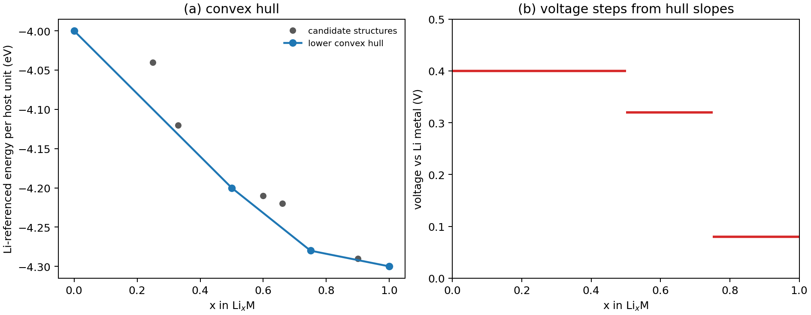

# 锂电池相图与相变

**适用环境：Linux / macOS / Windows（Python 3 + numpy + matplotlib）；相图数据来自 DFT 或热力学数据库，示例只演示凸包与电压台阶。**

锂离子电池的充放电曲线常常是台阶形的：在某些锂含量区间，电压几乎不变，另一些区间则连续倾斜。前者通常对应两相共存，后者对应固溶体。把候选结构的形成能放在一起做凸包，就能从热力学上判断哪些相稳定、哪些相会分解，以及电压平台出现在哪里。

本文用准二元 $\mathrm{Li}_x\mathrm{M}$ 截面说明凸包、公切线和电压台阶的关系，并给出一个可运行的 Python 示例。示例中的能量是**为检查代码而构造的示意数值，不是真实材料的相图**。

## 凸包：稳定相的最小能量包络

给定一组候选结构，固定宿主组成 $\mathrm M$，用每个宿主单元的锂含量 $x_i$ 和每个宿主单元的能量 $E_i$ 作图。在 $E$–$x$ 平面上，稳定相必须位于所有候选点的**下凸包**上。若某点位于凸包上方，它可以分解成相邻两个稳定相的混合物，混合后的能量更低：

$$
E_{\rm mix}=(1-t)E_a+tE_b,\qquad x_{\rm mix}=(1-t)x_a+t x_b.
$$

在离散候选集内，凸包顶点给出稳定相，相邻顶点之间的连线给出两相混合的能量。若考虑有限温固溶体，应比较其连续自由能曲线与共存相的公切线。

对二元系，凸包可以用单调链算法从排序后的点构造；对三元或多元系，要用线性规划或 Qhull。截面凸包只对纳入的候选结构有效。评估分解为截面外的相时，需要完整成分空间的竞争相。

## 从凸包到电压

对反应

$$
\mathrm{Li}_{x_1}\mathrm{M}+(x_2-x_1)\mathrm{Li}\rightarrow \mathrm{Li}_{x_2}\mathrm{M},
$$

平衡时锂的化学势满足

$$
\mu_{\rm Li}=\frac{E(x_2)-E(x_1)}{x_2-x_1}.
$$

以金属锂为电压参考，令 $\widetilde E(x)=E(x)-x\mu_{\rm Li}^{\rm metal}$，平均电压为

$$
V=-\frac{\mu_{\rm Li}-\mu_{\rm Li}^{\rm metal}}{e}
=-\frac{\widetilde E(x_2)-\widetilde E(x_1)}{e(x_2-x_1)}.
$$

也就是说，**以金属锂为参考的能量凸包，线段斜率取负并除以元电荷即得电压**。斜率越陡，电压越高；斜率相同的一段对应一个平台。两相共存时，锂含量变化而电压不变，因为体系通过改变两相比例来容纳锂，而不是改变单相成分。

固溶体区段则不同：能量随 $x$ 连续弯曲，电压随锂含量连续变化。实际电池中还会叠加界面能、应力、扩散过电位和滞后，所以实验曲线比热力学台阶圆滑。

## 准二元截面不是完整相图

把正极写成 $\mathrm{Li}_x\mathrm{M}$ 是**准二元截面**：只允许锂含量变化，其他元素的配比固定。真实相图还有温度、氧分压、阳离子混排和杂质等维度。截面上的凸包能回答“在这个固定配比下，哪些锂化相稳定”，不能回答“整个多元体系在什么温度下分解”。

对电池模型，常见简化是：

- 固定过渡金属比例，只扫描锂含量；
- 用 DFT 形成能（0 K、无振动熵）构造凸包；
- 用 CALPHAD 或有限温自由能补上熵和热膨胀；
- 用团簇展开或机器学习势扩大成分空间。

0 K 凸包给出的稳定相在有限温下可能变成固溶体，反之亦然。报告电压时，要说明是 0 K 形成能还是包含振动的自由能。

## 两相反应与固溶体

两相共存区里，本体自由能是两相混合物，电压由公切线斜率固定。纳米颗粒因为界面能和应变能，可能绕过成核势垒，出现“固溶体路径”或改变平台电压；这就是为什么纳米化会改变倍率与循环，而不只是缩短扩散距离。

亚稳相位于凸包上方，但在动力学上可能长期存在。判断一个相是否“可合成”，除了凸包，还要看成核势垒、界面迁移率和制备温度。凸包只给热力学下限，不给动力学路径。

## 示例：从候选能量到凸包与电压台阶

配套案例在 [battery-phase-diagram](../../../examples/materials/battery-phase-diagram/README.md)。`data/input.json` 中每个候选结构对应一个 $(x,\widetilde E)$ 数据点。

```json
{"x_Li": 0.5, "energy_eV_per_host": -4.2}
```

运行：

```bash
cd examples/materials/battery-phase-diagram
python3 -m pip install -r requirements.txt
python3 run.py
```

程序用单调链求下凸包。能量列已扣除金属锂参考项，按固定宿主单元计量。输出包括稳定相、每段电压和相对端元的形成能，并画两张图：左图是候选点与凸包，右图是凸包斜率给出的电压台阶。示意输入得到稳定相 $x=0,0.5,0.75,1$，电压台阶 0.40、0.32、0.08 V；这些数字只用于说明读图，不能当作任何真实正极的电压。



换成自己的数据时，注意：先将每原子或每胞的能量换算到相同的固定宿主单元，再扣除金属锂参考项。纳入截面端元及已知候选相，凸包上方的点在该候选集中属于热力学不稳定或亚稳构型。

## 检查清单

- 锂含量和能量是否都归一到同一个固定宿主单元？
- 候选相是否包含所有已知竞争相和端元？遗漏一个稳定相会改变整条凸包。
- 凸包是 0 K 形成能还是有限温自由能？有没有包含振动熵、构型熵？
- 电压的符号和参考态是否正确？核对电压是否按锂化反应自由能的负值除以转移电荷计算。
- 两相区与固溶体区是否和实验/文献的电压曲线形状一致？不一致时先查相图，不要先调参数。
- 纳米体系是否需要界面能与应变能修正？平台电压会不会随粒径移动？

## 参考

- 高健，李泓．锂电池基础科学问题（Ⅲ）——相图与相变．*储能科学与技术*，2013，2(3)．[doi:10.3969/j.issn.2095-4239.2013.03.010](https://doi.org/10.3969/j.issn.2095-4239.2013.03.010)
- 高健，李泓．锂电池基础科学问题（Ⅳ）——相图与相变（2）．*储能科学与技术*，2013，2(4)．[doi:10.3969/j.issn.2095-4239.2013.04.007](https://doi.org/10.3969/j.issn.2095-4239.2013.04.007)
- A. Van der Ven, J. Thomas, Q. Xu, et al. Linking the electronic structure of solids to their thermodynamic and kinetic properties. *Math. Comput. Simul.*, 2010, 80: 1393. [doi:10.1016/j.matcom.2009.08.007](https://doi.org/10.1016/j.matcom.2009.08.007)
- Materials Project 文档：[Phase Diagram](https://docs.materialsproject.org/methodology/materials-methodology/phase-diagrams)（凸包与竞争相的构造说明）。
