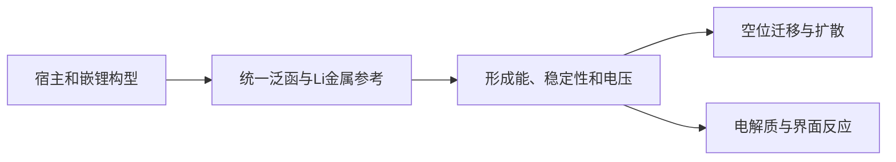

# 锂离子电池：从 LiC6 电压到扩散与界面

**适用环境：macOS / Linux，CPU 计算。**

## 按电池中的角色选任务

电极重点是结构、嵌入/脱出能、电压、容量与迁移；固态电解质重点是相稳定性、离子迁移与界面；液态电解液还需要溶剂化结构与分解过程。本例选择石墨到 LiC₆ 的端点，实际计算嵌入能、平均电压和按石墨宿主质量归一化的理论容量。平均电压的第一性原理定义见经典研究[^1]。

## 统一结构与参考态



本例用 AB 石墨四原子胞、AA 堆叠的 stage-I LiC₆ 七原子胞和 bcc Li 两原子胞。Li 位于石墨六元环空隙对应的位置，不能仅在碳原子正上方放置 Li 就假定得到正确的插层结构。

参数文件中石墨 $a=2.46$ Å、$c=6.708$ Å，LiC₆ 单层周期 $c=3.70$ Å，Li 金属 $a=3.45$ Å。三者使用相同 PBE、450 eV 和 D3(BJ)，固定晶胞、优化内部坐标，力阈值 0.02 eV/Å；完整电压研究还应按一致方案优化晶胞并检查色散模型的适用性。VASP 的 D3 设置见官方说明[^2]。

```text
IVDW = 12
IBRION = 2
ISIF = 2
NSW = 100
EDIFFG = -0.02
```

## 电压与容量公式

以本例胞为单位，

$$\Delta E=E(\mathrm{LiC}_6)-\frac{3}{2}E(\mathrm C_4)-\frac{1}{2}E(\mathrm{Li}_2).$$

这里 $\mathrm C_4$ 是石墨胞，$\mathrm{Li}_2$ 是含两个原子的 bcc Li 胞。端点反应转移一个 Li 和一个电子，故以 eV 计的 $\Delta E$ 给出 $\bar V\approx-\Delta E$ V，相对于 Li/Li⁺。系数来自原子数守恒，不能把三个不同胞的总能量直接相减。

一般的 $x_1\to x_2$ 区间满足

$$\bar V\approx-\frac{E(\mathrm{Li}_{x_2}H)-E(\mathrm{Li}_{x_1}H)-(x_2-x_1)E(\mathrm{Li}_{metal})}{(x_2-x_1)e}.$$

此处将自由能差近似为 0 K 总能量差；有限温度、构型熵与压力贡献要按目标问题评估。`curve.csv` 的两个点只描述端点，不是完整组成凸包或连续电压曲线。

容量 $Q=nF/(3.6M)$，$n$ 为每摩尔宿主转移电子数，$M$ 单位 g/mol，结果 mAh/g。石墨到 LiC₆ 取 $n=1,M=6M_C$。如果按 LiC₆ 总质量归一化，应明确更换分母，不能把两种数值混用。

## 稳定性与中间组成

完整电压曲线需要枚举多个 $x$ 和占位/层序，在同一参考下形成能比较，构造成分凸包。稳定相之间的两相区给出平台；中间构型未采样时，端点平均电压不能证明全组成范围稳定。

检查 Li 金属参考的晶体与磁性、宿主与嵌锂结构的相变、体积变化、赝势与精度。层状材料还要比较晶胞和色散敏感性。容量属于计量上限，不直接包含循环稳定性、极化或可达锂含量。

## 离子迁移与固态电解质

先构造包含空位或间隙的足够大模型，分别优化初末态，确定迁移原子和晶体通道，再生成 NEB 中间像。原子对应关系、周期边界与固定原子必须一致，见[NEB 过渡态搜索](../../VASP/表面与反应/NEB过渡态搜索.md)。空位迁移与满占位体系中强行推动一个 Li 的机制不同。

AIMD 的 MSD 需展开周期边界并在平衡区间统计 $D=\lim_{t\to\infty}\langle|\Delta\mathbf r|^2\rangle/(2dt)$。离子电导由扩散推断还涉及离子数密度与关联假设；短轨迹未跳跃时不能把斜率零当作真实零电导。进入[CP2K AIMD](../../CP2K/动力学与反应/CP2K分子动力学.md)或已有扩散笔记。

## 电解液、界面与副反应

CP2K 适用于选择了合适模型的电解液与界面 AIMD；GROMACS/LAMMPS 可在相容力场下研究经典溶剂化和扩散。界面反应则应定义电荷、反应参考和溶剂环境，按问题采用反应能或自由能台阶图，不能把真空中单分子 LUMO 直接解释为电池的实际还原电位。

现有[容量分析脚本](../../../scripts/analysis/calculate_capacity.py)和[电池分析脚本](../../../scripts/analysis/battery_capacity.py)分别按显式电子计量/输入质量和指定氧化态模型计算，分母与可达插入量的含义见[脚本说明](../../../scripts/analysis/README.md#容量与-rdf-的输入条件)。本例容量直接按明确反应式计算。

[^1]: Aydinol et al. Ab initio study of lithium intercalation in metal oxides and metal dichalcogenides. Physical Review B 56, 1354 (1997). https://doi.org/10.1103/PhysRevB.56.1354
[^2]: VASP. IVDW. https://vasp.at/wiki/IVDW

## 配套案例

[石墨—LiC6 端点电压与容量](../../../examples/materials/battery/README.md)提供参数、运行命令与数据说明。先检查[本机运行与结果检查](../本机运行与结果检查.md)，再运行案例；更换参数后使用新输出目录。

返回[锂离子电池](README.md)或[材料应用](../README.md)。
