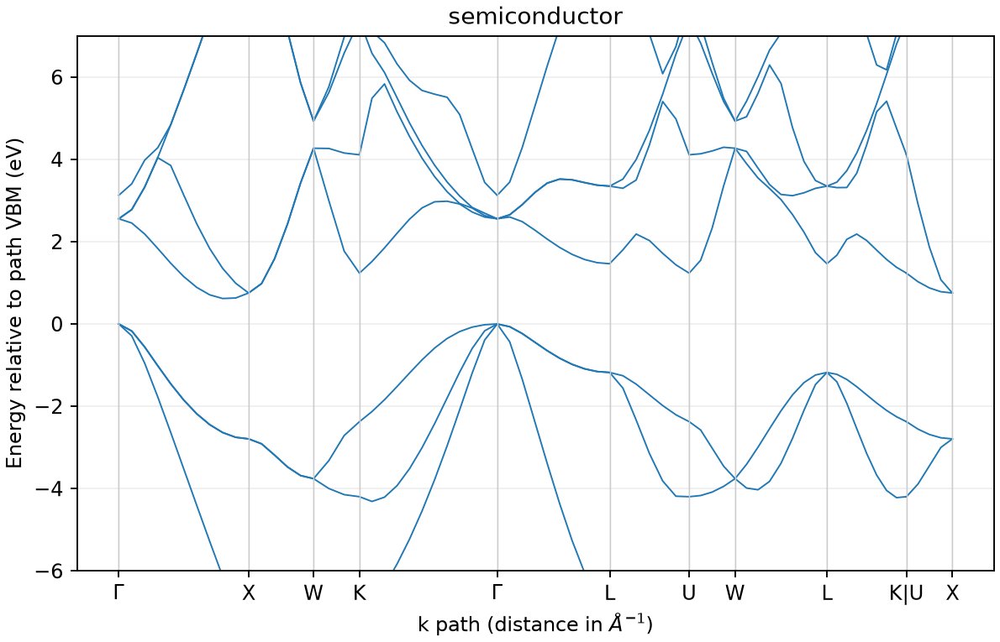

# 结构、性质与计算档案数据库

手册里已经有一张硅能带图。要复算它，得先拿到对应的结构。要把它和数据库的带隙并排放进报告，还得查清对方用了什么方法。CIF、性质摘要和计算档案各能回答其中一部分。沿着这张图找一遍，就知道什么时候可以停在网页上，什么时候还得翻原始输入。

## 一、为什么先查库，再开计算

查库能省下两类工作。建模时，先找目标物相的结构，省去从化学式猜结构的过程。结果出来后，找一组条件清楚的公开计算做对照。两份硅带隙不同，可以先查晶胞、泛函或 k 点采样，再决定需要重算哪一步。记下来源的好处，是过几个月再看这个数，仍能沿着同一条记录找到计算条件。

## 二、三个入口，分别能查到什么

- **需要实验晶胞**，先去 COD 按结构和文献找 CIF。一个化学式可能有多条记录，应按物相、占位、温度和压力挑选。保存条目号、引用与 CIF 修订号。 [COD 的查询和修订说明](https://wiki.crystallography.net/howtoquerycod/)
- **需要计算性质**，从 Materials Project 查结构、带隙和能带，从 OQMD 或 AFLOW 找形成能与候选结构。浏览器适合先读一两条记录。需要批量筛选时再用 SDK 或 API。只想在几个库里复用结构筛选语法，可以用 OPTIMADE。 [Materials Project 查询示例](https://docs.materialsproject.org/downloading-data/using-the-api/examples) · [OQMD API](https://www.oqmd.org/api/) · [AFLOW AFLUX](https://aflow.org/API/aflux/) · [OPTIMADE](https://www.optimade.org/specification/latest/)
- **需要复查某次运行**，找能拿到原始输入和输出的档案。在 Materials Project 用性质对应的任务号查计算记录，在 NOMAD 用 `entry_id` 找原始档案，在 Materials Cloud 按论文或数据集 DOI 找发布版本。 [NOMAD 档案接口](https://docs.nomad-lab.eu/reference/api.html) · [Materials Cloud Archive](https://archive.materialscloud.org/)

## 三、已经算出硅的带隙，怎么找对照

手册里的半导体案例给出的路径采样带隙是 **0.6189 eV**。它来自 PBE 计算，等价常规立方胞边长 **5.47 Å**，自洽 k 网格 **9 × 9 × 9**。图上沿路径出现的最高价带和最低导带，就是这次取值用的带边。 [带隙结果](../../examples/materials/semiconductor/data/results.json) · [曲线数据](../../examples/materials/semiconductor/data/curve.csv) · [输入与结果记录](../../examples/materials/semiconductor/data/provenance.json)



先找结构。COD 9008566 是金刚石结构的硅，条目给出的立方胞边长是 **5.4307 Å**，温度标注为 **1573 K**。如果报告要列室温参考，应另选一条温度合适的记录。也可以直接用手册另一个硅原胞案例的两原子 POSCAR 练习，它等价的常规立方胞边长是 **5.43 Å**。 [COD 9008566](https://www.crystallography.net/cod/9008566.html) · [硅原胞最小案例](../VASP/电子结构与成键/VASP能带计算.md#一文件与计算顺序)

复算图里的 **0.6189 eV** 要用图对应的 **5.47 Å** 晶胞和原 k 点设置。如果想看看晶格常数会影响多少，就在这套输入里只改变晶格常数。直接拿两个案例的带隙作差，会把 k 点采样的变化也算进去。 [5.47 Å 案例复现入口](../../examples/materials/semiconductor/README.md)

再找性质。Materials Project 的 `mp-149` 提供硅的计算结构和电子结构结果。网页上可以先读带隙和图。报告里要写计算条件时，再从摘要找到产生带隙的任务，查它用的泛函和 k 点。下面的示例需要安装 `mp-api`，从环境变量 `MP_API_KEY` 读取密钥。 [MP 的硅案例](https://docs.materialsproject.org/downloading-data/using-the-api/examples) · [性质来源查询](https://docs.materialsproject.org/downloading-data/using-the-api/querying-data)

```python
import os

from mp_api.client import MPRester

with MPRester(os.environ["MP_API_KEY"]) as mpr:
    docs = mpr.materials.summary.search(
        material_ids=["mp-149"], fields=["material_id", "band_gap", "origins"]
    )
    for doc in docs:
        print(doc.material_id, doc.band_gap, "eV")
        for origin in doc.origins or []:
            if not origin or origin.name != "electronic_structure" or not origin.task_id:
                continue
            task_id = str(origin.task_id)
            print("电子结构任务", task_id)
            tasks = mpr.materials.tasks.search(
                task_ids=[task_id], fields=["task_id", "run_type", "task_type", "input"]
            )
            for task in tasks:
                print("泛函和任务类型", task.run_type, task.task_type)
                if task.input is not None and task.input.kpoints is not None:
                    print("任务的 k 点设置", task.input.kpoints)
```

材料 ID 用来找硅这一条记录，任务 ID 用来找某份性质的计算过程。摘要如果查不到电子结构任务，可以另选一份注明 k 路径的能带，或一份注明采样的态密度（DOS），把该结果和自己的任务 ID 一同保存。高对称路径和均匀网格取样不同，查到的带隙也可能不同。 [MP 的能带和 DOS 方法](https://docs.materialsproject.org/methodology/materials-methodology/electronic-structure)

## 四、换到吸附能，先对反应式

用数据库筛材料时，形成能和凸包距离适合做第一轮筛选。到了表面反应，还要对上反应两端的构型和参考态。手册的 H/Al(111) 案例以气相 H₂ 为参考。全覆盖时每个 H 平均需要 **0.3150 eV**，而从半覆盖再加一个 H 需要 **0.3913 eV**，也就是用两个 H 的总吸附能减去一个 H 的总吸附能。若数据库只列了一个“吸附能”，先核对它对应的表面、位点、覆盖度、参考态和归一化，再决定该跟哪一个数比。 [H/Al(111) 的参考态和平均、增量之分](../VASP/表面与反应/VASP吸附能计算.md#三平均吸附能与继续加一个-h-的代价) · [Catalysis-Hub 查询入口](反应与催化数据库.md)

## 五、合并数据时容易踩的坑

**看到同一化学式就配成一对。** 先比结构和相态。带隙对照还需核对计算方法、k 点采样，以及实验报告的是光学吸收还是其他测量量。晶胞差异和采样差异同时存在时，数值接近也不能证明带边已经收敛。 [硅能带的带隙定义](../VASP/电子结构与成键/VASP能带计算.md#五写带隙时说明是哪一种能量差)

**把几个库的形成能直接汇总画相图。** 能量单位统一之后，还要核对元素参考态、泛函和校正。缺少这些信息的记录可以用来找候选结构。相图中的比较最好来自口径一致的一组能量。 [Materials Project 的相图方法](https://docs.materialsproject.org/methodology/materials-methodology/thermodynamic-stability/phase-diagrams-pds)

**把代码仓库的许可证当作数据许可证。** 归档时分别保留数据条目号、版本、出处和使用条件。查 STM、DOS 或力场数据时先选 JARVIS 的具体子库，引用和许可也查到子库。 [JARVIS 数据目录](https://jarvis-tools.readthedocs.io/en/master/databases.html) · [专题的引用与许可说明](README.md#规模许可与引用怎样读)

## 六、给自己的报告留下一行可追溯的记录

硅案例可记为 `Si | PBE | 5.47 Å | SCF 9 × 9 × 9 | 路径采样带隙 0.6189 eV`，源文件指向上面的结果、曲线和参数。另加数据库值时，用同样的粒度填上结构来源、性质任务、方法、单位和访问日期。查不到计算条件的值可以留在参考栏。下次换数据源时，先按缺的是结构、性质还是原始输入去找。
