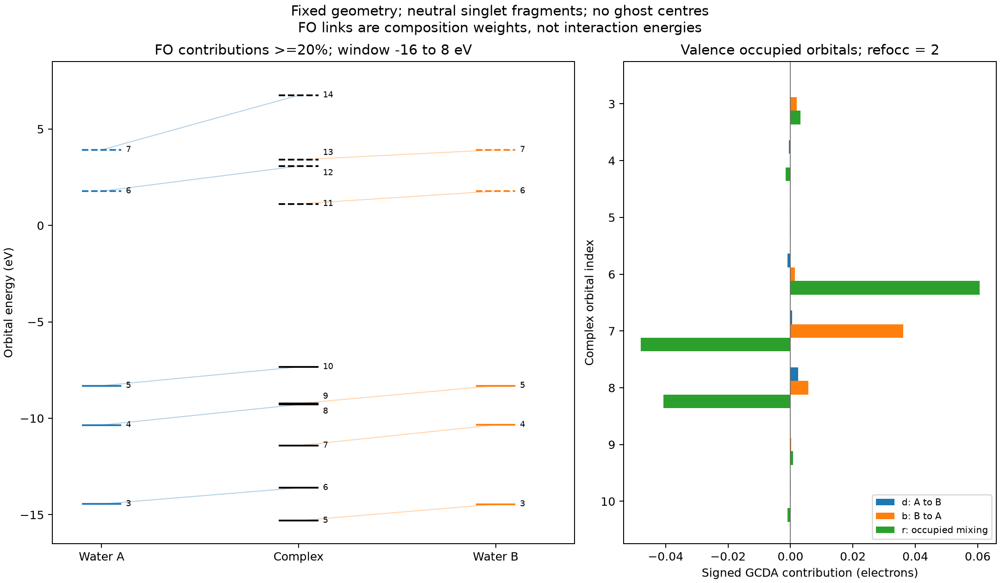

# CDA 的片段轨道与电荷分解

**适用环境：通用；案例使用 ORCA 和 Multiwfn，周期扩展须另核对相应接口。**

CDA 把复合物轨道重新展开为片段轨道，再分析片段间的占据–空轨道混合和占据轨道混合。它适合追踪哪些轨道参与给电子与反馈。片段状态、轨道空间和分解约定共同定义了结果，因此首先要建立一致的复合物与片段计算。

## 片段文件怎样准备

1. 从同一复合物几何提取片段，保持坐标、朝向、原子顺序及 AO 顺序对应。片段单点使用复合物中的几何；独立优化的片段属于另一参照，不应混入此基变换。
2. 对应原子使用相同基函数，包括指数、收缩、球谐/笛卡尔约定和赝势。经典 AO 分块路线要求片段 AO 数之和等于复合物 AO 数，并有完整、可逆的片段轨道空间。删除线性相关基函数可能破坏这一条件；不要为通过检查强行保留严重病态的空间。
3. 明确各片段电荷、自旋和所研究的成键参考，例如离子片段与中性自由基片段回答不同问题。各片段电子数应与复合物对应，自旋分辨分析还需 α、β 数分别匹配。
4. 使用相同电子结构层级和兼容的轨道文件。本文 AO 分块示例不带对方的 ghost 基函数；含 ghost 的反能量校正输入不能直接按同一分块假设送入 CDA。

开壳层片段可能需要在分析中交换某片段的 α/β 标签，使其与复合物的自旋计数对应。该标签交换不等于重新得到一个指定自旋耦合的纯态，也不消除自旋污染；仍需说明参考态及波函数质量。

## 基变换与分解项

把片段 AO 系数按块组成 \(F\)，复合物 AO 系数为 \(C\)，则片段轨道展开系数和重叠为

$$
T=F^{-1}C,\qquad S^{\mathrm{FO}}=F^\mathrm TSF.
$$

同一片段内的轨道相互正交，不同片段间通常有非零重叠。忽略这些重叠、直接平方 \(T\) 后相加，不是默认 Mulliken 片段轨道成分。

对实数、单个自旋通道，Multiwfn 的 GCDA 形式可写为

$$
t_i=\eta_i\sum_{m\in A,n\in B}\frac{\eta_m^{\mathrm{FO}}-\eta_n^{\mathrm{FO}}}{\eta_{\mathrm{ref}}}T_{mi}T_{ni}S^{\mathrm{FO}}_{mn}.
$$

其中 \(\eta_{\mathrm{ref}}\) 对闭壳层空间轨道为 2、对自旋轨道为 1。对片段占据差为正的轨道对求和得到 \(d_i\)，对占据差为负的项取反后求和得到 \(b_i\)，所以 \(t_i=d_i-b_i\)。这些是带符号的重叠分解，\(d_i\)、\(b_i\) 本身并非保证非负的概率。

占据轨道混合项为

$$
r_i=\eta_i\sum_{m\in A,n\in B}\frac{2\min(\eta_m^{\mathrm{FO}},\eta_n^{\mathrm{FO}})}{\eta_{\mathrm{ref}}}T_{mi}T_{ni}S^{\mathrm{FO}}_{mn}.
$$

对于整数占据，\(d\)、\(b\) 恢复原始 CDA 的对应公式，当前 \(r\) 约定是原始公式的两倍。跨程序比较时应按公式、占据和自旋核对因子，不能依据某篇旧例的倍数说明替代当前实现验证。分解值单位是电子数型权重，\(r\) 不是 Pauli 排斥能。公式定义可继续查阅 [GCDA 方法论文](https://doi.org/10.12677/JAPC.2015.44013)。

**未占据的片段轨道为什么也要保留？** 复合物轨道占据为零时，其 \(d_i,b_i,r_i\) 均为零；但虚片段轨道仍是展开占据复合物轨道和分析给电子通道的必要组成。自然轨道的分数占据可进入 GCDA；它们没有通常正则 MO 那样明确的能量，不能据此随意绘制同含义的能级图。

## CDA、ECDA 与净片段电荷

\(d-b\) 是所定义轨道分解中的方向性指标，混合了参考与极化因素。若目标是净电子得失，应另按明确分区比较[片段电荷](原子电荷、片段电荷与方法选择.md)，保持密度和参照一致。

ECDA 用片段占据/空轨道在复合物占据/空子空间的成分组合消去其定义中的共同极化项。它给出另一种总量，也依赖片段轨道与成分方法，不是唯一可观测的净转移。当前 Multiwfn 的 ECDA 限于相应两片段、整数占据、兼容自旋与 Mulliken 成分条件；自然轨道、多片段、限制性开壳层和 SCPA 情形会跳过。应读日志中的实际分支。

多片段 CDA 可以逐对分解，但成对数值的简单网络求和不自动给出唯一的电子流。方法关系见[电子转移与极化](电子转移、极化与分析方法的选择.md)。

## Multiwfn 的操作和输出

载入复合物波函数，进入 `16`，依次给出片段数和片段文件。每个片段按原子块顺序对应。程序读取并检查后显示 CDA 与可用的 ECDA 结果。

- `2`：查看指定复合物轨道的片段轨道成分，或某片段轨道在复合物轨道中的分布。
- `3`：导出 `coFO.txt`，行是片段轨道、列是复合物轨道。
- `4`：导出片段轨道重叠 `ovlpint.txt`，保存程序提示的片段索引范围。
- `6`：把某复合物轨道的 \(d,b,r\) 继续分解为片段轨道对，检查主要通道及正负项抵消。
- `5`：设置并绘制轨道相互作用图；CDA 后处理菜单用 `-1` 返回主菜单，与一些其他模块的 `-10` 不同。

打印阈值会隐藏小项；不要只加屏幕列出的行便与完整总量比较。弥散函数会增加重叠分配和线性相关敏感性，应检查基组、完整空间与条件数，必要时使用更稳健的补充分析；不能为得到好看的分解而删掉描述原体系必需的弥散函数。

## 固定水二聚体与轨道相互作用图

[案例](../../examples/orca/minimal/orbital-dos-cda/README.md)中，A 为前一个水、B 为后一个水，O···O 为 `2.9 Å`；复合物和两个中性单重态片段均为 PBE0/def2-SVP，几何固定且未优化。复合物有 48 个 AO，两个片段各有 24 个。独立 AO→FO 变换与原生导出系数相差约 \(10^{-8}\)。

本例得到 \(d\approx0.001543\)、\(b\approx0.045714\)、\(d-b\approx-0.044171\)、\(r\approx-0.026321\)；ECDA 的 A→B 净项约为 `−0.05391`。数值仅针对该几何、参考片段和分解约定；两种总量不同，正说明需要按各自定义解读。

图左只展示 `−16` 至 `8 eV` 的能级，连线表示单个 FO 对复合物轨道的 Mulliken 成分至少为 `20%`。实线/虚线横杠分别为占据/空轨道。阈值以下的通道仍保存在数据中，没有连线不代表完全没有混合。右图展示价层占据轨道的带符号分解，正负项可以显著抵消。

作图时优先缩小到所研究的能量窗口、提高连线阈值或调整标签位置，保持能级和权重不变。连线不是反应路径或相互作用能；整体轨道相位任意，判断相位配合需同时看波函数与重叠，而不能只由一条连线推断。简并/近简并轨道可在子空间内混合，跨体系追踪时应关注完整相关子空间。

### 连线条件与横杠显示分别设置

在 Multiwfn 的轨道相互作用图菜单中，`Set the rule for linking and drawing orbital bars` 将连线条件与横杠显示方式分开设置。两片段示例中，`15,or,20` 表示分别按 A 的 `15%`、B 的 `20%` 阈值独立连线；`15,and,20` 则要求同一复合物轨道同时具有满足两侧阈值的片段轨道贡献，才显示相应联系。后者适合突出两片段共同参与的混合，图中会省去只满足一侧条件的联系。具体输入按所用版本的菜单提示核对。

横杠还可选择全部显示、仅显示已连线的轨道，或只对片段/复合物一侧隐藏未连线轨道。图注写清能量窗口、连线规则和横杠筛选；被隐藏的能级仍存在于原始计算中。若为排版对某一列能级作人为平移，应标明偏移量，并用原始能量讨论能级差。
