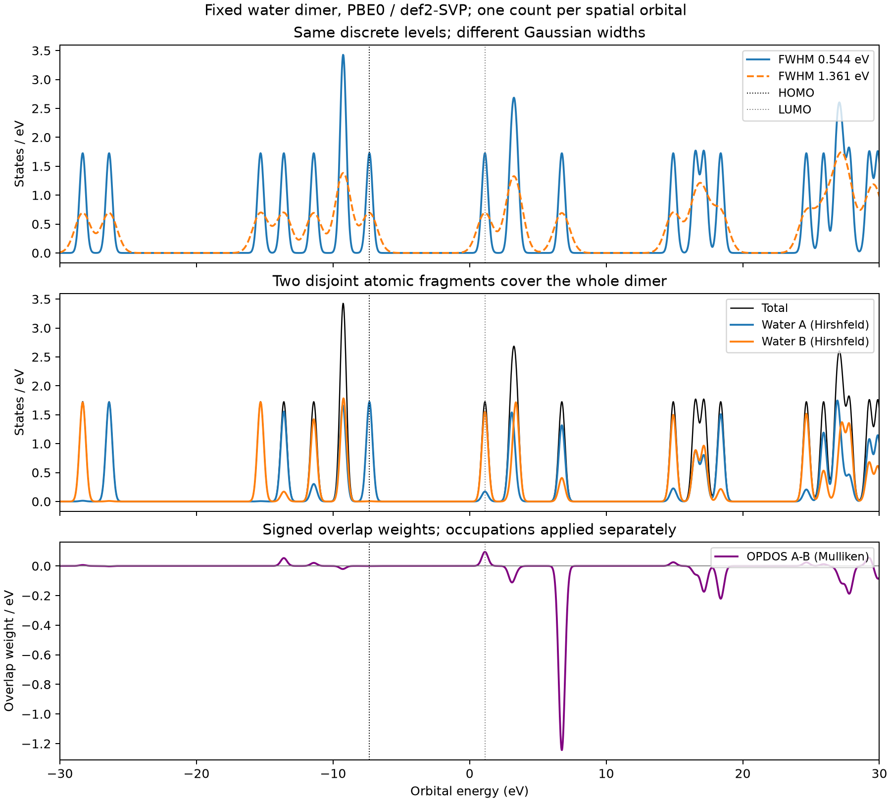

# DOS 的展宽、分区与空间分布

**适用环境：通用；分子后处理使用 Multiwfn，周期结果结合所用电子结构程序检查。**

DOS 把能级在能量轴上的分布汇总为一条曲线。PDOS 再按指定权重分解，OPDOS 显示重叠项，LDOS 显示空间点上的分布。先明确“态”如何计数、能级从哪里来和纵轴如何归一，才能比较不同曲线。

## 离散能级与展宽曲线

有限分子的离散 DOS 可写为 \(D(E)=\sum_i s_i\delta(E-\epsilon_i)\)，数学定义是明确的。为了展示能级密集程度，可用归一化核函数 \(K\) 替换 δ 函数：

$$
D_\Gamma(E)=\sum_i s_iK_\Gamma(E-\epsilon_i),\qquad
\int_{-\infty}^{\infty}K_\Gamma(E)\,dE=1.
$$

默认每条空间轨道取 \(s_i=1\) 时，全能量积分给出轨道数；乘占据数得到的是另一个电子加权谱。非限制性计算可分别处理 α、β 自旋轨道。是否把闭壳层空间轨道计为一个态或两个自旋态，需要在图注中说明，不能把占据数、简并度与显示线高互相替代。

Gaussian 的半高全宽满足 \(\Gamma=2\sqrt{2\ln2}\,\sigma\)；Lorentzian 用半宽 \(\Gamma/2\)；Pseudo-Voigt 是两种核的加权组合。展宽越大，邻近能级越容易合并，峰高下降，尾部还可填入原本没有能级的间隙。不能从平滑后曲线接近零的位置重新定义分子的 HOMO–LUMO 间隙。

有限绘图窗口通常漏掉核心态、高能空态和核函数尾部，因此窗口内积分不必等于全部轨道数。应分别检查轨道列表是否完整、能量范围是否覆盖目标、核是否归一和积分步长是否充分。若进一步计算一阶矩，见 [d 带中心的能窗与参考](d带中心的能窗、参考与比较.md)。

周期体系的 DOS 还包含能带、布里渊区与 k 点权重：\(D(E)=\sum_{n\mathbf k}w_\mathbf k\delta(E-\epsilon_{n\mathbf k})\)。分子展宽不能替代 k 点收敛；周期超胞的 Γ 点结果是否足够取决于体系。VASP 的原子球/投影子 PDOS 也不必严格加和为总 DOS，应查具体投影定义，而不是照搬分子完备分区的恒等式。输出单位和投影列可查 [VASP DOSCAR 说明](https://vasp.at/wiki/DOSCAR)。

## PDOS、OPDOS 与 LDOS 分别说明什么

| 曲线 | 定义与用途 | 需要核对的条件 |
| --- | --- | --- |
| PDOS | \(D_A(E)=\sum_i s_ip_{Ai}K(E-\epsilon_i)\)，看某片段/角动量的能量分布 | 轨道成分方法、分区是否重复/遗漏、局部坐标系 |
| OPDOS | 将每条轨道在两个 AO 片段之间的带符号重叠权重展宽 | Mulliken 型约定、占据与因子，基组敏感性 |
| LDOS | \(D(\mathbf r,E)=\sum_i s_i\lvert\psi_i(\mathbf r)\rvert^2K(E-\epsilon_i)\) | 点/路径坐标、轨道归一化、空间和能量单位 |
| MO-PDOS | 选择某组完整分子轨道后单独展宽 | 轨道分类依据及简并子空间的一致选择 |

当 \(\sum_Ap_{Ai}=1\) 时，PDOS 才逐点加和为 TDOS。仅有“片段并集等于全部体系”还不够：若同时把整个配体与其中某官能团各算一个片段，就重复计数了。成分方法的区别见[轨道成分笔记](轨道成分、基函数与空间分区.md)。

两个片段在同一能量附近都有较大 PDOS，并不能判断它们空间上有重叠或以何种相位组合。实数 AO 表示中，一种常用 OPDOS 权重是

$$
x_{AB,i}=2\sum_{\mu\in A}\sum_{\nu\in B}C_{\mu i}C_{\nu i}S_{\mu\nu}.
$$

正、负号描述该分解下的成键/反键重叠特征。虚轨道的负权重表达其被占据后的重叠趋势；原态中未占据的轨道没有相应电子布居贡献。OPDOS 不是作用能，也不是使用哈密顿矩阵加权的 COHP。弥散或近线性相关时需检查其敏感性，不能把重叠分配异常直接解释为真实电子转移。

LDOS 中同一轨道可在一个点显著、在节点附近接近零。沿路径绘制能量–位置填色图，可把这些空间差异显示出来；它与片段积分 PDOS 不同。联系 STM/STS 时，还需考虑偏压、针尖、隧穿矩阵元和相应近似，不能把任意 LDOS 截面直接称为实验信号。

## 纵轴、能量零点与显示约定

归一化 DOS 的单位为 `states/Ha` 或 `states/eV`。设 \(E'=aE\)，则密度应满足 \(D'(E')=D(E)/a\)，这样积分计数不变；不能只乘横轴而保留纵轴标签。程序的额外显示比例和每轨道强度也会改变导出数值，应先核对再做积分。

Multiwfn 2026.7.15 切换到 eV 时会同步改变内部强度和缩放设置。[配套菜单](../../examples/orca/minimal/orbital-dos-cda/README.md)明确设置这些值，使同一 Gaussian 曲线的 Ha/eV 积分计数一致；自定义脚本则直接对 Ha 数据做 Jacobian 转换。定量比较时保留纵轴刻度、归一与单位，不将其作为可以随意省略的信息。

孤立分子的 HOMO 参考线就是 HOMO，不能自动标成费米能级。周期体系的费米能级或化学势采用其计算定义；跨体系能级比较还要统一真空、平均电势或其他参考。展示时把 HOMO 移到零只是一种对齐方式，不保留绝对电离趋势。

### 自旋图向下的曲线表示负态数吗？

自旋分辨图常将 α 通道向上、β 通道乘以 `−1` 向下绘制，负号只是镜像显示约定。保存原始正值数据，图注明确上下通道；总 DOS 是原始两通道之和，不能直接把图上的正负纵值相加。两通道使用同一个能量零点；分子可分别标出 α、β 的 HOMO，但若各自平移到零，会丢失两者的原始能级差。

### 态数怎样对应电子数？

态数与电子数也要分开：对每条自旋轨道计一次的 DOS，电子数为 $N_\sigma=\sum_i f_{i\sigma}$，实际积分需包含相应占据权重。有限展宽会把部分谱重移到占据边界两侧，按平滑曲线截断得到的积分未必精确还原原始占据数。共线、无自旋轨道耦合且只计自旋贡献时，$M_z=(N_\alpha-N_\beta)\mu_B$；投影 DOS 的窗口面积则按其投影定义解释，不能直接当作完整原子磁矩。

## 在 Multiwfn 中设置与导出

1. 进入主功能 `10`。TDOS 可由纯能级文本生成；PDOS/OPDOS 需要 AO 系数与相关基组信息；LDOS 需要能评价轨道空间分布的输入。空轨道没有求出时，补一个能量不会补出其系数，见[波函数文件](波函数文件的选择与转换.md)。
2. 用 `7` 选择轨道成分方法，再用 `-1` 定义片段。当前菜单中 `3` 是 Hirshfeld、`4` 是 Becke，应读屏幕而不是照抄旧例的注释。AO 片段可按原子、壳层、基函数或条件定义；空间分区片段按原子定义。
3. 用 `1`、`2`、`3` 设置核函数、能量范围与 FWHM，`8` 切换 Ha/eV。`4` 控制额外曲线缩放；`-4` 核对当前能量、占据、强度和宽度。开壳层还要用 `6` 选择自旋。
4. `0` 生成曲线，后处理 `3` 导出 `DOS_curve.txt`、`DOS_line.txt`。列顺序随是否包含 OPDOS 改变：有 OPDOS 时第三列为 OPDOS，PDOS 从第四列开始；只含 PDOS 时第三列就是第一片段。
5. LDOS 点入口为 `10 → 10`，输入点坐标的单位是 Bohr；路径入口为 `10 → 11`。各任务放独立目录，保留日志中的字段定义，避免同名导出覆盖。

复杂片段可导出 `DOSfrag.txt`；绘图主界面的 `s`、`l` 保存和恢复会话状态。批处理可用本版本支持的 `-silent` 跳过自动打开图形窗口，直接导出数值再用脚本绘图，无需修改全局配置。

## 固定水二聚体示例

本例为固定、未优化的 PBE0/def2-SVP 水二聚体。完整 AO 空间含 48 条空间轨道、10 条双占据轨道；图中每条空间轨道计一次。`0.02 Ha`、`0.05 Ha` 的展宽约为 `0.544`、`1.361 eV`，下方 OPDOS 使用同样的单位转换。

原始 `−1.5` 至 `1.5 Ha` 窗口内，窄、宽核积分约为 `27.0002`、`27.0724` 个态；差别来自窗口外能级的展宽尾部，不能据此认为体系多出了轨道。Hirshfeld 两个水的 PDOS 在输出精度内恢复 TDOS；这项加和只针对本例的完备、不相交分区。输入、导出列核对与重绘脚本见[案例](../../examples/orca/minimal/orbital-dos-cda/README.md)。
