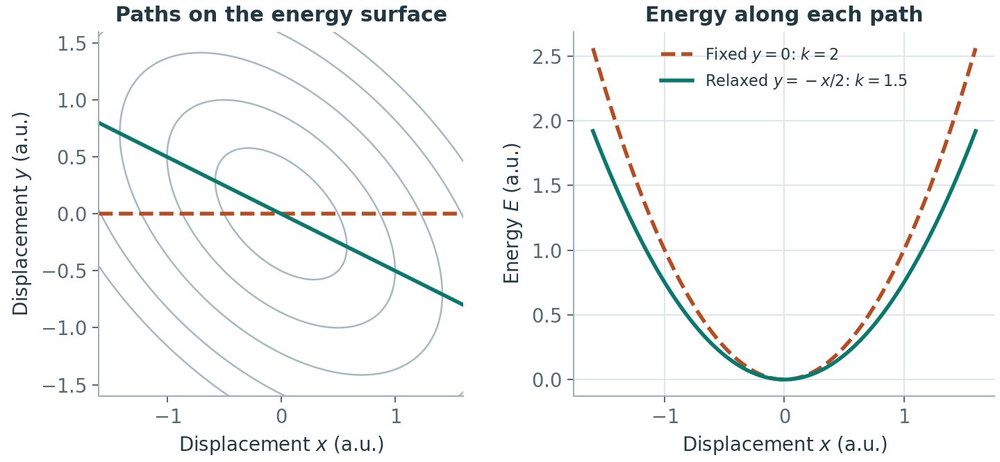

# Hessian、正常模式与频率复核

**适用环境：通用；分子、固定晶胞周期体系及受限模型按各自自由度解释。**

振动频率来自势能面对核坐标的曲率，并经过质量加权与平动、转动处理。读取 Hessian 可以重做模式和同位素分析，但它不会把原方法的曲率变成另一种方法的曲率。

## 从笛卡尔 Hessian 到正常模式

设原子位移按 $(x_1,y_1,z_1,x_2,\ldots)$ 排列，Hessian 为

$$
H_{ij}=\frac{\partial^2E}{\partial R_i\partial R_j}.
$$

令 $M$ 为对角质量矩阵，每个原子质量在三个坐标上重复，质量加权矩阵为

$$
K=M^{-1/2}HM^{-1/2},\qquad K\mathbf l_k=\lambda_k\mathbf l_k.
$$

在一致的物理单位下，$\lambda_k=\omega_k^2$，其中 $\omega$ 为角频率；普通频率 $\nu=\omega/(2\pi)$，波数 $\tilde\nu=\omega/(2\pi c)$。质量加权本征矢转回笛卡尔位移还需乘 $M^{-1/2}$。不同程序的归一化与动画幅度可以不同，不能仅按本征矢逐元素数值判断模式是否相同。

负本征值对应虚频，常在输出中以负波数表示。直接对本征值取绝对值会抹去曲率符号，改变驻点解释。频率也不是曲率的线性函数，简单振子中为 $\omega=\sqrt{k/\mu}$。

## 单位是重算时最常见的错误

若 Hessian 用 Hartree/Bohr²、质量用原子质量单位，则数值本征值需要换算后才得到 s⁻²。对应波数可用约 $5140.5\sqrt{\lambda}$ cm⁻¹ 计算；这里的 $\lambda$ 特指上述混合单位下质量加权矩阵的数值，不能与 SI 本征值混用。

文件还可能保存质量加权力常数而非原始 Hessian，或使用 eV/Ų 等单位。先确认坐标顺序、质量、是否已加权、对称矩阵如何存储，再计算。仅看到字段名中有 `force constant` 不足以确定全部约定。

数值差分受力时，符号和步长同样重要：

$$
H_{ij}\approx-
\frac{F_i(\mathbf R+h\mathbf e_j)-F_i(\mathbf R-h\mathbf e_j)}{2h}.
$$

步长过大引入非线性误差，过小则放大电子和积分噪声。比较多个步长及更严电子精度，检查矩阵对称性与目标模式；不能只靠 Hessian 做对称化就认为消除了误差。

## 平动和转动怎样处理

在适当驻点附近，无约束非线性分子有 3 个平动与 3 个转动自由度，内部振动为 $3N-6$；线性分子的独立转动只有 2 个，内部振动为 $3N-5$。这些方向应在质量加权空间中识别并按程序约定投影或分离。

把按大小排序后的前六个本征值直接删除并不稳妥：真实虚频可能排在它们之前，软振动也可能与数值零模混合。查看模式与对应位移子空间，不能只按数量截断。外场、固定原子、部分 Hessian 和周期晶体会改变自由度与解释，应采用相应模型。

## 读取已有矩阵能做什么

Gaussian 的 `Freq=ReadFC` 读取先前频率任务的力常数，重做模式与热化学分析，适合改变温压、同位素等后处理条件；它不会在新泛函下重新求二阶导数。`Opt=ReadFC` 则将读入的力常数用于优化初始信息，两者用途不同。

同位素替换主要改变核质量；在相同 Born–Oppenheimer 势能面近似下，可保留笛卡尔 Hessian、重新质量加权。模式可能重新混合，频率排序也可能变化，因此比较时应结合本征矢，而不只比较第几个模式。Gaussian 的读取约定见 [Freq 手册](https://gaussian.com/freq/)。

从 `.fch`、ORCA `.hess` 或其他格式重算时，保留原矩阵、结构、质量与来源方法。重算结果应与原程序在相同投影和归一化下对照，并确认是否只读取了优化器的近似 Hessian。若原结构不是所需驻点，重做对角化本身不能修复几何。

实际模式与结果入口见 [ORCA 分子频率](../ORCA/基础与结构/ORCA几何优化与振动频率.md)、[CP2K 分子频率](../CP2K/动力学与反应/CP2K振动频率.md)和[低频处理](低频振动与虚频的处理.md)。周期晶体则进入[声子计算](../VASP/振动与热力学/VASP声子谱计算.md)。

## 振动箭头怎样与实际模式对应

绘图时同时提供参考结构和目标模式的位移，核对原子顺序、坐标取向、模式编号与频率。结构单独旋转后，矢量也要按同一旋转变换；周期展开或扩胞后，按原子及镜像映射复制。解析孤立分子输出的脚本可能按线性/非线性和冻结原子数推算模式数量，不能直接用于周期声子、部分 Hessian 或任意受限体系。

先确认导出的是质量加权本征矢还是笛卡尔位移。前者需按原子质量转换，不能重复乘质量因子；程序已导出的位移则沿其归一化约定使用。箭头长度通常是人为放大的显示幅度，不是该温度下的真实振幅、振动能量或 IR 强度。箭头粗细与基点位置可按可读性调整，但不要将不同原子分别归一化成等长后再比较参与程度。

对于 Γ 点的实模式，整体反号只改变所选振动相位。一般 q 点声子则包含复本征矢及不同晶胞之间的相位关系，应按所用动力学矩阵约定构造实位移，而不是直接取每个分量的模或实部后平铺到所有晶胞。Phonopy 的 [MODULATION 说明](https://phonopy.github.io/phonopy/setting-tags.html#modulation)给出包含质量、空间相位与所选相位的构造；所用超胞还需与目标波矢相容。

图注保留 q 点、频率（虚频保留符号）、原胞/超胞、模式身份及显示幅度。简并子空间内单条箭头图可随选基变化；比较结构间的模式时结合重叠或整个子空间，不能仅按“第 17 模”匹配。虚频箭头帮助辨认不稳定方向，沿它生成位移结构后仍需实际优化和能量检查，动画本身不证明已找到过渡态或新的稳定相。

## 从局部曲率到允许环境弛豫后的刚度

某个原子的笛卡尔 Hessian 对角元、一个伸缩正常模式的频率和某条键的局部伸缩刚度是不同对象。多原子模式混合了坐标与质量，不能直接把某一条频率较高解释成某条键更强。

在稳定驻点附近，把指定的伸缩坐标记为 $x$，其它允许弛豫的独立坐标记为 $y$。对二次能量模型分块写 Hessian，固定 $y$ 时的曲率是 $H_{xx}$；若 $H_{yy}$ 正定可逆，令 $y$ 在每个小 $x$ 下弛豫，得到

$$
k_{\mathrm{relaxed}}
=H_{xx}-H_{xy}H_{yy}^{-1}H_{yx}
=\frac{1}{(H^{-1})_{xx}}.
$$

这里的 $H$ 是该独立坐标空间内、未质量加权的 Hessian，第二个等号还要求整个矩阵可逆。耦合项反映环境弛豫，因而在这些稳定性条件下，弛豫曲率不大于固定环境时的曲率；冻结远处原子会改变允许空间及结果。compliance matrix 是相应 Hessian 的逆矩阵，其对角元的倒数称为柔性力常数；物理解释与适用性讨论见[原始研究](https://doi.org/10.1039/C5SC01322D)及[对弱相互作用解释的研究](https://pubmed.ncbi.nlm.nih.gov/16939234/)。

### 用二坐标模型理解环境弛豫

例如，用同单位的两个局部位移构造 $E=\frac12ax^2+bxy+\frac12cy^2$，其中 $c>0$、$ac-b^2>0$。固定 y=0 得到曲率 a；允许 y 弛豫时，$y_*=-bx/c$，代回能量得到 $k_{\mathrm{relaxed}}=a-b^2/c$。若 a=c=2、b=1，则刚性曲率为 2，柔性曲率为 1.5，柔度对角元为 2/3；Hessian 的两个本征值却是 1 和 3。它们对应不同的位移问题，正常模式频率还需另行质量加权。这个二次模型只描述驻点附近，不能用其无界增长的能量外推真实断键过程。

沿左图的两条路径分别作能量截面。允许 $y=-x/2$ 随 $x$ 弛豫时，右图的曲线比固定 $y=0$ 更平，曲率从 2 降为 1.5。

### Hessian 有零模时怎样处理？

在笛卡尔坐标中，分子平转动、周期体系整体平移等零模会使直接求逆失效。应先识别允许的稳定子空间、约束及零模，或在明确投影和阈值的条件下使用广义逆。对一个给定的小形变坐标 $q$，若 $b=\partial q/\partial R$ 是其位移梯度，将坐标梯度同时表示在这一子空间后，柔度可写为 $b^{\mathrm T}H^{+}b$，有效刚度为其倒数。若目标坐标包含自由平移等零模响应，就不能靠投影删除它来制造一个有限刚度。它依赖所定义的物理坐标及允许弛豫的环境，不是随意取逆矩阵某个 Cartesian 对角元。负模与近零软模应先解释，不能仅用数值截断掩盖不稳定性。

Hessian 用 `eV/Ų`、q 用 Å 时，该伸缩刚度也用 `eV/Ų`；材料宏观弹性柔度的单位和应力—应变定义另属一层，不能与原子坐标柔度直接混用。周期分析还要说明固定或放松晶胞、超胞大小及采样；固定胞的局部响应不能直接当作含宏观应变弛豫的响应。

柔性力常数描述驻点附近的二次响应，断键能和吸附能比较的是不同状态的能量。多键网络或强耦合吸附环境中，一个坐标的响应会牵动其它键，不能从单个数值恢复某条独立键的能量。配合位移方向、非对角耦合与能量过程判断，不把它当作通用的“键强排名”。

## 同位素替换：复用力常数，重新求模式

在固定结构、同一电子态的通常 Born–Oppenheimer 近似下，核电荷相同的同位素使用同一电子势能面。改变质量不必重算笛卡尔力常数，却需要重建质量加权矩阵；周期体系也应在每个目标 q 点重新对角化动力学矩阵，质量因子见 [Phonopy 的定义](https://phonopy.github.io/phonopy/formulation.html#dynamical-matrix)。同时保存原子顺序、各位点质量、晶胞和力常数来源，避免把材料名称相同当成数据可互换。

只有全部质量同时乘以 $a$ 时，固定力常数下所有非零频率才统一乘以 $a^{-1/2}$。只把 H 换成 D 时，各模式对 H 的参与程度不同，不能把整张谱都除以 $\sqrt{2}$。即使是孤立双原子伸缩，也应使用约化质量 $\mu=m_1m_2/(m_1+m_2)$。例如取理想化质量 H=1、D=2、O=16，同一力常数下 OD/OH 的频率比为 $\sqrt{9/17}\approx0.728$；这是简振子示例，不是某个表面羟基的预测。

质量改变还会改变零点能、振动自由能和模式位移；振动平均结构及含零点能的平衡体积因此可以出现同位素效应。静态电子吸附能保持不变，并不意味着 H、D 的吸附自由能或反应速率相同。速率还涉及初态与过渡态振动、隧穿和动力学模型，不能仅用一个伸缩频率比替代动力学同位素效应。自然同位素丰度混合物也不等于一个均匀的平均质量晶体；后者没有显式表示质量无序及其散射。

同位素替换还可能改变红外强度与拉曼活性。固定几何下的电子偶极、极化率及其笛卡尔位移导数可以保持不变，但转换到质量加权正常坐标时，本征矢和质量因子改变，因此 $\partial\boldsymbol\mu/\partial Q_k$、$\partial\boldsymbol\alpha/\partial Q_k$ 会改变。不能只移动原谱峰位置而保留所有强度，就称为完整的同位素谱预测；模拟拉曼散射强度时，还需采用相应激光频率、温度布居和强度转换约定。

## 将电子态弛豫投影到振动模式

缺陷电子局域、氧化还原或局域激发可能改变平衡核坐标。要分析哪些振动参与结构变化，先准备两态一致的原子映射、同位素质量、晶胞和约束；选取连续周期镜像，去掉表示差异造成的整体平移。分子还需相容的转动对齐，固定基底的表面模型则不能任意旋转片段以抹去真实倾转。

设两态平衡结构之差为 $\Delta\mathbf R$，参考态质量加权动力学矩阵的实正交本征矢为 $\mathbf l_k$，满足 $\mathbf l_k^{\mathrm T}\mathbf l_j=\delta_{kj}$。其模式投影为

$$
\Delta Q_k=\mathbf l_k^{\mathrm T}M^{1/2}\Delta\mathbf R,
\qquad
\lambda_k=\frac12\omega_k^2(\Delta Q_k)^2,
\qquad
S_k=\frac{\lambda_k}{\hbar\omega_k}
=\frac{\omega_k(\Delta Q_k)^2}{2\hbar}.
$$

$S_k$ 是无量纲 Huang–Rhys 因子；$\lambda_k$ 是沿该参考态谐势的模式弛豫能贡献，不是 ZPE，也不是零声子线能量。上式使用角频率 $\omega=2\pi\nu$；SI 单位下质量用 kg、位移用 m，$\Delta Q$ 用 kg¹ᐟ²·m。若输入为波数、THz、amu¹ᐟ²·Å，先统一换算，不能把动画中任意放大的位移直接代入。

### 弛豫能与频率都用波数时怎样换算？

输出若将模式弛豫能也写成 cm⁻¹，实际给出的是 $\tilde\lambda_k=\lambda_k/(hc)$，而振动波数为 $\tilde\nu_k=\omega_k/(2\pi c)$。两者采用相同波数单位时，直接取 $S_k=\tilde\lambda_k/\tilde\nu_k$，无需再乘 $h$、$c$ 或 $2\pi$。若能量以 kJ/mol 输出，则先除以阿伏伽德罗常数，转为单个体系的能量后再与振动量子比较。绘制模式贡献图时，横轴频率、纵轴弛豫能即使都用 cm⁻¹，也应分别标明物理量。

完整稳定子空间中的投影平方和，应还原该子空间内的质量加权总位移平方；投影残差可检查模式是否缺失、原子是否错序或自由度是否不一致。对参考态的谐势，$\sum_k\lambda_k$ 可与该态上交叉几何的弛豫能比较，定义见[重组能](电子转移、极化与分析方法的选择.md#重组能明确电子态核坐标与环境响应)。差异反映非谐性、较大结构变化或其它模型不一致，不能强制归一化模式贡献使其精确相等后仍称为原始分解。

不同电子态通常有不同曲率和模式。Duschinsky 关系可写为 $Q_B=JQ_A+K$，表示两套模式坐标的混合及原点位移；解释 J 前先对齐原子、整体坐标、模式顺序和符号。单个本征矢反号或简并子空间中的转动，不应被当成新的物理耦合。简并模式的单条 $S_k$ 也可能随选基改变，宜同时比较整个简并组的贡献。

若用一套模式近似两态，就明确采用平行模式及相应曲率假设；若两态差异显著，应分别保留参考态分解或处理模式混合。一维有效构型坐标是沿总畸变定义的简化模型，也不一定对应某一条实际正常模式。缺陷材料中的多模式方法与长波声子影响可参看[原始研究](https://doi.org/10.1088/1367-2630/16/7/073026)。

周期超胞 Γ 模式描述的是该超胞允许的位移空间，不等于只用了原胞 Γ 声子；超胞增大、远处原子响应和活动区域都会影响分解。局部 Hessian 只覆盖所保留自由度，不能自动称为完整电子–声子耦合谱。研究光谱或载流子俘获率时，还需相应电子态、跃迁耦合、温度及线形模型，不能仅由总 $S=\sum_kS_k$ 推出全部动力学结论。

## 模式指认：位移分量与 PED 分别描述什么

“伸缩占多少、弯曲占多少”需先定义分析坐标。正常模式的笛卡尔本征矢、原子位移平方、质量加权参与量和势能分布（PED）不是同一指标。动画可先辨认运动方向，再结合定量分解；某个原子移动得大，并不自动说明与它相连的一条键贡献了最多势能。

在驻点附近，若使用覆盖目标振动空间的独立内坐标 $s$，谐势可写为

$$
\Delta E=\frac12\sum_{ab}F_{ab}\Delta s_a\Delta s_b.
$$

将某个正常模式写为 $\Delta s_a=L_{ak}Q_k$ 后，各 $F_{ab}L_{ak}L_{bk}$ 项共同给出该模式的势能系数。非对角项是坐标耦合；PED 的百分比还取决于内坐标集合、交叉项分配及归一化约定。使用冗余内坐标时，需由相应算法处理度量与线性相关，不能直接套用任意矩阵求逆。

[VEDA 的原始方法说明](https://doi.org/10.1016/j.saa.2013.05.096)展示了生成并优化内坐标组合以便指认振动的路线。组合坐标可以让表格更集中，但改变的是描述方式，不是消除了真实耦合或改变了频率。报告“某坐标贡献 80%”时，同时保存该坐标的原子编号和组合系数；只保留软件生成的 `s12` 等标签，读者无法知道它具体表示哪些伸缩、弯曲或扭转。

输出中的负号也要按格式解释：有些带符号的贡献表用符号表示运动的相对方向，不能直接称为负势能；另一些能量分解则确实保留带符号交叉贡献。不能只见百分号就当作非负概率，更不能把不同规则的表逐项比较。正常模式整体反号不会改变物理振动，简并模式的单条指认还可能随子空间选基变化。

周期材料先区分 Γ 点与一般 q 点、原胞与超胞，以及实际活动原子。局部吸附物的伸缩或弯曲坐标可帮助解释相应位移，但声学模、框架集体运动和复数声子本征矢不能未经处理就送入孤立分子的 PED 流程。对混合明显的模式，直接报告主要原子、位移方向和耦合特征，并附动画或投影定义，比强行贴上单一“某键伸缩”的标签更清楚。PED 也不等于 IR/Raman 强度或某条键的断裂能。

### 冗余内坐标权重为何会随坐标集合变化

将同一个正常模式转写为键长、键角和二面角的变化，可以帮助辨认运动，但冗余坐标并非彼此独立。增加一个描述相同形变的新坐标后，软件可能重新分配或归一化相对权重，使旧坐标的百分比下降；只要仍分析同一个 Hessian 和本征矢，这不是振动发生了变化。比较吸附前后或不同材料的表格时，应统一坐标集合与汇总规则，不能把不同列表中的百分比直接相减作为物理变化量。

Gaussian 的 `IntModes` 类冗余内坐标分析，与使用力常数及交叉项的 PED 分解应分别标名。前者表中的相对权重不能直接称为某条键的势能百分比。未成键原子间的距离也可作为描述运动的几何坐标，列入表格并不意味着出现了一条化学键；同一伸缩还可能同时改变多个角度或远端距离。将多个坐标归并为“基团扭转”时，保留原子映射与分组依据，并检查是否重复描述同一个运动。

## 跨尺寸比较：先匹配运动，再比较频率与谱峰

团簇、环、纳米带或不同超胞的模式数量会变化，同一频率序号不能充当跨体系的模式身份。先按运动定义挑出呼吸、面外弯曲、局部伸缩或键长交替等特征，再保存位移图、参与原子及投影依据。原子数相同且映射一致时可比较本征矢或简并子空间重叠；原子数不同则需共同的局部坐标或集体运动描述，不能直接对不等长向量做重叠。

频率排序接近或分支交叉处尤其要检查模式混合。[Phonopy 的 `BAND_CONNECTION`](https://phonopy.github.io/phonopy/setting-tags.html#band-connection)按本征矢估计相邻 q 点的连接，敏感处需加密路径并检查；它解决的是同一体系的色散分支跟踪，不会自动完成不同尺寸结构之间的对应。尺寸趋势可按相同结构族分别拟合，保留边界、封端、磁态和几何变化；有限环的频率趋于平缓，不证明无限链或其它拓扑材料已经收敛。

IR/Raman 光谱只显示相应活性及实验条件加权后的模式，不等于完整振动态密度。没有谱峰可以源于选择定则或强度很小，不能据此删除该振动自由度；展宽后一个峰也可能叠加多个模式。比较拉曼强度时保留入射波长、温度、偏振和活性到强度的转换约定，归一化谱的峰高不直接比较绝对散射强弱。表面、缺陷或环境降低对称性后，原孤立模型的禁戒模式可能获得活性，应根据实际模型重新判断。

谐振缩放、显式非谐计算和有限温度轨迹给出不同层次的信息。统一缩放不能生成泛音、合频或共振借强，也不能保证所有非谐频移均为红移。短轨迹中未见断裂，只支持该时长和初始条件下未发生该事件；RMSD 的周期还需与明确的模式坐标或相关谱对照，不能直接当作某条正常模式频率。需要动力学谱时使用对应偶极、极化率或速度相关函数，并检查采样间隔、轨迹长度和所求光谱类型。

例如，相对平衡结构的单一模式位移若为 $\Delta R(t)=a\cos(\omega t)$，其 RMSD 与 $|\cos(\omega t)|$ 成正比，周期是有符号位移的一半。相对初始帧求差时又会包含参考相位；多个模式叠加还会产生混频。因此应跟踪有符号的模式投影或定义明确的相关函数，不能仅将 RMSD 峰间距取倒数作为某条正常模式的频率。
