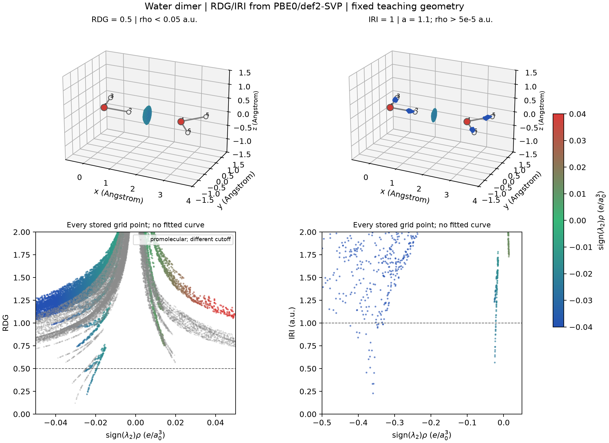

# IRI 与反应路径电子结构读图

**适用环境：Windows、macOS、Linux；示例使用 Multiwfn 2026.7.15。**

IRI 通过调整密度梯度中的密度幂次，使一个等值面阈值可以同时显示较高密度的成键区域与较低密度的接触区域。它适合观察结构和反应路径中的电子分布特征，再结合能量、键级等量判断过程。

## 函数、阈值与单位

\[
\mathrm{IRI}=\frac{|\nabla\rho|}{\rho^a},\qquad a=1.1\ \text{为常见设置}.
\]

指数 `1.1` 是方法中经验选择的参数，不是基本常数。若 \(a=4/3\)，IRI 与 RDG 只差一个常数因子；改变指数后，不同密度区的相对呈现也改变。因此 RDG 与 IRI 使用不同数值的等值面，不能直接比较表面的体积来判定哪种方法显示了“更多作用”。

标准 RDG 是无量纲量，IRI 在 `a=1.1` 时按指定原子单位报告。计算公式时保持密度、梯度与长度单位一致，不能将以 Å 表示的数值直接代入而沿用原子单位下的 `IRI=1` 阈值。

数学定义只需要密度及导数；当前 Multiwfn 的快捷入口要求波函数文件。若只有密度网格，需要另核对插值/差分导数及实现，不能把基于结构的准分子密度直接当作实际密度。

## 从同一水二聚体生成 IRI

载入[水二聚体案例](../../examples/orca/minimal/weak-interactions/README.md)的同一 Molden，进入 `20 → 4`；格点方式 `11`，原子 `1-6`，外扩 `2 A`，间距 `0.20 Bohr`。后处理 `3` 导出：

- `func1.cub`：\(\operatorname{sign}(\lambda_2)\rho\) 着色场。
- `func2.cub`：IRI 场。
- 选项 `2` 的 `output.txt`：坐标及上述两种函数值。

用 `func2` 的 `IRI=1` 表面映射 `func1` 的颜色。`0.9～1.1` 可用于初步查看，随后根据研究对象选择并报告实际阈值；比较同系列体系时尽量统一。整体正负曲率和密度数值的含义见[NCI/RDG](NCI与RDG的网格、筛选和散点图.md)。

### IRI 也有数值筛选

当前默认 `IRI_rhocut=5×10⁻⁵` a.u.，低于或等于该密度阈值的区域会把 IRI 置为 `5`；本版本部分零梯度情形也有该保护处理。这些固定值属于实现中的屏蔽或防护，不能当作真实函数的平台。研究极值或做拓扑时需另检查这些条件。

后处理 `9` 可把 \(\operatorname{sign}(\lambda_2)\rho<-0.1\) a.u. 的区域 IRI 改为 `100`，便于隐藏部分高密度接触。它采用经验筛选，不能据此把所有留下的区域严格归为非共价、把所有删去的区域严格归为共价。范围筛选和恢复的区别与 RDG 相同：已经改写的数据需要原始副本才能完整恢复。

## 实际等值面与散点对照

上排均使用同一 PBE0/def2-SVP 密度与 `0.20 Bohr` 网格。左图是带 `ρ<0.05` a.u. 筛选的 `RDG=0.5`，右图是带低密度筛选的 `IRI=1`。水分子间接触在两图均可见，右图还显示 O–H 附近的高密度区域。共用的 `−0.04～0.04` a.u. 色标会让高密度成键区饱和为蓝色，不能据此比较这些键的能量。

下排显示相应网格散点，虚线对应上方所画阈值。左图灰点另为同几何的准分子近似，使用其独立密度上限 `0.1` a.u.，不是另一份实际波函数。存储与显示的坐标范围在[科学记录](../../examples/orca/minimal/weak-interactions/fields-analysis.json)中给出，散点未拟合成连续曲线。

由同网格的实际密度和梯度独立重算，未被筛选的 RDG/IRI 与程序导出值的最大相对差分别约为 \(1.17\times10^{-5}\)、\(9.30\times10^{-6}\)，与 Cube 导出精度相符。IRI 图中的小表面和离散尖峰也受当前显示网格影响，本图用于讲解步骤。重绘见[案例步骤](../../examples/orca/minimal/weak-interactions/README.md#rdg-与-iri-对照)。

## 反应路径怎样比较

1. 为各个真实路径点保存结构与对应波函数，核对原子顺序、方法、基组、电荷、自旋和收敛态。IRC、约束扫描和任意几何插值是不同的路径，不混用名称。
2. 选择一致的坐标对齐方式和空间范围。孤立分子的整体平移/旋转可以统一处理；周期体系要同时保留晶胞和镜像信息。固定网格便于逐帧比较，但若结构移出盒子，应扩大统一范围。
3. 各帧采用相同指数、密度筛选、等值面、色标和视角，检查是否出现态切换或显示裁剪。把每帧参数与图像关联保存。
4. 先解读接触区域的位置和连通性变化，再与键长、键级、密度拓扑和能量曲线对照。动画中的变色不能直接给出活化能、反应速率或电子转移数。

过渡态或受限构型的密度可以有意义；需要明确它描述的是哪一个受限状态。把两帧图像平滑插值成动画只改善播放效果，中间画面不自动具有相应的电子结构。涉及跨几何密度差时，另按[参考态与密度差](密度差、平面平均与电荷位移.md)解释。

### 沿路径比较区域积分

把局部区域转成电子数、体积或平均密度时，先定义积分域，检查网格分辨率与域的合并、分裂；积分曲线的跳变不必然对应电子态变化或化学键形成。

对明确定义的域 Ω，分别计算 $q_\Omega=\int_\Omega\rho\,dV$、$V_\Omega=\int_\Omega dV$ 与 $\bar\rho_\Omega=q_\Omega/V_\Omega$。

q 是域内电子数，V 是体积，平均密度是电子数除以体积；若 V 用 ų，平均密度也应换为相容单位。按曲率符号拆分的子域还需核对其并集是否恢复原域，名称中的“吸引／排斥”不将这些电子数或体积变成能量分解。对应操作和网格收敛见[域积分案例](../../examples/orca/minimal/weak-interactions/README.md#iri-域积分轨道体积与-hirshfeld-表面)。

## π 子空间与周期表面

IRI-π 使用选定 π 子空间的密度和梯度。先说明轨道选择、混合与对称性，再在分析副本中处理占据；原始波函数保留。用 \(\rho_\pi\) 着色时，色标显示的是 π 密度，与完整体系的 \(\operatorname{sign}(\lambda_2)\rho\) 不是同一个场。等值面的环状或上下分布可辅助描述轨道结构，强度结论还应与[键级及子空间定义](键级、模糊分区与NAdO分析.md#单独考察-π-子空间)结合。

周期体系的波函数、晶胞及有效核电荷见[CP2K 输出](../CP2K/电子结构与响应/CP2K波函数输出与Multiwfn分析.md)。表面模型可按晶胞向量定义网格，仅保留包含目标表面和接触区域的盒子来减少真空开销，同时确认表面未在盒子边界被截断。斜晶胞的向量方向不能直接当作笛卡尔 Z；并行比较不同构型时保留一致的边界处理。
