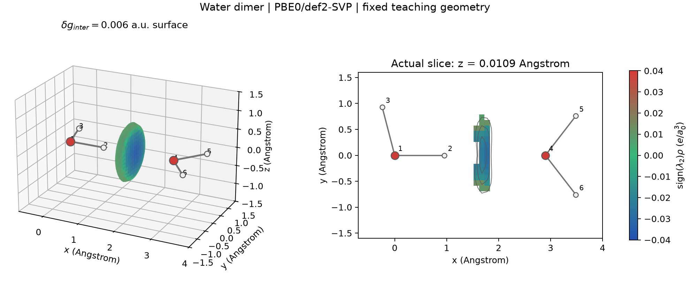

# Multiwfn 的 IGMH 片段分析

**适用环境：Windows、macOS、Linux；需要支持 IGMH 的 Multiwfn 与相应波函数文件。**

IGMH 用梯度抵消构造空间指标，适合把吸附物—表面、两个分子或指定原子组之间的区域单独显示出来。先固定片段和电子态，再讨论图像与贡献指数。下面用水二聚体贯穿操作，方法选择见[可视化读图](弱相互作用可视化的方法选择与读图.md)。

## 梯度差的含义与实现

给每个原子定义向量场 \(\mathbf u_A\)，对片段 \(F\) 求和得到 \(\mathbf u_F=\sum_{A\in F}\mathbf u_A\)。对不重叠、覆盖所分析原子集合的片段，构造

\[
\begin{aligned}
\delta g&=\sum_A|\mathbf u_A|-\left|\sum_A\mathbf u_A\right|,\\
\delta g_{\mathrm{inter}}&=\sum_F|\mathbf u_F|-\left|\sum_F\mathbf u_F\right|,\\
\delta g_{\mathrm{intra}}&=\delta g-\delta g_{\mathrm{inter}}.
\end{aligned}
\]

三角不等式使这些量在相应定义下非负。它们刻画向量的抵消程度；片段定义改变，片段间与片段内的分配也会改变。若只选全体系的一部分原子，报告该集合，不能把结果称作完整体系的分解。

IGMH 使用实际电子密度 \(\rho\) 及 Hirshfeld 权重 \(w_A=\rho_A^0/\sum_B\rho_B^0\)。在 Multiwfn 2026.7.15 中，实际使用的特殊原子向量为

\[
\mathbf u_A=w_A\nabla\rho-\rho\nabla w_A.
\]

它与分区密度 \(w_A\rho\) 的严格导数 \(w_A\nabla\rho+\rho\nabla w_A\) 有符号差异。方法原文后续[勘误](https://doi.org/10.26434/chemrxiv-2022-g1m34)说明了这一实现与定义问题；复现时应记录程序版本与实际表达式，不能将旧公式和当前结果混用。全体权重完备时，两种向量求和都恢复 \(\nabla\rho\)，但各原子和片段的范数不同。

原子向量及 \(\delta g\) 的常用原子单位为 \(e/a_0^4\)，空间积分的单位为 \(e/a_0\)。它们既不是电子数，也不是能量。实际密度的物理模型、基组、占据和参考原子库仍会影响结果。

## 文件、片段与网格

1. 先获得与目标几何对应的波函数，如 ORCA 导出的 Molden。检查电子数、自旋、原子顺序和基组；所用计算层级应足以描述目标接触。普通坐标文件可供 IGM/mIGM 近似预览，当前 IGMH 菜单需要波函数信息。
2. 进入 `20 → 11`。水二聚体定义两个片段：`1-3` 和 `4-6`。片段互不重叠；最后一个片段也可用 `c` 选择前面片段以外的原子，但要检查是否把不希望纳入的原子一并选入。
3. 选择格点方式 `11`，以 `1-6` 为范围，向外扩展 `2 A`，格点间距取 `0.20 Bohr`。这是本例的显示网格起点，较大体系可先粗算，随后收紧间距和扩大范围，检查目标区域。
4. 计算结束用 `3` 导出 `dg_inter.cub` 与着色场 `sl2r.cub`。在未启用网格筛选时还会导出 `dg.cub`、`dg_intra.cub`。这几张网格不是分别计算两个孤立单体后再相减，不需要为普通 IGMH 准备片段 SCF 波函数。

波函数及周期元数据的准备见[CP2K 输出](../CP2K/电子结构与响应/CP2K波函数输出与Multiwfn分析.md)和[格式选择](波函数文件的选择与转换.md)。对展宽体系应保留实际占据，不能为了分析方便私自整数填充。

### 核对网格筛选的实际状态

`IGMvdwscl` 非零时，只在不同片段的缩放范德华球覆盖范围有重叠的格点计算，其他格点置零。它可降低片段间分析成本，但此时不能再把 `dg`、`dg_intra` 当成完整场；本版本因此不导出二者。日志仍可能打印带“whole space”的积分标签，实际范围以盒子、筛选和数据为准。

不要只从配置示例推断当前值：本例实际二进制在未读取配置文件时使用 `2.0`，而随源码附带的配置示例为 `0`。复现时看启动信息与筛选日志，保存实际值。若使用筛选，比较扩大筛选范围或取消筛选后的目标等值面和指标，确认所需区域没有被删除；它不是对所有体系、任意阈值都无误差的保证。

## 等值面与数值切片

本例为 O···O 距离 `2.9 Å` 的平面教学几何，未做优化。PBE0/def2-SVP 单点的 IGMH 图使用 \(\delta g_{\mathrm{inter}}=0.006\) a.u.，以 \(\operatorname{sign}(\lambda_2)\rho\) 着色，色标统一为 `−0.04～0.04` a.u.。左图的表面来自三维网格；右图取实际的 \(z\approx0.0109\) Å 网格层，灰色轮廓为 `0.006`、`0.012`、`0.024` a.u.。分子内连线仅标明输入几何连接，不是 QTAIM 键径。

图中 H2 与 O4 之间有负值着色的接触区域，与给定的 O–H···O 排列一致。要判断该几何是否稳定或估计结合能，需要另做相应优化与能量比较。

`0.20` 和 `0.25 Bohr` 两档网格的有限盒子、筛选后片段间积分分别约为 `0.084623` 和 `0.084672 e/Bohr`。二者接近是一次网格敏感性检查；盒子端点还受离散网格取整影响，不能由此宣称所有性质已收敛。细网格边界上的最大值约 \(1.03\times10^{-5}\) a.u.，低于所画等值面数值，因而这张表面没有在计算盒边界被截断。

可用 VMD 同时载入两个同网格 Cube，将 `dg_inter` 设为等值面，将 `sl2r` 设为着色数据；确认可视化软件实际使用的数据集编号和色标。配套案例也提供由同一网格生成的小型表面数据和 Python 重绘脚本，见[完整运行步骤](../../examples/orca/minimal/weak-interactions/README.md)。

## 原子与原子对指标怎样理解

后处理菜单 `6` 可计算原子对指标。它有独立的积分网格选择，不由前面的三维显示网格间距决定。对原子 A、B，其核心形式为

\[
\delta G_{AB}=\int\bigl(|\mathbf u_A|+|\mathbf u_B|-|\mathbf u_A+\mathbf u_B|\bigr)\,d\mathbf r.
\]

对另一个片段求和可得到原子指标，再按全部跨片段原子对的指标和归一化为百分比。原子对百分比给出这一指标内部的相对排序，不是相互作用能的百分比。由于范数是非线性的，所有跨片段 \(\delta G_{AB}\) 之和一般也不等于 \(\int\delta g_{\mathrm{inter}}\)。

本例用每中心 `75×434` 的径向/角向积分网格，H2···O4 原子对指标约为 `0.073409 e/Bohr`，占全部跨片段原子对指标和的 `47.21%`。`atmdg.txt` 中每个片段自己的原子百分比分别归一化为 100%；把两个片段的原子行混在一起相加会得到约 200%。表格、单位和程序条件见[结果 JSON](../../examples/orca/minimal/weak-interactions/interaction-analysis.json)。

## 周期体系与晶体簇模型

周期等值面需要晶胞、正确的边界和相邻镜像处理，Γ 点路线需检查超胞与采样。当前程序的周期空间网格支持，不等于所有定量子功能都具有完整周期支持：原子对积分入口仍提示原子应远离盒子边界，不能把穿过边界的接触直接套进孤立体系原子对归一化表。

分子晶体也可取完整中心分子与周围完整分子构造簇，检查邻居壳层和电荷计数。若目的是保留晶体重原子骨架，可以约束重原子、调整有需要的氢位置；约束与簇边界属于模型的一部分。截断簇的真空波函数缺少长程周期环境，尤其离子晶体和强极化体系需另查环境与簇大小，不能仅以邻居“接触了一圈”证明收敛。

叠加临界点和键径时，可筛选两个片段之间的显示对象，保留完整拓扑数据另存。显示筛选后的图不用于验证全体系临界点计数。进一步讨论接触特征见[密度拓扑](电子密度拓扑、临界点与键径.md)；转移方向见[电荷与极化分析](电子转移、极化与分析方法的选择.md)。

需要定量描述表面几何时，按[面积、体积与网格收敛](等值面面积、体积与网格收敛.md)区分阈值、积分与表面算法。

## 复现旧 IGM 图时核对公式和着色来源

当前本机 Multiwfn 的准分子 IGM 以自由原子参考密度的梯度作为原子向量，并按上面的向量模公式构造指标。部分早期说明采用“先对每个笛卡尔分量取绝对值、再对向量取模”的表达；它与“先取各原子向量的模、再相加”一般不同。复现旧数据时核对实际版本与代码，不能仅凭同名 `δg` 就认定定义相同。原子参考密度和几何相同时，这一路线不会因实际体系的自旋、净电荷或电子极化不同而自动改变，因而适合作为几何接触的近似描述。

等值面场与着色场还可采用不同来源：准分子 IGM 的几何表面可以映射真实密度的 `sign(λ₂)ρ`，也可以映射准分子密度对应的量。提供波函数文件不等于把 IGM 表面自动变成 IGMH；记录两种场各自的来源，再比较图像。轨迹帧、约束扫描和实验结构也能按指定几何分析，是否优化由研究问题决定；不要为套用教程而把要研究的非平衡帧全部优化成极小点。
