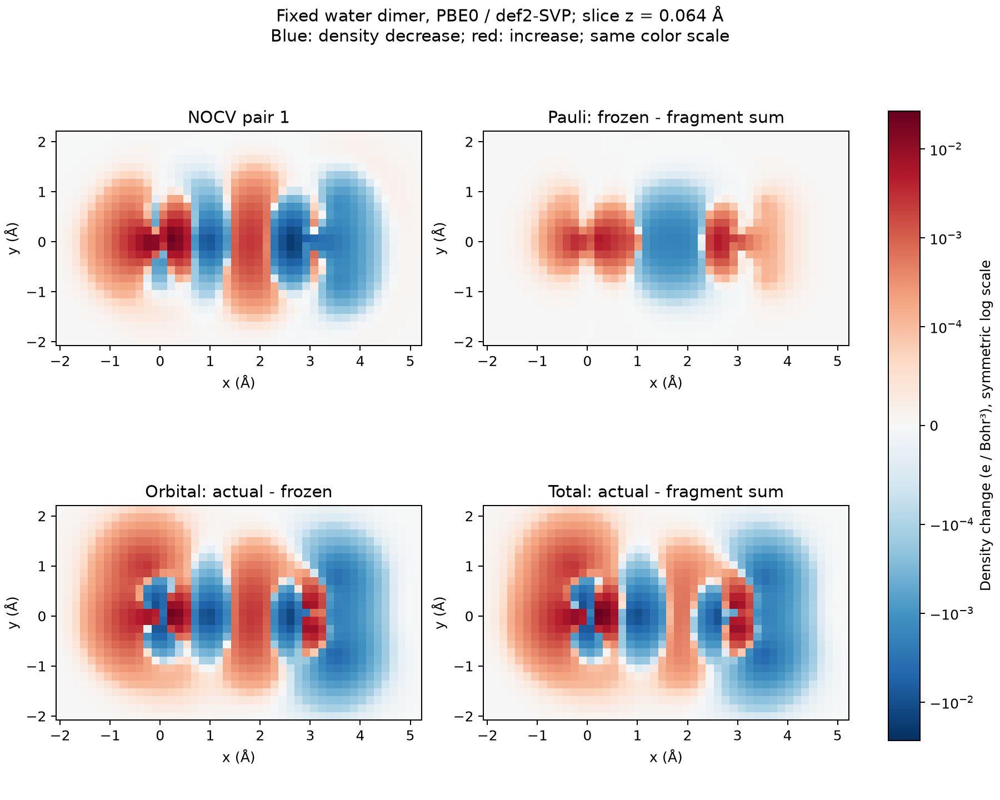

# NOCV 的冻结参考、密度分解与能量近似

**适用环境：通用；示例使用 Multiwfn，原生 EDA-NOCV 路线按所用电子结构程序核对。**

NOCV 将相对于冻结参考态的轨道变形密度分解为一组增、减密度模式。它能把总密度差中混在一起的变化拆开，但模式的含义依赖片段、参考态和能量算符。先确定分解对象，再看图和数值，避免把每一对模式都自动解释为独立化学键。

## 三个参考密度与两步变化

将保持复合物几何的片段波函数嵌入共同 AO 空间，定义片段密度之和 \(P_{\mathrm{pro}}\)。不同片段的占据轨道一般相互重叠，Multiwfn 对其做占据空间的 Löwdin 正交化，构造满足反对称化要求的冻结态 \(P_{\mathrm{frz}}\)。实际复合物密度为 \(P\)。因此

$$
\Delta P_{\mathrm{Pauli}}=P_{\mathrm{frz}}-P_{\mathrm{pro}},\qquad
\Delta P_{\mathrm{orb}}=P-P_{\mathrm{frz}},\qquad
\Delta P_{\mathrm{tot}}=\Delta P_{\mathrm{Pauli}}+\Delta P_{\mathrm{orb}}.
$$

NOCV 分解的是第二项。通常的“整体减孤立片段”密度差还包含第一项，不能直接拿来当同一个轨道变形密度。冻结参考本身依赖片段电荷、自旋、几何与正交化方式；相应准备能还可包含片段几何变形和电子态改变。

## 非正交 AO 中怎样得到 NOCV

若密度矩阵采用 \(\rho(\mathbf r)=\boldsymbol\chi^\mathrm T(\mathbf r)P\boldsymbol\chi(\mathbf r)\) 的约定、AO 重叠为 \(S\)，可先对

$$
B=S^{1/2}\Delta P_{\mathrm{orb}}S^{1/2}
$$

作普通本征分解。将本征矢通过 \(S^{-1/2}\) 变回 AO 表示得到 \(U\)，满足 \(U^\mathrm TSU=I\)，并重建 \(\Delta P_{\mathrm{orb}}=U\,\mathrm{diag}(\nu_i)U^\mathrm T\)。直接把 AO 密度矩阵当作正交矩阵对角化，会得到不同且依赖表示的谱。

对于相同电子数、相同整数占据的两个单行列式投影密度，本征值在相应度量下成正负配对；零模可以存在。若使用一般分数占据或非幂等密度，不能只由迹为零就推出逐项 ± 配对。开壳层按 α、β 通道分别处理，参考片段的自旋标签应与复合物计数对应。

一对 NOCV 的密度贡献为

$$
\Delta\rho_k(\mathbf r)=\nu_k\left(|\phi_{+k}(\mathbf r)|^2-|\phi_{-k}(\mathbf r)|^2\right).
$$

归一化完整空间中，每对积分为零。正本征值描述该模式的密度重排尺度；由于两项可在空间中抵消，正区积分及某片段的净增量通常小于或等于相应尺度，不能把 \(\nu_k\) 直接当作片段间净转移电子数。分区净变化需对指定区域或权重积分。

## NOCV 模式与能量是两层信息

NOCV 本征值不包含能量单位。若提供算符 \(F_*\)，模式能量可按 \(\nu_i\langle\phi_i|F_*|\phi_i\rangle\) 加和，完整和为 \(\mathrm{Tr}(\Delta P_{\mathrm{orb}}F_*)\)。不同算符或能量分解约定得到的数值需分别解释。

ETS 使用冻结态与最终态之间的电子密度路径来估计轨道相互作用能。中点算符对应一种路径积分近似，不是核坐标势能面上的化学过渡态。

Multiwfn 2026.7.15 的便捷 `-2` 路线由最终态轨道反解 Fock/KS 矩阵，使用的是 **最终态算符**；其 pair 能量和应作为该近似下的轨道项，不能直接写成严格的 \(E[P]-E[P_{\mathrm{frz}}]\)、总相互作用能或键解离能。

提供外部矩阵时也要说明它属于最终态、冻结态还是相应中间密度，并对齐 AO 顺序、单位与自旋。完整 EDA 还包含静电、Pauli、色散及可能的准备项，各软件对这些项的归并可不同。需要原生能量分解时，可按 [ORCA 6.1 EDA-NOCV 手册](https://www.faccts.de/docs/orca/6.1/manual/contents/spectroscopyproperties/nocv.html)准备对应任务，不把本篇 Multiwfn 结果当作已经运行该路线。

## 在 Multiwfn 中运行

1. 准备复合物及各片段的相同级别、相同几何/朝向/基组波函数，按连续原子块对应。完整示例复用 [CDA 的同几何输入](../../examples/orca/minimal/orbital-dos-cda/README.md)。
2. 载入复合物，进入 `23`，输入片段数和各文件。当前实现接收相应实数单行列式闭壳层或非限制性输入，限制性开壳层和相关自然轨道有明确限制，按实际提示处理。
3. 初始打印的零能量可能只是尚未计算能量。`-1` 载入外部 Fock/KS，`-2` 从完整正则轨道反解；系数不完整、线性相关严重或自然轨道能量无相应含义时，不能靠填零补齐。
4. `-4` 导出 NOCV 信息；`-3` 仅改打印阈值。用 `6`、`7` 分别导出单个 NOCV 波函数或 pair 密度，用 `8`、`9`、`10` 导出 Pauli、轨道和总变形密度，保持相同网格。
5. 用 `14` 查看 SCPA 轨道及 pair 成分。轨道成分各自归一，pair 成分为带本征值的差，合计为零；它是该系数分配下的描述，不自动等于空间片段净电荷。

**做完 NOCV，能直接继续普通布居分析吗？** 返回主菜单后，内存轨道和“占据”仍分别是 NOCV 及其正负本征值。继续普通 DOS、布居或其他波函数分析前，应重新载入原复合物；负 NOCV 本征值表示分析权重，不是物理负占据或 SCF 错误。

## 水二聚体的密度分解

[配套案例](../../examples/multiwfn/orbital-moments-nocv/README.md)复用固定、未优化的 PBE0/def2-SVP 水二聚体和两个中性单重态片段。48 个 NOCV 对应 24 个 pair，其中第一对本征值约为 `±0.138334`；最终态 Fock 近似的第一对能量约为 `−3.9731 kcal/mol`，所有 pair 合计约为 `−4.6446 kcal/mol`。

独立占据空间正交化和度量谱重建与原生 NOCV 对应；所有 pair 的网格和等于轨道变形密度，Pauli 与轨道两张网格之和在 Cube 舍入精度内恢复总密度差。图中显示实际 `z≈0.064 Å` 层，使用统一的对称对数色标，蓝色为减少、红色为增加。这个有限盒子用于观察空间模式，完整电子数关系由密度矩阵与重叠检查。

## 怎样指认与比较模式

结合增减密度的位置、轨道方向和参考片段，才能指认配位、反馈、σ/π 或片段内部极化。模式编号按本征值等规则排序，并不固定对应某种化学作用；本征值较大也不保证能量贡献更大。近简并模式可在子空间内混合，单张图的形状会改变，比较时应考察相关模式之和。

显示或打印阈值隐藏的小项仍可累积，需保留完整总和和剩余项。比较两个氢键、不同吸附位点或反应路径时，统一片段参照、方法、算符、等值面及模式追踪规则；某个轨道项更负，单独不足以判定总结合更强。可与 [CDA](CDA的片段轨道与电荷分解.md)、[NAdO](键级、模糊分区与NAdO分析.md)及[密度差](密度差、平面平均与电荷位移.md)提供的不同分解互相核对。
