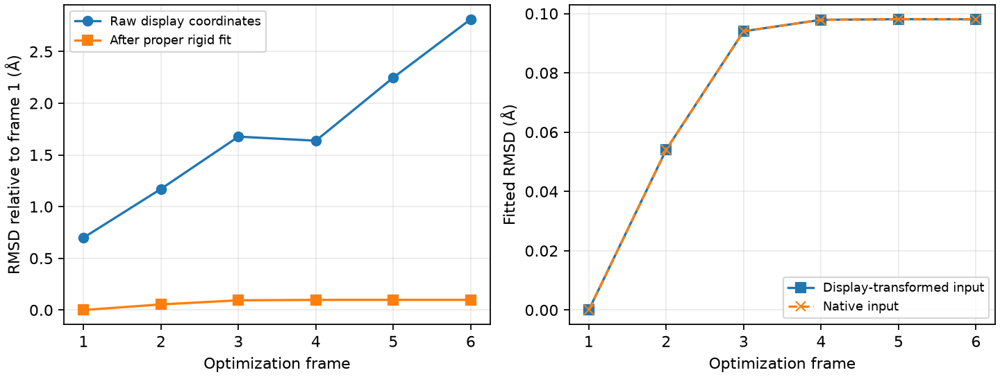
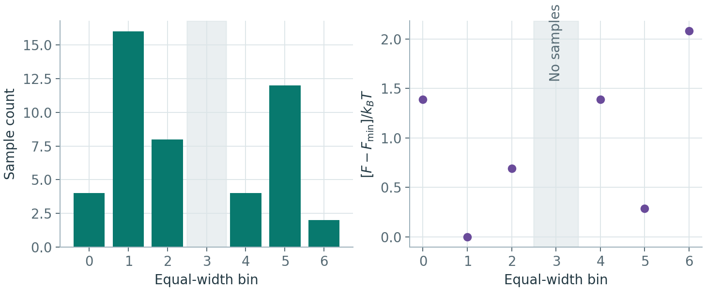

# RMSD、原子映射与轨迹对齐

**适用环境：通用；VMD 命令在其 Tk Console 中执行，配套数值例使用 Python / NumPy。**

比较两个构象时，先确定哪些原子互相对应，再决定要保留还是去掉整体平移、转动。两张图看起来重合、原子数相同或 RMSD 很小，都不能替代这两步。

## 固定原子对应关系再计算

设移动结构中第 $i$ 个原子坐标为 $\mathbf{x}_i$，参考结构中与它对应的原子为 $\mathbf{y}_i$。单位权重的 RMSD 为

$$
\operatorname{RMSD}=\sqrt{\frac{1}{N}\sum_{i=1}^{N}
\lVert\mathbf{x}_i-\mathbf{y}_i\rVert^2}.
$$

这里每一项是三维位移的平方；若对 $3N$ 个坐标分量直接取均方根，会比这个定义小 $\sqrt{3}$ 倍。坐标用 Å 时，RMSD 也用 Å。质量加权或其他正权重采用 $\sum_i w_i\lVert\Delta\mathbf{r}_i\rVert^2/\sum_i w_i$，报告时写清权重，不能直接与单位权重结果混用。

先建立“参考原子 → 移动原子”的映射，逐项核对元素、成键邻接和化学位置。XYZ 只有元素和坐标，同元素原子换序后仍可能通过元素序列检查。不同分子或不同大小的体系，可以比较明确选出的共同骨架，但两组选中原子的数量和对应顺序必须一致。

对称等价原子的置换属于额外的映射搜索。普通固定对应关系的刚体拟合不会替你搜索所有置换；若确实允许交换两个甲基氢或对称位点，记录允许的置换及最终映射。比较反应路径时还要保留原子沿路径的身份，不能逐帧任意换名以压低 RMSD。

## 去掉整体运动后再看构象差异

刚体拟合求解

$$
\min_{\mathbf{R},\mathbf{t}}
\sum_i w_i\lVert\mathbf{x}_i\mathbf{R}+\mathbf{t}-\mathbf{y}_i\rVert^2,
\qquad \mathbf{R}^{\mathsf T}\mathbf{R}=\mathbf{I},\quad\det\mathbf{R}=+1.
$$

公式采用行向量坐标。先减去加权中心，再对坐标交叉矩阵做 SVD，即可得到固定映射下的全局最优刚体旋转。行列式 $+1$ 排除反射，否则可能把不同手性的结构镜像重合。平面分子并不因此需要靠手动预旋转来寻找局部极小；异常拟合应先查原子顺序、选择集合、坐标尺度和软件实现。

三个不共线的对应点通常足以确定一个正常旋转；共线点绕轴的转动存在自由度，单个原子只确定平移。拟合集合退化时，最小 RMSD 可以有意义，但变换对集合外原子的位置未必唯一。不要把秩不足导致的取向不确定解释为化学运动。

拟合集合与统计集合可以不同。例如用芳环骨架确定变换，再把同一个变换应用到整个分子，分别报告骨架和取代基的 RMSD。若只选择环原子，得到的小数值只描述这个环，不能说明取代基也重合。外场、界面法向或实验室坐标轴具有物理意义时，应保留相关取向，另行定义内部几何比较。

## 结构编号与原子编号分别核对

结构生成器的第几个输出、文献采用的异构体编号、坐标文件中的原子序号分别描述不同对象。例如富勒烯的生成顺序可能随算法和筛选条件改变，不能直接拿输出序号代替指定文献体系中的异构体编号。保存生成条件、结构标识及原始邻接关系，再建立各文件之间的原子对应表。

对有限分子或团簇，先用元素组成、原子度数和图指纹筛选候选，再验证完整的图同构。设两份结构的邻接矩阵分别为 A、B，最终映射需满足每个原子都有且只有一个对应原子，并逐对检查 $A_{ij}=B_{p(i)p(j)}$，同时保持元素及任务所需的键属性。只比较一个压缩后的浮点指纹，即使容差很小，也不能替代这种检查；没有匹配、多个候选或多个对称等价映射应分别处理。实现时可参考 [NetworkX 图同构接口](https://networkx.org/documentation/stable/reference/algorithms/isomorphism.html)，其默认比较不含节点和边属性，元素等条件需要显式传入。

拓扑映射确定后，再比较三维几何、手性和关键局部参数。同一连接图可以对应不同构象；结构生成器给出的三维嵌入也只是计算起点，需按目标模型优化。周期体系还要保留晶胞、跨胞连接及像向量，不能把盒内坐标当成孤立分子图直接去重。

## 优化动画突然翻转时先查坐标表示

部分量化程序会在每一步重新确定标准朝向。接近对称或主轴近简并时，几何的细微变化可引起坐标轴大幅翻转；这与原子沿反应路径突然移动是两回事。先比较连续步骤的键长、键角、能量和固定映射下的拟合 RMSD，再检查读取器采用的是输入朝向还是标准朝向。优化步序也不是物理时间，动画播放速度不能用于推断运动速率。

保留原始输出，从同一种朝向字段提取各步坐标，或对提取出的结构副本作刚体对齐。不要通过修改原日志的坐标表标题来混淆字段；原子数、步号、缺失帧及映射应随导出一起核对。若要叠加力、偶极或其它方向量，必须将其变换到同一参考系，不能仅为动画连贯而独立旋转每个数据集。

是否利用对称性加速、是否重新定向、是否约束结构或电子态，是不同设置。已有动画的显示问题通常可在后处理中处理；要探索对称破缺的结构或磁态，则需另行选择初猜、约束和稳定性检查。关闭对称性本身既不保证找到更低能态，也不保证结构必然失去对称性，参数应按实际程序和版本核对。

## 在 VMD 中操作

先分别载入两份结构，查看实际 molecule ID，并把下面的 `0`、`1` 换成对应 ID。此例假定两份文件已按相同顺序排列，所有原子一一对应：

```tcl
set reference_id 0
set mobile_id 1
set ref [atomselect $reference_id "all" frame 0]
set mob [atomselect $mobile_id "all" frame 0]
puts [$ref get {index name element}]
puts [$mob get {index name element}]
if {[$ref num] != [$mob num]} { error "Selected atom counts differ" }
set transform [measure fit $mob $ref]
set whole [atomselect $mobile_id "all" frame 0]
$whole move $transform
puts "RMSD (angstrom): [measure rmsd $mob $ref]"
$whole writepdb mobile-aligned.pdb
$ref delete
$mob delete
$whole delete
```

`measure fit` 返回变换矩阵，`move` 才把它应用到坐标；`measure rmsd` 直接比较当前坐标，本身不执行拟合。程序默认单位权重；如使用 `weight mass`，先检查元素和质量是否正确读入，并在拟合、统计两步使用所需的一致定义。导出的 PDB 只是展示副本，其字段与坐标精度不能替代原始计算文件。

若只拟合骨架，把前两条选择语句中的 `all` 换成各自对应的骨架选择，仍将变换施加到 `whole`。随后新建所需统计集合计算 RMSD。对轨迹逐帧执行时，明确指定参考帧与移动帧；在新副本中操作，避免重复对同一帧施加旧矩阵。

VMD 的 `index` 从 0 开始，`serial` 是文件读入的标签，不能一概当成从 1 开始的坐标行号。`index 8 2 5` 这样的选择表达式也不能保证返回次序就是键入次序；用 `$sel get index` 检查。`measure fit` 的 `order` 列表用于重排第二个选择中的对应项，其编号从该选择内部的 0 开始。使用重排拟合后，统计 RMSD 也必须按同一映射配对，不能随后直接计算未重排的两个选择。

命令细节可查 [VMD measure 手册](https://www.ks.uiuc.edu/Research/vmd/vmd-1.9.4/ug/node139.html)。周期轨迹应先恢复完整分子和连续映像，再决定拟合；直接拟合被盒边界切开的分子会混入跳跃，见[坐标变换与周期拼接](坐标变换、周期拼接与分子团簇.md)。

## 用实际轨迹区分显示变化与几何变化

[配套案例](../../examples/geometry-review/README.md)使用已有 RHF/def2-SVP 水分子优化的 6 帧原生结构，逐帧人为加入不同的显示旋转和平移，再与第一帧比较：



最后一帧直接比较显示坐标得到约 2.813 Å，正确对齐后约 0.0981 Å；对未经显示变换的原生结构做同样拟合，也得到相同的 0.0981 Å。这部分差异来自优化中的内部几何变化。示例中的旋转、平移是人为演示，不是 Gaussian 原生输出，也不是动力学轨迹。

RMSD 没有适用于所有分子的合格阈值。它是整体平均量，局部键长、二面角或少数位点的大变化可能被大量不动原子稀释。按研究问题同时检查关键几何量、最大原子位移和必要的电子态、能量；两个不同电子态也可以有很接近的几何。

## 对齐后做 PCA 与投影自由能

对选定原子的连续轨迹，将每帧坐标组成向量 x，按明确的质量权重或单位权重建立协方差矩阵。PCA 的本征值是对应投影的方差；前 k 项本征值之和除以迹，表示保留的**坐标方差比例**，不是保留的能量、熵或动力学信息比例。大方差方向不一定是慢反应坐标，前两个 PC 也没有固定的解释率。低方差模式仍可能与局部缺陷或反应有关。

先恢复相容周期镜像、原子身份和时间顺序，再选择拟合集合与分析集合。自由分子可去整体平转动，固定基底界面则需保留有物理意义的法向与相对运动；NPT 晶胞变化还需区分应变与内部位移。扩散原子会持续跨胞，盲目包回晶胞或逐帧重排同元素原子都可能制造假相关。不同轨迹比较应投影到同一组基矢和共同中心；各自算出的 PC1 不能仅按名称视为同一坐标。方法与工具入口见 [GROMACS 协方差分析](https://manual.gromacs.org/documentation/2026.1/reference-manual/analysis/covariance-analysis.html)。

对相同温度、相容平衡系综中的无偏样本，选定坐标 z 上的概率密度可定义投影自由能：

$$
F(z)-F(z_0)=-k_BT\ln\frac{p(z)}{p(z_0)}.
$$



示意图的分箱等宽、样本等权，以最高计数格为自由能零点。计数 8 的格比计数 16 的格高 $\ln 2$ 个 $k_BT$。灰带中的格没有样本，因此右图留空。

二维直方图需将计数除以总样本数与各格面积，再按目标权重统计。$-\ln p$ 的相对值是以 $k_BT$ 为尺度的无量纲量；报告每摩尔能量时使用 RT，保留温度与单位。此图是所选坐标、测度和采样系综下的边缘自由能，不自动等于反应势能面或 Gibbs 自由能；非线性坐标变换及其 Jacobian 也会改变概率密度的表示。

有偏采样需按相应方法重加权，不能直接对原始帧数取对数。去掉平衡前数据并检查时间相关、分块稳定性、重复采样与区域间往返；点多可能只是同一停留事件的密集输出。投影中的低自由能盆含许多微观构型，高概率不证明其中任意一帧的势能更低，二维投影相连也不证明存在低势垒的真实通道。

### 空白区域与平滑后的通道怎样解释？

零计数表示当前没有有效样本，不能据此确定一个有限的高自由能。保留掩膜；若为显示设置上限，明确截断并保存原统计。分箱、核密度带宽和伪计数会影响盆深与表观通道，平滑不能补充未访问状态。比较这些设置及统计误差后再读图，避免插值跨过空区制造低自由能盆；概率反演工具可参考 [gmx sham](https://manual.gromacs.org/current/onlinehelp/gmx-sham.html)。
