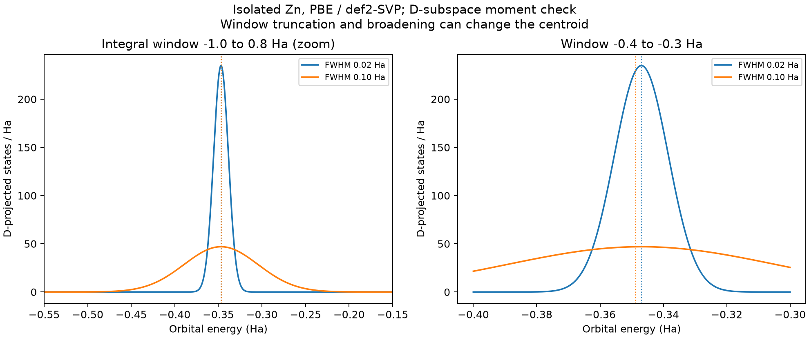

# d 带中心的能窗、参考与比较

**适用环境：通用；DOS 后处理使用 Multiwfn 或已有数值积分工具。**

d 带中心把所选金属原子、轨道投影和能量窗口中的 d 态压缩为一个能量质心。它可帮助比较相近表面的电子结构，但数值依赖投影、占据和参考零点。先把这些条件对齐，再讨论它与吸附趋势的联系。

## 先写清自己算的是哪一个质心

给定 d 投影 DOS \(D_d(E)\)、窗口 \([E_l,E_h]\) 与参考能量 \(E_{\mathrm{ref}}\)，定义

$$
\bar E_d=\frac{\int_{E_l}^{E_h}E D_d(E)\,dE}{\int_{E_l}^{E_h}D_d(E)\,dE},\qquad
\epsilon_d=\bar E_d-E_{\mathrm{ref}}.
$$

若只讨论占据部分，可以限制到相应上界，或在被积函数中加入占据 \(f(E)\)；这与包含目标 d 子空间全部态的质心不同。有限电子温度下更应区分能量截断与 Fermi–Dirac 加权。使用离散投影权重时，相应质心为 \(\sum_i p_{di}\epsilon_i/\sum_i p_{di}\)，同样需要指定求和范围和占据因子。

表面计算常以同一次任务的费米能级为参考。孤立团簇若以 HOMO 对齐，应明确写“相对于 HOMO 的投影能级质心”；把 HOMO 改名为费米能级不会使它成为金属体相的同一种量。跨体系比较绝对能级时，还需统一真空或其他电势参考。

## d 投影包含哪些原子和方向

选择参与目标吸附位点的表层原子、邻近配位原子或整个金属片段，会得到不同质心。应记录原子集合，并区分单原子、分层和全体系的投影。若要分析 `dz²`、`dxy` 等分量，还需固定局部坐标轴；不同吸附方向不能机械沿用全局轴标签。

AO 基组里的所有 D 型函数包含多个径向部分，不等同于唯一的金属 `3d` 原子轨道。某些高能虚态也有 D 投影；应按研究对象定义价层窗口或局部投影子空间，并检查其稳定性。不能一律把高能投影称为无意义，也不能把全能谱所有 D 成分的质心都当作价层 d 带中心。

Mulliken、Löwdin、PAW 投影球等定义不完全相同。Mulliken 投影还可能带符号，若积分分母很小或出现严重正负抵消，其质心就不适合作为稳定的谱描述符。空间 Hirshfeld 分区能给出原子 PDOS，却不能单独拆出 d 角动量，见[轨道成分](轨道成分、基函数与空间分区.md)。

## 展宽什么时候影响质心

对于有有限一阶矩、以零为中心的归一化对称核，完整积分保留离散谱质心。但在有限窗口内，峰的不同尾部被截去，展宽就可能改变分子、分母及最终质心。Gaussian 满足上述全轴条件；Lorentzian 的全轴一阶矩不绝对收敛，使用其质心时应明确有限窗口或其他积分约定。

因此，检查质心时至少改变一次能量范围、展宽宽度和积分网格。比较窗口尾部的投影权重是否可忽略，保留分母和所选态数，不只看一条平滑曲线。

**两个自旋通道的中心可以直接取平均吗？** 合并时应按各自积分权重加权；简单平均 α、β 两个数通常不等于合并 DOS 的中心。

[配套案例](../../examples/multiwfn/orbital-moments-nocv/README.md)使用孤立、中性闭壳层 Zn 的 PBE/def2-SVP 波函数，选择全部 10 个 D 型基函数。它用于核对投影质心算法，不是表面催化模型。左图只放大展示主峰，积分窗口为 `−1.0` 至 `0.8 Ha`；两种宽度得到的中心均约 `−0.346950 Ha`。

右图将积分窗口缩为 `−0.4` 至 `−0.3 Ha`，FWHM 从 `0.02` 增至 `0.10 Ha` 后，原生质心变为约 `−0.348832 Ha`，相差 `0.001882 Ha`，约 `0.0512 eV`。

这是同一波函数、同一投影的截断效应。配套脚本同时用有限窗 Gaussian 的解析积分和原生矩形求和核对，区分连续积分与有限格点求和误差。

## 在 Multiwfn 中取得数值

1. 载入有正确能量和系数的波函数，进入 `10`，用 `-1` 定义投影片段。若选全部 D 基函数，可在片段命令界面用 `l d`；仅选部分金属时结合原子或条件筛选，并查看实际加入的索引。
2. 当前条件选择 `cond` 的“不限制”输入可能要求直接回车，旧例中的字母 `a` 不一定仍有相同含义。先确认非空片段，不能看到程序正常退出就当作已经计算了 PDOS。
3. 明确能量单位、FWHM、窗口、自旋和额外缩放，生成曲线。读取日志中的 `Center of PDOS`，再减所选参考能量；图上 HOMO 线和周期费米能级按各自定义处理。
4. 导出曲线，独立重算一阶矩/零阶矩。该版本原生中心使用包含端点的格点求和；若独立脚本用梯形积分，两者在截断较强的窗口可有小差异。

DOS 单位转换、曲线列及自旋计数见 [DOS 笔记](DOS的展宽、分区与空间分布.md)。已有程序输出周期 PDOS 时，也可以直接积分其数据，不必为一个描述符转换整个波函数。

## 从中心位置到吸附结论

简单 d 带模型把金属–吸附物轨道混合及反键态占据与吸附趋势联系起来，适合在可比的吸附物、位点、配位和电子结构系列内检验。磁性、自旋通道、带宽、谱形、轨道耦合和吸附物能级都可能改变这项相关性；相关方法的磁性扩展见[原始研究](https://doi.org/10.1038/srep35916)。

吸附更强也不自动代表催化更快：覆盖度、活化自由能和产物脱附等步骤共同影响反应。实际材料分析应同时保留目标吸附位点的 PDOS、结构和[吸附能或自由能](相互作用能与BSSE校正.md)，以本系列的数据检验趋势，避免只凭 d 带中心高低排列所有材料的催化性能。
