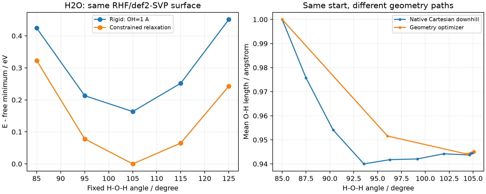
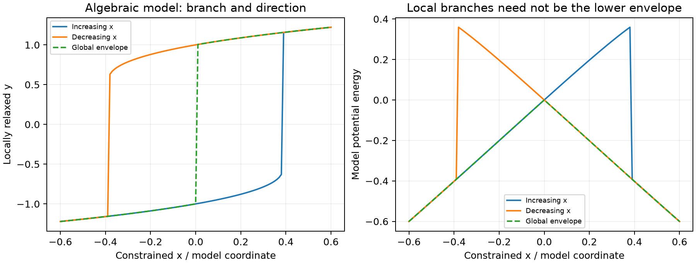

# 势能面扫描、约束与滞后

**适用环境：通用；Gaussian 输入见对应笔记，数值案例使用 ORCA 6.1.1。**

扫描前先定义横坐标改变时哪些自由度保持不变。刚性扫描、约束弛豫、无约束优化和下坡跟踪可以从同一个结构出发，却回答不同问题；只写“做了扫描”不足以让别人复现。

## 固定的是坐标，还是整个片段

| 做法 | 每个点怎样产生 | 得到什么 |
| --- | --- | --- |
| 刚性扫描 | 按明确定义改变坐标，直接算单点 | 选定几何切片上的能量 |
| 柔性/弛豫扫描 | 固定扫描变量，对其余允许变量优化 | 一系列约束子空间中的局部极小点 |
| 无约束优化 | 所有允许自由度按优化器更新 | 一个势能谷中的驻点候选 |
| downhill | 从非驻点按指定度量跟踪负梯度 | 该势能面上的一条下降路径 |

在 Z-matrix 中改变一个二面角，不一定带动预期的整个基团；这取决于后续原子如何引用前面的坐标。整片段平移或旋转时，先列出原子身份，再对全部原子施加同一刚体变换，操作见[坐标变换](坐标变换、周期拼接与分子团簇.md)。

几何中心、质心、原子间距、平面间距和投影距离也不是同一变量。涉及环中心、同步转动或距离组合时，明确数学定义、单位和原子集合，不能只给变量名。周期模型还要保留晶胞、连续映像和片段完整性，见[坐标与周期拼接](坐标变换、周期拼接与分子团簇.md)。

## downhill 的路径参数不是物理时间

从非驻点跟踪质量加权负梯度，可考察指定电子态或外场下的一条下降路径。令 $Q=M^{1/2}R$，按质量加权弧长 s 参数化时，方向满足

$$
\frac{dQ}{ds}=-\frac{\nabla_Q E}{|\nabla_Q E|},
\qquad
\nabla_Q E=M^{-1/2}\nabla_R E.
$$

因此改变同位素质量可改变路径，即使采用的 Born–Oppenheimer 势能面及其驻点坐标未变。它按所选度量连续下降，不包含牛顿动力学中的惯性、初始速度、热浴或热涨落，不能由路径点间距和动画播放速度读出结构弛豫时间，也不能保证到达几何距离最近或全局最低的极小点。

普通优化器为寻找驻点可使用预条件、Hessian 和动态步长，优化迭代记录不必沿这条下降路径。downhill 末端仍应继续优化并检查所需驻点；电子态、外场、冻结区域和路径步长保持明确。若为克服积分失败而关闭校正步，应另检查路径对步长和算法的敏感性，不能只凭能量下降就认为所得中间几何精确。

## 约束优化收敛，不等于全梯度为零

把扫描变量记为 $c(\mathbf R)=s$。在约束面上的极小点，可以有

$$
\nabla V(\mathbf R)=\lambda\nabla c(\mathbf R),
$$

即允许方向的能量导数为零，而约束方向的受力仍不为零。多约束时是相应梯度的线性组合。检查优化收敛应使用该优化器与约束一致的判据；若要宣布无约束驻点，还需释放约束并重新优化、检查模式。

[自建水分子案例](../../examples/orca/minimal/scan-and-descent/README.md)固定 H—O—H 角度，对 O—H 键长作弛豫。85° 点的原始 Cartesian 梯度模约为 0.07631 Hartree/Bohr，去掉角度约束梯度方向后的分量模约为 $3.35\times10^{-5}$ Hartree/Bohr。它已满足相应约束优化要求，但显然不是全空间的零梯度点。

左图中，刚性扫描把两根 O—H 固定为 1 Å；弛豫扫描只固定角度。两者均用同一 RHF/def2-SVP、同一电子态并以自由优化的极小点为零。85° 点弛豫降低约 0.10178 eV；105° 点降低约 0.16342 eV。自由极小点角度约为 105.13165°，所以扫描网格中的最低点仍需进一步定位。

对同一约束值，若真正找到同模型下允许空间中的全局最小值，它的能量不会高于该空间内任意刚性构型。实际局部优化可能落入不同分支或失败，因此观察到“弛豫能量反而更高”时，要先核对结构是否属于同一个约束面、目标电子态、收敛和参考零点。

## 恒力、定距离与展开初猜分别处理

为得到伸展构象，可以逐步增加端点距离并约束弛豫，也可以施加拉伸偏置。若伸长坐标为 q，外力与其共轭且按增大 q 的方向定义为正，恒力模型可写为 $U_F(\mathbf R)=E(\mathbf R)-Fq(\mathbf R)$。优化收敛对应偏置后允许方向的合力为零，不要求原始 E 的梯度为零。恒力可能找不到有限的稳定极小点，或使分支失稳、断键；定距离扫描则可在指定长度下继续得到受限结构，两者不能当作同一组边界条件。

记录拉伸原子／原子组、q 的定义、力的单位、固定端与允许的转动。端点受力、组质心受力与对每个原子施加相同力会产生不同力矩和载荷分布；周期链、薄膜或晶体的应变还需定义晶胞变形和应力，不能用孤立分子的端点距离代替。静态优化曲线也不是给定温度、加载速率下的拉伸动力学或自由能曲线。

用临时点电荷、强排斥或便宜模型展开链，只是生成初猜。恢复目标电荷、势函数、约束和环境后再检查结构；这种模型中的能量、受力和电荷不能沿用为实际材料结果。是否保留伸展约束取决于研究目的，全部释放后结构可能重新卷曲。扫描报错后的最后一帧也需核对它是已接受、收敛的结构还是优化器试探点，不能因外观看起来平直就当作验证通过。

### 移动弹簧中心不等于固定粒子速度

谐和牵引可写为 $U_{\mathrm{bias}}=\tfrac12k[q(\mathbf R)-q_0(t)]^2$，其中 $q_0(t)=q_0(0)+vt$。这里的 v 是偏置中心的变化率，实际 q 会因弹簧伸长、体系响应与热涨落而滞后；它既不是恒力，也不是严格约束 q 按该速度运动。广义偏置力为 $-k(q-q_0)$，并通过 q 对原子坐标的导数分配到各原子；输出的牵引力不等于该组受到的全部净力。

两组质心的距离与沿固定方向的投影是不同反应坐标：前者受力方向随组间连线变化，后者只控制选定投影。参考组未固定时也会响应外力，不能假设两组等速或等位移反向移动。保留组成员、质量／额外权重、方向、周期镜像处理及实际坐标和受力随时间的输出，检查初始偏置是否引入突加载荷。恒力、谐和偏置与约束在不同版本中的关键词和符号应查实际手册，例如 [GROMACS 2026.4 牵引参数](https://manual.gromacs.org/documentation/2026.4/user-guide/mdp-options.html)；不从旧版参数名称推断当前输出列含义。

### 纳米线加载还需定义标距和受力截面

端部原子组质心距离的变化率是两夹持区的相对分离速度，不一定等于每端的速度。定义初始标距 L₀ 后，工程应变率可按该加载坐标的变化率除以 L₀ 计算；夹持区厚度、横向冻结与旋转限制会改变应力集中和断裂位置。保留实际组成员、初始距离及加载方式，不把观看动画时的播放速率当作物理加载速率。

有限纳米线处于真空盒中时，按整个盒体积归一化的压力会随真空量改变。报告应力需说明采用初始还是瞬时截面积、截面如何定义，以及受力来自夹持区反力还是其它统计量；同时给出力–位移曲线更便于核对。温度稳定、结构未散架或断面形状符合直觉，都不足以验证势函数能描述表面重构、塑性与断裂。对比温度、加载速率、尺寸、夹持条件及合理的重复轨迹，再解释结果的适用范围。

## 滞后来自沿哪条局部分支走

连续扫描常用上一个点的结构、轨道作下一点的初猜，这有助于保持分支，也可能把计算维持在亚稳分支。反向扫描可能沿另一条分支返回；即使角度走完一圈，首末几何和能量也未必相同。更小步长能改善分辨率，不保证消除分支选择。

用独立无量纲模型

$$
V(x,y)=\frac14(y^2-1)^2-xy+0.2x^2
$$

说明这一点：固定 $x$、弛豫 $y$，驻点满足 $y^3-y-x=0$，局部极小条件为 $3y^2-1>0$。在 $|x|<2/(3\sqrt3)$ 时存在两条局部极小分支。图中算法沿已有分支继续，到分支消失后跳到另一条；另绘每个 $x$ 的全局低能包络。

正反扫描在约 ±0.38490 的分支终止附近发生跳变，全局包络则在另一位置换支。这是[明确设置的数学模型](../../examples/orca/minimal/scan-and-descent/branch-model.json)，不表示真实分子一定按最近根优化，也不把扫描方向依赖等同于实验热滞后。

**扫描曲线跳变，先加密点数吗？** 先逐点看几何、约束值、电子态与收敛记录，比较正反向及多个合理初猜。必要时把两条分支分别保存。直接连成光滑曲线、只保留低能点或把最高点自动标成 TS，都会丢失当前证据。

## 能量示意图与实际路径曲线分别标注

用横杠表示中间体和过渡态的能量图，横向位置常仅用于排版或表示反应次序；横杠间距不自动等于几何距离、反应时间或质量加权路径长度。折线连接也不提供中间几何及其能量，不能从线段斜率读取受力。若画的是实际扫描、IRC 或 NEB 数据，则写出横坐标的定义与单位，并保留原始采样点。

同一图的各节点采用一致的能量定义、参考组成和零点，区分电子能与指定温度和标准态的自由能。多条反应路径共享节点时使用同一个参考；存在吸附物数目、质子或电子数变化时，补齐相应储库的化学势或反应计量条件。结构标签与已验证的驻点及连接关系对应，不因排版上有一条连线就认定反应通道成立。绘图中的节点位置来自数据，圆整只作用于标签，不能手工挪动纵坐标以改善外观。

## 点数、单位和目标量一起保存

若包含初始结构并作 N 次增量，计划的坐标为 $s_k=s_0+k\Delta s$，共有 N+1 个点。两个独立变量的完整网格通常有 $(N_1+1)(N_2+1)$ 点；同步约束的两个变量则未必构成二维网格。完整一圈是否重复首点，取决于使用的是闭区间还是半开区间。

记录计划点、实际接受点和失败点，不凭帧序号补造未完成的坐标；多维网格按坐标对定位，再排列成矩阵。键长、角度和通用组合变量分别核对 Å、Bohr、度、弧度及显式换算。周期体系还需固定并记录晶胞和所选周期映像。

扫描断键时还要沿途检查电子解、占据和自旋。沿用旧波函数有助于连续性，也可能保留错误解；重新混合初猜则不保证每点都得到目标分支。整体自旋标签翻转与电子结构改变应分别判断，不能直接对所有布居取绝对值后忽略异常。

电子能扫描不是键解离焓、自由能或构象布居。高层级单点可以修正固定几何的能量，但不会自动修复低层级错误的结构、电子态或通道；研究用结果还应做目标方法、基组和采样的针对性检查。

## 优化器与终止判据的补充说明

### 变量上下限与一般几何约束不同

L-BFGS-B 的 B 表示变量边界 $l_i\leq x_i\leq u_i$，不意味着直接支持任意键长、夹角或非线性等式约束；这些条件需合适的坐标参数化或另一种约束算法。边界处的最优点可以有非零原始梯度，例如最小化 $f(x)=x$、要求 $x\geq0$ 时，最优点为 0 而导数为 1。此时应检查相应可行方向或投影梯度，见 [SciPy L-BFGS-B 判据](https://docs.scipy.org/doc/scipy/reference/optimize.minimize-lbfgsb.html)，不能按无约束零梯度要求否定它。

读取优化日志时区分函数／梯度评估次数、线搜索试探点与接受迭代。步数耗尽、线搜索失败和满足收敛条件是不同终止原因，包装脚本不应统一打印成功。自行汇总梯度时，最大绝对分量为 $\max_i|g_i|$，不是 $|\max_i g_i|$；均方根为 $\sqrt{\sum_i g_i^2/N}$，也不同于未除 N 的欧氏范数。阈值与变量、梯度的单位和尺度配套记录，尤其在混用长度、角度或晶胞参数时。

### 无导数优化仍需检查目标函数与残差

没有可靠解析梯度时，可考虑 NEWUOA 等无导数局部方法，但每次函数评估若包含一次电子结构计算，总成本仍可能很高。记录函数评估次数、变量缩放、初始步长／信赖域尺度和终止原因；把终止半径设得很小不等于真实参数误差也同样小。SCF 噪声、态切换或不连续的失败惩罚会影响局部模型，先核对同一点重复求值及目标变化的数值精度，再讨论优化是否稳定。局部方法对初猜的依赖也不会因不用导数而消失。

将方程残差的模或平方最小化时，优化器停止只说明找到了该目标的候选最小值，不保证原方程有根或残差已足够小。单独报告原方程残差；多参数拟合再检查各项残差、权重与参数可辨识性。目标函数值、参数步长和物理量误差是不同判据，不能用一个通用阈值互相替代。
