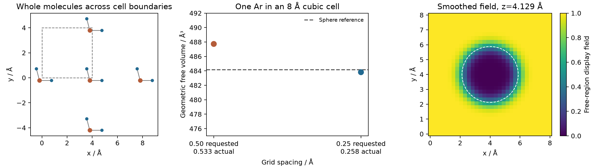

# 坐标变换、周期拼接与分子团簇

**适用环境：通用；操作使用 Multiwfn，核对示例使用 Python。**

对齐分子、拼接跨晶胞的分子和提取邻近团簇，都会改变文件中的坐标表示，却不一定改变同一件事。先说明目的：是换一个观察方向、选择周期镜像，还是要生成新的物理结构。

比较结构变化或去掉动画中的整体转动时，见 [RMSD、原子映射与轨迹对齐](RMSD、原子映射与轨迹对齐.md)。

## 分清刚体变换、镜像与形变

对整个孤立体系作刚体变换，可以写成 $\mathbf r'=R\mathbf r+\mathbf t$，其中 $R^TR=I$、$\det R=+1$。它保持原子间距离、键角和手性。把某一坐标分量取负或交换两个笛卡尔分量则可能得到 $\det R=-1$ 的镜像变换，会改变手性；要把一个方向反过来，优先使用合适的 180° 旋转或直接指定目标负方向。

片段单独旋转、只平移部分原子、缩放坐标或改变晶胞，通常改变了原子间的相对位置，应作为新结构重新检查。对有外电场、固定基底或各向异性边界的模型，即使只旋转分子，也可能改变物理问题。

处理 MD 初态时，速度、约束方向和外场也应按目的同步处理；几何文件旋转成功不代表这些量已经同步改变。

周期体系还应同步处理晶胞。若晶胞矢量按行组成矩阵 $A$，行坐标满足 $X=FA$，整个体系刚体旋转时应使用

$$
X'=XR^T,\qquad A'=AR^T.
$$

只转动原子、不转动晶胞，会改变周期镜像关系。对于斜晶胞，$|\det A|$ 才是体积，不能用三个边长之积代替。

## Multiwfn 的常用操作怎样组合

载入坐标后进入 `300 → 7`。每次操作都作用于内存中的当前结构，可以连续组合；`-9` 恢复最初几何。完成后导出新文件，保留原输入。以下编号按 Multiwfn 2026.7.15：

| 任务 | 入口与需要确认的内容 |
| --- | --- |
| 平移、居中 | `1` 指定原子和位移；`2` 选择几何中心、质心或核电荷中心，再指定定义中心的原子 |
| 转动方向 | `3` 绕笛卡尔轴、键或指定向量旋转；`4` 使用旋转矩阵；检查角度单位和所选原子 |
| 对齐键、向量或平面 | `5` 对齐两原子连线；`6` 对齐指定向量；`11` 对齐拟合平面，查看平面拟合误差 |
| 对齐主轴、偶极矩 | `8` 使用惯性主轴；`7` 需要波函数以计算偶极矩，先核对坐标来源与状态 |
| 重排、增删、随机扰动 | `13` 重排；`15–17` 增删或保留原子；`18` 生成随机位移结构，位移标准差用 Å |
| 周期复制、完整分子与团簇 | `19` 复制晶胞；`20` 拼接完整分子；`25` 提取中心分子及邻近分子 |
| 周期位置与晶胞 | `21` 同步缩放晶胞方向及坐标；`22` 卷入晶胞；`23–24` 沿晶格平移或居中；`26` 设置晶胞 |
| 导出结构 | `-1` XYZ，`-2` PDB，`-3` Gaussian 输入，`-4` CIF |

操作后还要核对几何量与原子映射。惯性主轴在接近简并时方向可能不稳定；线性片段也不能唯一确定拟合平面的法向。可以另指定一个参考键或原子，固定方向与符号，避免逐帧图像突然翻转。

重排后保存新旧原子号映射，同步修改片段、约束、磁矩、原子类型、参数与分析索引。`27` 添加用于展示的边界镜像原子，会增加原子数；这种展示副本不能直接用于周期能量或体积统计，以免重复计数。`28` 的晶轴互换涉及分数坐标分量和晶胞长度，尤其对斜晶胞，不应当作通用刚体旋转；实际变换后检查距离、角度和晶胞度量。

## 几何变了，波函数会不会跟着变

这里的几何模块不会完整同步变换波函数。对局部轨道含有方向性角动量函数的体系，旋转核坐标而保持原来的展开系数，会破坏原文件的对应关系。平移、增删原子、改变顺序或晶胞后，也应分别核对基函数中心、矩阵、轨道及网格是否仍与几何一致。

安全的工作顺序是：用结构副本完成几何操作，导出结构；若后续需要该几何下的波函数，再计算或使用能够完整处理波函数变换的工具。仅为了改变图像视角，可直接旋转查看窗口，避免改动计算数据。

向量和张量也需按同一个约定变换。例如纯旋转下 $\boldsymbol\mu'=R\boldsymbol\mu$、$\alpha'=R\alpha R^T$。带电体系的偶极矩还依赖原点；若 $\mathbf r'=R\mathbf r+\mathbf t$、总电荷为 $Q$，则 $\boldsymbol\mu'=R\boldsymbol\mu+Q\mathbf t$。把旧坐标系中的跃迁偶极矩直接画在新几何上，会得到错误方向。

## 卷入晶胞与拼接分子各解决什么

`22` 将原子选择为晶胞内的周期代表点，可以再次把一个完整分子切到边界两侧。`20` 则根据键连关系选择不同镜像，使分子在笛卡尔空间连续；它允许原子位于原胞外，并不意味着结构错误。

在[跨边界水分子案例](../../examples/multiwfn/geometry-voids/README.md)中，边长 4 Å 的 P1 晶胞里，O 的分数坐标为 `(0.95,0.95,0.95)`，两个 H 分别跨过 X、Y 边界。拼接后两条 O–H 长度分别约为 0.9572、0.9578 Å，原子数仍为 3，位移均为整数晶格矢量。这些条件比“所有原子都在盒子里”更适合验证拼接。

实际晶体还应核对对称等价位置、占据率、无序和缺失原子。仅把一份含不对称单元的坐标当作完整原胞，后续拼接和接触分析都会缺少环境。实验氢位置、环境和弛豫方案的选择见[从实验结构到计算模型](从实验结构到计算模型.md)。斜晶胞可以通过分数坐标卷入，但最短镜像距离一般不能靠笛卡尔坐标逐分量取模得到；卷入代表点与寻找最短镜像不是同一个运算。

## 提取团簇后还要检查什么

在 `25` 中输入中心分子中一个原子号，再设接触阈值。默认示例为 1.2：按相应原子间距离与 vdW 半径和的倍数选取邻近完整分子。它是几何邻近规则，不是相互作用能截断。

上述水晶格教学模型得到中心水及四个平移镜像，共 15 个原子。每个水的内部几何相同、分子间平移为整数晶格矢量；中心原子号从程序输出读取，不对其它晶体假定连续编号。

图左是提取的五个完整水分子在 XY 平面的投影，虚线为原胞；模型用于说明操作，并非水的平衡晶体结构。图中其余两幅解释见[晶体自由空间](晶体自由空间、平滑网格与探针体积.md)。

扩大邻近范围后复查目标 [IGMH](Multiwfn的IGMH片段分析.md)或电势是否稳定。极性、带电晶体还可能需要更远的环境或嵌入模型。有限镜像搜索、共价半径连键和“完整分子”的假设不适用于所有配位网络、聚合物及连续固体；这类体系应先定义局部簇及截键处理。

随机扰动只是生成候选结构，不等于热平衡采样，也不能代替收敛、极小点和振动检查。批量生成时记录随机种子或保存生成的全部坐标，并检查最短原子距离。

## MOL2 转换保留哪些结构信息

MOL2 的 `ATOM` 区记录坐标及原子类型，`BOND` 区记录按原子标识引用的连接和键型；它们比普通 XYZ 包含更多拓扑信息，但转换程序仍可能重新猜键或改写类型。原子名、元素、Tripos 类型和 GAFF 等力场类型不能直接互换，例如 `C.ar` 带有芳香碳的类型含义，`CA` 这样的名称却不能脱离来源判断元素。读取异常时，在分析副本中采用工具明确支持的元素映射，保留原始类型和新旧编号，避免直接覆盖类型后继续当作原力场拓扑。

导入与导出后分别核对原子数、元素、原子标识和连接端点、芳香/酰胺等键型、总电荷及电荷来源。电荷列存在不保证来自量化计算，也不保证可以与当前非键参数搭配；“无电荷”与每个原子电荷为零含义不同。多分子文件还需检查各 `MOLECULE` 块是否完整保留，不能只看到第一个结构就认定转换成功。

周期 MOL2 可含 `CRYSIN` 晶胞信息，但具体读取器可能忽略或在写出时丢失；框中显示了晶胞也不保证输出文件保存了它。用转换前后的晶胞矩阵、距离与周期镜像核对，另存周期方向和所需空间群/对称展开信息。含连接表同样不代表格式完整表达了跨胞键，周期网络仍需保留像向量，不能把单胞内的一组线当作整个无限拓扑。

## 吸附取向与层间几何：距离和夹角分别定义

平面环、片状吸附物或局部表面原子，可用所选原子的最小二乘平面定义取向。至少选三个不共线点；原子明显翘曲时，同时检查拟合偏差，不能只保留一个法向就当整个片段严格共面。近线性片段的平面法向不唯一，微小坐标误差可能令角度剧变。

若单位法向为 $\mathbf n_1,\mathbf n_2$，不区分平面正反面的夹角为

$$
\theta=\arccos\left(|\mathbf n_1\cdot\mathbf n_2|\right),
\qquad 0\leq\theta\leq90^\circ.
$$

数值实现先将点积限制在允许范围，避免舍入误差使反余弦无定义。三点叉积得到的法向会随原子顺序反号；取绝对值适合无向平面夹角，若研究定向翻转则需另定法向符号和连续跟踪规则。它也不同于给定四个原子的有符号二面角。

设两个片段几何中心之差为 $\mathbf d=\mathbf c_2-\mathbf c_1$，其距离 $|\mathbf d|$ 同时包含法向和面内位移。相对于第一个平面，可以分解为

$$
h_1=|\mathbf d\cdot\mathbf n_1|,
\qquad
s_1=\sqrt{|\mathbf d|^2-h_1^2}.
$$

$h_1$ 是第二个中心到第一个平面的距离，$s_1$ 是中心侧向滑移。两个平面不平行时，对第一个、第二个平面计算的高度可能不同；无限延伸的非平行平面还会相交，不能给它们指定一个统一的非零“层间距”。表面粗糙时，说明用整个基底、局部邻近原子还是某个晶面作参考。对平行于晶格矢量 $\mathbf a,\mathbf b$ 的表面，参考法向来自 $\mathbf a\times\mathbf b$，并不总是笛卡尔 Z。

### 怎样只改变高度而保留面内错位？

要改变两个平行片段的间距并保留面内错位，先固定参考平面、中心 $\mathbf c_1$ 与定向单位法向 $\mathbf n$。第二片段中心为 $\mathbf c_2$，当前有符号高度 $z=(\mathbf c_2-\mathbf c_1)\cdot\mathbf n$；将第二片段每个原子统一平移 $(z_{\mathrm{target}}-z)\mathbf n$，即可得到目标有符号高度。使用有符号量能明确片段位于参考面的哪一侧，避免将绝对距离当作位移。平移后核对片段内部距离、相对法向高度与面内位移，并检查碰撞和周期镜像；所得结构是指定高度的候选，不自动成为该高度下的受限极小点。若需受限弛豫，另定义固定的自由度与能量扫描条件。

### 轨迹中的距离与角度怎样读取？

Multiwfn 2026.7.15 可用 XYZ 轨迹进入 `1000 → 201 → 1`，输入总帧数及两组原子号。`distangle.txt` 依次输出帧号、几何中心距离（Å）、第一个平面法向与中心连线的无向夹角、两拟合平面的无向夹角（度）。第三列反映相对第一个平面的错位，不是两平面的倾斜角。选择同入口的 `2` 则输出片段相对 XY、YZ、XZ 平面的夹角。

该入口直接使用 XYZ 中的坐标。分析周期材料前，按一致原子映射将跨边界片段拼接完整，并选择两片段相邻的周期镜像；普通 XYZ 不提供可靠的逐帧晶胞。对变胞轨迹还需逐帧保留晶胞，不能用初帧盒子处理全程。这个入口不能自动替代周期最短镜像或跨界连续跟踪。先核对代表帧与几何，再将帧号按实际输出时间间隔转换为时间；续算拼接、抽帧或不等间隔输出需使用对应时间表。

## 量化翘曲：MPP、SDP 与逐原子高度

若问题是二维片层、共轭骨架或表面局部区域偏离平面多少，可在前述拟合平面上定义有符号距离。令所选 N 个原子的几何中心为 $\mathbf c$，最佳拟合平面的单位法向为 $\mathbf n$，则

$$
d_i=(\mathbf r_i-\mathbf c)\cdot\mathbf n,
\qquad
\mathrm{MPP}=\sqrt{\frac{1}{N}\sum_i d_i^2},
\qquad
\mathrm{SDP}=\max_i d_i-\min_i d_i.
$$

这里最佳拟合是最小化垂直距离平方和，所有选中原子等权；可由中心化坐标矩阵的最小奇异值方向确定法向。MPP 描述整体偏离，SDP 描述上下极端跨度，都使用长度单位。两者与刚体转动、平移无关，却不能区分所有起伏形状：分布相似的不同波纹可有相同数值，应同时保留逐原子 $d_i$ 或空间图。方法定义见[平面性指标原始研究](https://doi.org/10.1007/s00894-021-04884-0)。

对同一等权原子集合，平面穿过几何中心使 $\sum_i d_i=0$，可用以下关系复核导出值：

$$
2\,\mathrm{MPP}\leq\mathrm{SDP}
\leq\sqrt{2N}\,\mathrm{MPP}.
$$

左侧来自有限区间内方差的上界，右侧可由最大、最小距离的平方和不超过 $\sum_i d_i^2$ 得到。明显违反时，先查两列是否来自同一选区、同一帧和同一单位；符合关系也不证明法向或原子选择正确。加权定义、相对固定外部平面的距离和不同原子集合不能直接套用这组等权拟合关系。

载入结构后，在 Multiwfn 2026.7.15 主菜单输入 `MPP`，再输入所选原子号；`a` 选全部原子，`h` 选所有非氢原子。对材料优先明确列出目标层、骨架或表面原子，避免把吸附物、不同层及终止基团一并拟合。输入 XYZ 轨迹后，可选择目标帧或全部帧，`MPP_SDP.txt` 的三列为帧号、MPP、SDP，长度单位 Å。周期镜像和原子对应需预先处理，不能由普通 XYZ 自动恢复。

导出的 PQR 将 $d_i$ 暂存于 `charge` 字段，单位为 Å；这是用于着色的几何量，不是原子电荷。未选原子的该字段为零，也不代表这些原子恰在平面上。保存为独立显示文件，图例写“相对拟合平面的有符号距离 / Å”，不同结构使用一致色标。

### 二维材料和轨迹的额外判断

- **逐层比较**：上下两层即使各自严格平面，合并拟合也会产生非零 MPP。原生双亚层的屈曲结构同样需要按研究目的选择整体层或子层；该指标量化几何，不判断结构是否稳定。
- **去倾斜与固定基底参考**：逐帧重拟合可去除整体倾斜，保留内部翘曲；若要研究片层相对基底的抬升或倾转，还需相对固定基底平面另算高度和夹角。三斜胞表面法向不直接等于 Z。
- **法向和符号**：法向 $\mathbf n$ 与 $-\mathbf n$ 代表同一平面，MPP、SDP 不变，但所有 $d_i$ 会反号。轨迹着色需与基底法向或前一帧连续定向；近线性或拟合方向近简并时，先处理法向不稳定，不能仅靠翻号修复。
- **采样尺度**：比较不同超胞或局部区域时，记录面内尺寸、原子集合和温度。更大的区域可容纳更长波长的起伏；局部缺陷也可能被大量平整原子稀释，故同时查看缺陷邻域和整体层的分布。
- **逐帧统计**：先逐帧计算指标，再对平衡区间统计分布与相关性。正负翘曲可在平均坐标中抵消，因此“平均结构很平”不代表瞬时结构都很平。MPP 也不能直接推导芳香性、带隙或载流子迁移率。

## 均匀方向采样与随机取向

吸附初猜、方向扫描或角度平均中，“均匀”应相对于明确的测度。单位球面的面积元为 $d\Omega=\sin\theta\,d\theta\,d\phi$，因此分别均匀抽取极角 $\theta\in[0,\pi]$ 与方位角 $\phi\in[0,2\pi)$ 会在两极过度取样。可独立抽取 $u\in[-1,1]$、$\phi\in[0,2\pi)$，令

$$
\mathbf n=\left(\sqrt{1-u^2}\cos\phi,
\sqrt{1-u^2}\sin\phi,u\right).
$$

这里 $u=\cos\theta$ 均匀分布，得到的是按面积均匀的**方向**。方向平均可对这些点等权求平均；规则经纬网则通常需要面积权重。随机点在有限样本中会有空隙和聚集，不能因肉眼看来不等间隔就判定分布不均匀；可检查 $u$ 的直方图及 $\langle n_i\rangle\approx0$、$\langle n_in_j\rangle\approx\delta_{ij}/3$，并随样本数检查目标量的稳定性。

完整刚体取向还有绕自身轴的转角。将某条分子轴对齐到 $\mathbf n$ 只确定两个自由度；若吸附物不具轴对称性，还需处理第三个转角。可使用 [SciPy `Rotation.random`](https://docs.scipy.org/doc/scipy/reference/generated/scipy.spatial.transform.Rotation.random.html)生成 SO(3) 上 Haar 均匀的旋转，按版本设置随机数生成器或种子；分别随机转动三个笛卡尔轴的角度，一般不能得到这种均匀分布。

对表面吸附，允许的半空间、碰撞排除、位点对称性和分子对称性都应另外定义。拒绝与基底重叠的构型后，保留下来的是经过该几何筛选的分布；它仍不是按吸附能或自由能加权的热平衡分布。随机取向适合扩展初猜覆盖，后续分别弛豫、去重和比较能量。统计方向平均时，则保留采样测度、筛选规则、权重与误差，不能只平均找到的几个最低能构型就称为均匀平均。

## VMD 近邻选择：选中原子与重建镜像是两步

先核对 `element`、`name`、`resid`、`fragment` 等属性是否由输入可靠提供，或只是读取器推断。`water`、`ion` 等预定义选择并不自动识别任意命名的材料组分。`fragment` 依赖当前键连关系；对金属、配位网络或连键缺失的文件，不能无条件把它当作化学上独立的分子。

以下用内部 `index 10` 表示已经核对的目标原子，距离单位为 Å；实际分析时换成目标原子或原子组。

| 选择语句 | 含义与检查 |
| --- | --- |
| `within 5 of (index 10)` | 当前坐标下距离目标 5 Å 内的原子，包含满足条件的目标本身 |
| `exwithin 5 of (index 10)` | 当前坐标下的近邻，并排除目标选择自身 |
| `pbwithin 5 of (index 10)` | 周期近邻选择，需有正确的当前帧晶胞与版本支持 |
| `same fragment as (within 5 of (index 10))` | 将近邻扩展为当前连键定义下的完整片段，不是按能量选择重要片段 |

`same residue as (...)` 则按内部残基身份扩展，和 `same resname as (...)` 选同名残基不同；相同 `resid` 标签还可能在不同链中重复。相关语义见 [VMD 选择说明](https://www.ks.uiuc.edu/Research/vmd/current/ug/node97.html)。材料若没有可靠的分子或残基标签，先建立明确原子列表和连键，不凭默认分类导出模型。

周期选择只确定哪些已有原子满足近邻条件，不自动输出它们的最近镜像坐标。导出局部簇之前仍需连续拼接、选择镜像并核对距离；只把选中原子原样写出，可能得到被盒子切开的簇。表面模型还要核对所用选择是否按预期处理各周期方向，不把真空方向的显示副本计为额外邻居。

轨迹中的距离与坐标选区会随帧改变。图形表示需开启逐帧更新；Tcl 的选择对象切换帧后，还需按接口调用 `update` 重新求成员，见[官方 atomselect 用法](https://www.ks.uiuc.edu/Research/vmd/vmd-1.8.3/ug/node177.html)。记录每帧成员与数量：动态邻居适合统计接触环境，固定身份集合适合跟踪原子、RMSD 或相应位移，两者不能因得到的数组长度相同就混用。

## 查看器中的编号与计算原子号怎样对应

VMD 的内部 `index` 从 0 开始。对未经重排、删除或复制且按原顺序载入的结构，计算输入中的第 n 个原子通常对应 `index n-1`；先用元素、邻接关系和坐标核对几个标志原子，再建立完整对应。`serial`、PDB 文件里的序号字段和查看器内部索引也需分别确认，不能在存在断号或重号时直接互换。

可在 VMD 的原子标签中显示编号，按所用版本的标签格式选择零基或一基显示，操作入口见[官方标签说明](https://www.ks.uiuc.edu/Research/vmd/vmd-1.8.7/ug/node45.html)。标签只是显示文本：即使图上显示为从 1 开始，`index` 选择仍按内部编号处理，不能把标签格式变化当成原子已重新编号。多个载入模型还各有 molecule ID，创建或查询标签前先确认目标模型。

由裁剪簇、超胞或边界镜像得到的新结构，应保存“新编号—原始编号—晶格平移”对应；同一个原始原子的不同镜像需要用平移向量区分。对波函数、约束、磁矩、片段定义和逐原子结果表一起检查映射，避免把可视化副本的编号直接写回原计算。正式图中只标需要讨论的位点，图注说明编号来源；内部核对可以显示全部编号，但不必将拥挤的标签图作为最终结果。

### 连接表与显示连线分别核对

PDB 的 `CONECT` 使用文件原子序号声明连接；VMD 内部连接表使用内部索引，不能在序号断号、重排或裁剪后直接做减一转换。读取行为还取决于版本、插件和构建：[官方 PDB 插件源码](https://www.ks.uiuc.edu/Research/vmd/plugins/doxygen/pdbplugin_8c-source.html)包含受编译选项控制的 `CONECT` 路径，不宜沿用旧教程中“一律不读”的结论。加载后用实际连接表核对几个已知连接及本不相连的近邻，必要时提供独立拓扑；仅看文件里有 `CONECT` 不足以证明查看器已按它显示。

Tcl 选择对象的 `getbonds` 返回每个选中原子的邻居索引列表，`setbonds` 则逐原子设置列表，见[接口说明](https://www.tcbg.illinois.edu/Research/vmd/current/ug/node122.html)。编辑时检查双向一致、重复项和索引范围，并保存可重新载入的拓扑。距离绘制的 DynamicBonds、手工连线和真实连接表可能不同；尤其 `fragment` 选择依赖连接关系，改线后应重新核对片段成员。表面网格顶点借用 PDB 显示时，其边是三角网格边，不是化学键；任何显示连接都不能代替键级、密度拓扑或成键能量分析。

### 结构与标量场切片使用同一投影

将原子结构叠在密度、ELF 或势的平面图上时，先记录切面原点 $\mathbf o$、两条正交单位面内轴 $\mathbf e_1,\mathbf e_2$ 及法向 $\mathbf n=\mathbf e_1\times\mathbf e_2$。原子的图上坐标为 $u=(\mathbf r-\mathbf o)\cdot\mathbf e_1$、$v=(\mathbf r-\mathbf o)\cdot\mathbf e_2$，离面高度为 $w=(\mathbf r-\mathbf o)\cdot\mathbf n$。结构投影与场采样采用同一坐标系、单位、范围及轴方向，图中保持横纵轴等比例；不通过分别拉伸图层去凑合原子位置。

投影到切面的原子不一定实际位于切面内。按明确的离面距离筛选标签，或用符号、透明度和图注区分面上与面外原子；三维球棍叠图采用正交投影，并核对多个不共线标志点。透视投影会让不同深度处缩放不同，无法靠一次统一缩放与二维切片处处重合。沿用原场数据时不要只旋转原子坐标；应变换完整数据，或在原坐标系中定义切面。显示连线用于辨认结构，不自动成为切面内的键径或场特征。
