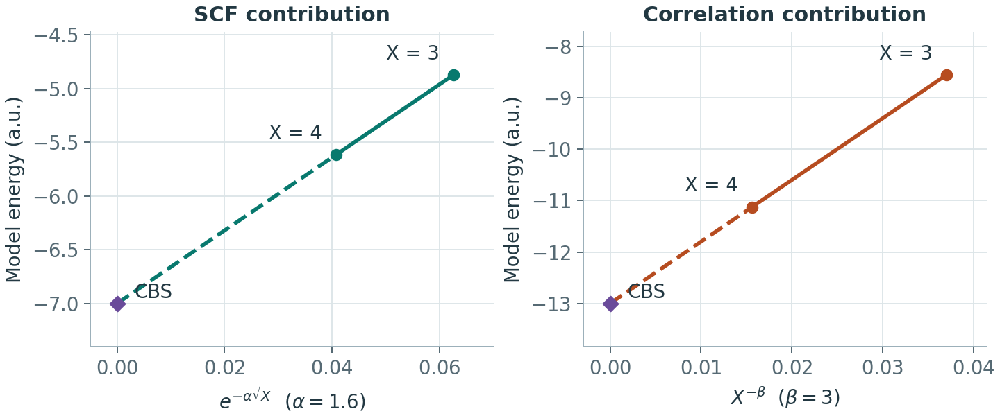

# 基组收敛与完备基组外推

**适用环境：通用；外推公式以分子相关一致性基组的能量计算为例。**

基组收敛测试问的是：继续扩大轨道空间，目标能量差或性质还会变多少？完备基组外推（CBS）进一步用有限几个基组点估计极限。外推仍依赖模型与拟合形式，不能把标有 `CBS` 的数值直接当作精确解。

## 先定义要收敛的量

若研究反应 $\mathrm A+\mathrm B\rightarrow\mathrm C$，应在每个基组级别计算同一定义的

$$
\Delta E(X)=E_\mathrm C(X)-E_\mathrm A(X)-E_\mathrm B(X).
$$

固定几何、电子态、冻结核和相对论处理后，按同一基组系列增大 `X`，记录目标差值及相邻级别的变化。目标精度应小于要讨论的化学效应；只观察某个分子的总能下降不能替代这一步。

测试记录至少包含基组的实际定义、显式与相关电子数、SCF 阈值、积分与辅助基组、局域关联阈值和目标能量差。若这些设置同时改变，就难以区分基组误差与其他误差。

## 区分基组、网格与物理模型

| 调整 | 主要减少什么误差 |
| --- | --- |
| 同系列 DZ → TZ → QZ | 轨道基组不完备性 |
| 增加弥散或芯价函数 | 特定空间区域或电子相关描述不足；应采用相应系列 |
| 提高 DFT 积分网格、收紧 SCF | 数值积分与迭代误差 |
| 收紧 PNO 等局域阈值 | 局域电子关联近似误差 |
| CP2K 提高 `CUTOFF` / `REL_CUTOFF` | GPW/GAPW 中相应网格表示误差 |
| 换泛函、关联方法或赝势 | 改变理论模型，需另行验证 |

平面波截断能收敛与高斯基组的基数外推采用不同变量。不能把 VASP 的 `ENCUT` 或 CP2K 的 `CUTOFF` 代进下文的 `X`。

## 基组选择以目标性质为准

价层多重 ζ 增加径向灵活性，极化函数增加角向灵活性，弥散函数扩展尾部描述；它们改善不同方面，不能只按总基函数数目给所有任务排序。电子相关能、阴离子或 Rydberg 态、响应性质和核附近性质的要求也不同。先确认目标电子态与所需空间，再采用为相应方法和性质构造的基组系列；轨道基组、密度拟合辅助基组和 ADMM 基组分别核对角色与匹配关系。

以较小基组优化、较大基组做单点是一种成本分配方案，是否足够仍由目标结构、软模式、能垒和能量差判断。频率统一缩放不能消除任意模式的基组误差，更不能修复因较小基组而改变的驻点、电子态或氢键构型。需要较高精度时，选代表结构比较几何、受力和关键频率，而不是将“优化不需要大基组”当作固定上限。对响应或弥散态，增加普通价层 ζ 也不保证替代所需的尾部函数。

### 周期 Gaussian 基组：收缩方式与条件数一起检查

致密周期体系中，延展函数在不同原子和镜像间重叠，可能增加线性相关、积分成本和 SCF 困难。但“含弥散原始函数”与“添加独立、很松的弥散基函数”不同：CP2K 的 MOLOPT 使用包括弥散指数的收缩构造，面向气相、界面和凝聚相；SR 变体减少原始函数并缩短范围，见[基组原始研究](https://doi.org/10.1063/1.2770708)与[官方数据文件说明](https://github.com/cp2k/cp2k/blob/master/data/BASIS_MOLOPT)。不能据有无某个小指数，就一律判定周期基组可用或不可用。

表面吸附物、孔道客体、带电缺陷与体相致密区域可能对空间延展有不同需求。比较相容的基组及势，记录目标性质、重叠特征值或实际删去的子空间、电子收敛和耗时；遇到问题先定位，不直接删除全部弥散函数，也不靠极小阈值保留病态空间。混合基组时保持同一反应或吸附比较中的原子分配规则一致，并检查活动区扩大和 BSSE；某个布居方案对基组敏感时，另查分析定义，不能为得到整数电荷或平滑键级而牺牲原电子结构所需的空间。

## 为什么把 SCF 能与相关能分开

对以 HF 为参考的相关方法，可以写成：

$$
E_\mathrm{tot}(X)=E_\mathrm{SCF}(X)+E_\mathrm{corr}(X).
$$

两部分的收敛速度不同。常见模型之一是

$$
E_\mathrm{SCF}(X)=E_\mathrm{SCF}(\infty)+A e^{-\alpha\sqrt X},
\qquad
E_\mathrm{corr}(X)=E_\mathrm{corr}(\infty)+B X^{-\beta}.
$$

另有使用 $e^{-\alpha X}$ 等形式的 SCF 外推，参数不能跨公式挪用。$\alpha$、$\beta$ 的选取取决于基组家族、两点组合与方案；用双 ζ/三 ζ 得到的估计不应自动视为与三 ζ/四 ζ 同样可靠。

给定两个基数 $Y>X$，相关能的两点公式为：

$$
E_\mathrm{corr}(\infty)=
\frac{Y^\beta E_\mathrm{corr}(Y)-X^\beta E_\mathrm{corr}(X)}
{Y^\beta-X^\beta}.
$$

对上述 SCF 形式，令 $f_X=e^{-\alpha\sqrt X}$、$f_Y=e^{-\alpha\sqrt Y}$，则

$$
E_\mathrm{SCF}(\infty)=
\frac{f_X E_\mathrm{SCF}(Y)-f_Y E_\mathrm{SCF}(X)}{f_X-f_Y}.
$$

分别外推后再相加。程序输出中的相关能须按所用方法定义提取，避免把总能误当成相关能再次相加；自旋分量缩放、微扰三激发或复合方法也要按其方案拆分。

用示意能量分别画出两个外推模型。横轴的零对应 $X\to\infty$，由 $X=3$ 和 $X=4$ 两点延长直线即可读出纵截距。

### 先求差再外推，与先外推再求差一样吗？

对固定基数组合和固定参数，上述两点外推都是输入能量的线性组合。因此，各物种采用同一套系数时，先分别外推再按化学计量数求能量差，与先求同一能量分量的差再外推，应在舍入误差内一致，可用来检查数据提取和符号。

若每个物种独立拟合 $\alpha$、改变外推点或采用不同近似，系数不再相同，这个等价关系便不成立；也不能把分别外推 SCF/相关能的步骤简化成对总能随意套一个指数。

## 实际安排一组外推计算

1. 选定适合方法的系统基组系列，例如相关能计算中的 `cc-pVXZ`；是否加 `aug`、是否使用 `-PP` 或芯价系列由任务决定。
2. 固定一组几何，并在全部反应组分上保持相同的电子、相对论和近似设置。冻结核变化应作为独立测试。
3. 计算所选两点或三点，检查每个任务正常结束、SCF 与相关步骤收敛、电子态相符。
4. 保存原始分量，明确外推公式、基数组合和参数来源。将更大基组点或另一组合的结果作为复查，而不是仅报告外推后的一个数。
5. 弱相互作用还应比较 [BSSE 校正](相互作用能与BSSE校正.md)前后及其随基组的变化。有限基组外推和 CP 的组合必须按同一方案用于所有组分。

ORCA 6.1 手册将旧的内置自动 `Extrapolate` 功能标记为弃用，并建议采用维护中的 [CompoundScripts 外推脚本](https://github.com/ORCAQuantumChemistry/CompoundScripts/tree/main/EnergyExtrapolation)。选脚本时核对适用版本、支持的方法与输出分量，不把旧教程中的关键词直接套入新版本。

## 高低层级组合的误差放在哪里

为了降低代价，有时以低层级的大基组结果加高层级的小基组增量：

$$
E_\mathrm{high}^{\mathrm{CBS}}
\approx E_\mathrm{low}^{\mathrm{CBS}}
+\left[E_\mathrm{high}^{\mathrm{small}}-E_\mathrm{low}^{\mathrm{small}}\right].
$$

例如以 MP2/CBS 为基础补入 CCSD(T)−MP2 增量。它假设增量的基组依赖较弱，需要在代表性结构上检验；强多参考、异常收敛或态性质变化时尤其要重新判断。外推与增量也不会自动消除冻结核、局域阈值和溶剂模型误差。

### 怎样组合高层级能量与低层级热修正？

几何与热修正可以在较便宜的层级计算，再在同一几何上做高层级单点。常用的自由能组合为

$$
G_\mathrm{comb}\approx E_\mathrm{high}
+\left(G_\mathrm{low}-E_\mathrm{low}\right).
$$

括号内已经含零点能和相应热修正，若再加一次零点能就会重复计入。应记录几何层级、单点层级、温度、标准态、溶剂条件与低频处理。若更高层级改变了构象、电子态或驻点性质，原结构上的修正也需复查，见 [ORCA 优化与频率](../ORCA/基础与结构/ORCA几何优化与振动频率.md)。

本仓库的[水分子 HF/MP2/CCSD(T) 案例](../../examples/orca/minimal/correlated-methods/README.md)固定在同一个 `cc-pVDZ` 基组，适合学习能量分量和冻结核；基组收敛测试需另行建立多级基组计算。
