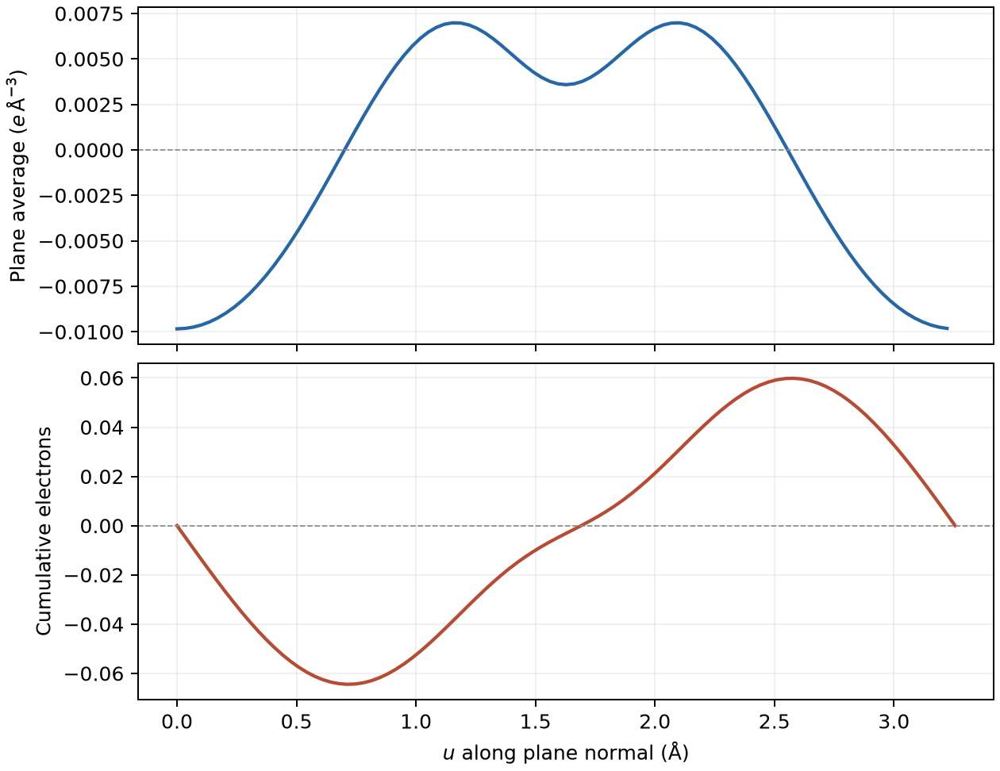

# 密度差、平面平均与电荷位移

**适用环境：通用；Multiwfn、VESTA/VMD 或 Python 后处理按各自环境运行。**

密度差描述目标体系相对于指定参考的电子重排。三维等值面适合找变化发生的位置，平面曲线适合沿选定方向比较，累计积分则给出分界面一侧电子数的净变化。三者的定义和单位应一起说明。

## 先定义参考，再做相减

片段相互作用常用：

\[
\Delta\rho(\mathbf r)=\rho_{AB}(\mathbf r)-\rho_A(\mathbf r)-\rho_B(\mathbf r).
\]

这里 \(\rho\) 表示电子数密度，正的 \(\Delta\rho\) 为相对参考的积累，负值为耗尽。A、B 通常保持它们在 AB 中的核坐标；参考的电荷、自旋、基组、周期边界和外场也需定义。分别优化片段后再相减，会把几何变化与相互作用引起的重排混在一起。

其他研究问题可选不同参考：激发态减基态、带电态减中性态、外场下减零场。比较电子态时保持同一几何才能隔离纯电子变化；若同时改变几何，则应按实际比较目的解释。不同模型的绝对密度之差可以研究方法差异，不能直接称为同一模型的激发或成键密度差。

积分应满足：

\[
\int\Delta\rho\,d^3r=\Delta N_e.
\]

AB 与片段参考总电子数相同，右端为零；比较电离或电子附着时则应与实际电子数差一致。积分接近零本身不能证明差分正确，整体错位的两个等电子数网格也可能满足它。

## 原子叠加参考与吸附片段参考回答不同问题

变形密度常采用实际密度减去选定自由原子密度的叠加。对表面 A 与吸附物 B，若两者使用完全相容的原子参考，则有恒等式

$$
\rho_{AB}-\sum_a\rho_a^{\mathrm{ref}}
=\underbrace{\rho_{AB}-\rho_A-\rho_B}_{\text{整体相对片段的重排}}
+\underbrace{\rho_A-\sum_{a\in A}\rho_a^{\mathrm{ref}}}_{\text{表面片段的变形密度}}
+\underbrace{\rho_B-\sum_{a\in B}\rho_a^{\mathrm{ref}}}_{\text{吸附物片段的变形密度}}.
$$

因此，原子参考图中的一块积累区可以包含表面或分子原有成键的贡献；它不必由吸附过程新产生。讨论吸附引起的变化时使用整体减固定几何片段，讨论相对原子叠加的成键重排时使用变形密度，并在图注写出公式。分别用两个参考作图可以互补，但不应把它们的积分量放在同一列中直接比较。

原子参考还要说明电荷、电子态、芯/价密度以及角向平均约定。开壳层原子的某个定向电子态或单行列式可能有非球形密度；若要构造无优先方向的自由原子叠加参考，应使用定义明确的球平均密度或相应系综，而不是随意把某条 p、d 轨道轴对准材料中的某个键。改变原子组态、径向密度或芯数会改变参考，不能仅为了使图形对称而换成另一套模型后省略说明。

VASP 从原子密度叠加构造初猜与最终自洽密度是两个阶段，见 [ICHARG 定义](https://vasp.at/wiki/ICHARG)。使用程序生成的原子叠加参考时，核对其势数据集、显式电子数、网格与实际使用的打印量；它不等于分别计算并收敛表面片段和吸附物后的密度之和。也不宜把孤立分子的全电子原子数据库直接减到周期 GPW 或 PAW 价密度上。

涉及色散修正时，区分固定几何的电子响应与几何间接效应。例如 [DFT-D3](https://vasp.at/wiki/DFT-D3) 这类纯粹加在总能量上的、由原子几何决定的色散项，在固定核坐标下不进入 Kohn–Sham 势，通常不直接改变自洽密度；若它改变了优化结构，再比较两份密度便同时包含结构效应。非局域密度泛函或带自洽密度依赖的修正需按各自实现判断，不能把这一结论扩展到所有名称含“范德华”的方法。

## 网格一致性与单位

相减前比较物理量、原点、网格尺寸、三个步进向量、坐标单位、密度单位以及原子位置。网格点数相同而晶胞或原点不同，仍不能逐点相减。统一模型与打印设置，保留原始网格；确需插值时记录插值方法，并重新检查积分和局部误差。

VASP CHGCAR 的规则网格值与体积有比例关系。若原始数值为 \(d_{ijk}\)，密度为 \(d_{ijk}/V\)，体素体积为 \(V/N_{\mathrm{grid}}\)，所以电子数为原始数值的平均。不要在已经转换为实际密度的读取结果上再次除体积。总密度、自旋密度和 PAW 占据块也需分开读取，见[CHGCAR 定义](https://www.vasp.at/wiki/index.php/CHGCAR)。

Cube 的坐标单位不自动规定数值场的单位。Multiwfn 常以原子单位导出密度，换成电子数/ų时要除以 \(a_0^3\)；只把横坐标由 Bohr 改为 Å，不会自动把纵轴的密度或截面积分一起换好。密度、长度、面积与积分采用一套相容单位。

赝势价密度、补芯密度和平滑密度不是同一种数据，差分时保持一致。CP2K 的 GPW 与 GAPW 密度导出选项见[软件教程](../CP2K/电子结构与响应/CP2K密度差与平面曲线.md)。

## 三条曲线分别表示什么

先考虑 xy 截面面积固定为 \(A\)、沿 z 方向积分的模型：

\[
\lambda(z)=\int_A\Delta\rho(x,y,z)\,dx\,dy,\qquad
\overline{\Delta\rho}(z)=\frac{\lambda(z)}{A},
\]

\[
Q_e(z)=\int_{z_0}^{z}\lambda(z')\,dz'
=A\int_{z_0}^{z}\overline{\Delta\rho}(z')\,dz'.
\]

| 曲线 | 含义 | 密度使用电子数/ų时的单位 |
| --- | --- | --- |
| 平面平均 \(\overline{\Delta\rho}\) | 截面的平均密度变化 | 常标作 \(e/\text{Å}^3\) |
| 截面积分 \(\lambda\) | 单位法向长度内的电子数变化 | 常标作 \(e/\text{Å}\) |
| 累计 \(Q_e\) | 从起点到分界面的电子数净变化 | 电子数，常标作 \(e\) |

电子数本身是计数；图中的 \(e\) 用于表明电子数量。若要表达电子电荷的变化，则为 \(\Delta q=-eQ_e\)，符号与电子数变化相反。正的 \(Q_e\) 表示分界面左侧相对参考积累电子；在总电子数守恒时，等效于电子从右侧向左侧重排。

不同横向面积的超胞可以有相同平面平均，却有不同截面积分和累计电子数。比较覆盖率、不同表面积或重复分子数时，应按总量、每个吸附物或单位面积选择归一化，并明确写出。

## 怎样读转移量

在给定参考态与分界面 \(z_*\) 下，可以报告 \(Q_e(z_*)\)。同时说明坐标方向、起点和分界依据；片段间的低密度区或有物理定义的边界可作为选择依据，不应自动把全曲线最大值当作片段转移电子数。

曲线包含片段内极化，也包含跨边界的净重排。原子 Bader/Hirshfeld 电荷、平面分区和轨道分解采用不同划分方式，结果无需逐项相同；应比较各自定义下的结论。该分界思想也用于[电荷位移分析研究](https://pubs.rsc.org/en/content/articlehtml/2015/sc/c5sc02971f)。

分别计算两态原子电荷时，分区边界或模糊权重也可能改变，不能无条件把电荷差等同于固定区域内的密度差积分，见[原子与片段电荷](原子电荷、片段电荷与方法选择.md#电荷变化与密度差积分何时相同)。需要解释双向轨道通道或激发态特征时，按[电子转移方法选择](电子转移、极化与分析方法的选择.md)补充相应分析。

有限孤立体系的积分起点应在密度变化可忽略的区域。周期晶胞没有天然的“负无穷”，移动起点会改变累计曲线的零点与中间数值。对含真空的 slab，可在合适真空区设起点；对体相晶体，应直接说明采用的晶胞切分，不将其累计曲线解释为唯一的原子电荷。

## 斜晶胞沿晶面法向积分

晶胞向量不正交时，数组的第三轴通常对应分数坐标 \(s_3\)，并不等于笛卡尔 z。对平行于 \(\mathbf a,\mathbf b\) 的切面，面积和法向高度为：

\[
A_{ab}=|\mathbf a\times\mathbf b|,\qquad
h=\frac{V}{A_{ab}},\qquad u=s_3h.
\]

在固定 \(s_3\) 的切面求网格平均，可得到 \(\overline{\Delta\rho}(u)\)，截面积分为 \(A_{ab}\overline{\Delta\rho}(u)\)。若第三方向有 \(n_3\) 层，完整周期网格的层间法向距离是 \(h/n_3\)，从而：

\[
Q_{e,k}\approx\sum_{j=0}^{k}
\overline{\Delta\rho}_j A_{ab}\frac{h}{n_3}.
\]

该累计和对应每层的上边界；不重复周期网格末端。完整三维积分应与最后一个累计值相同。面积不能直接写成 \(|\mathbf a||\mathbf b|\)，法向高度也不能直接写成 \(|\mathbf c|\)。

Multiwfn 的网格处理可按菜单生成平面平均、局部积分与累计积分曲线，但应核对所选方向和当前网格是否满足功能条件。任意斜网格能读入，不代表所有按笛卡尔 X/Y/Z 切片的功能都适用。可使用支持晶格几何的后处理；下列 NaCl 案例给出了保留向量和体积因子的实现。

## 用已有 NaCl 密度结果对照

[VASP 差分密度案例](../VASP/电子结构与成键/VASP差分电荷密度.md)已经定义整体和中性周期片段，并保存电子数核对方式。配套[平面曲线脚本](../../examples/vasp/minimal/charge-density-difference/plane_profile.py)读取其单场 `cdd.cub`，沿第三分数坐标方向计算平面平均、截面积分和累计电子数：

```bash
python3 plane_profile.py cdd.cub --density-unit e/bohr3 --axis 3
```

在案例工作目录运行，依赖沿用原案例。`--axis 3` 选择网格第三向量，实际积分方向为另两个向量张成平面的法向。输入单位必须显式指定；输出表同时保留采样平面的位置和累计层上边界的位置，元数据记录法向、面积、层距和输入摘要。



图基于既有三维差分网格，由配套脚本生成；该体相周期模型没有真空分界，也不定义唯一的 Na/Cl 片段分界面。这里用于核对斜晶胞积分和电子数守恒，不从曲线峰值指派原子电荷。数值表见[平面曲线数据](../../examples/vasp/minimal/charge-density-difference/cdd-plane-profile.dat)，科学元数据见[对应记录](../../examples/vasp/minimal/charge-density-difference/cdd-plane-profile.json)。

## 用重排量和质心描述差分密度

除平面曲线外，还可把三维差分的正负部分分别积分、求质心。取非负的积累分布 $p=\max(\Delta\rho,0)$、耗尽分布 $m=\max(-\Delta\rho,0)$，在等电子数比较中定义

$$
q=\int p\,d^3r=\int m\,d^3r,
\qquad
\mathbf R_+=\frac{\int\mathbf r p\,d^3r}{q},
\qquad
\mathbf R_-=\frac{\int\mathbf r m\,d^3r}{q}.
$$

$q$ 与[方法选择笔记](电子转移、极化与分析方法的选择.md#密度差的正负部分能告诉什么)中的重排量 T 相同，$D=|\mathbf R_+-\mathbf R_-|$ 描述两个分布中心的分离。它们包含片段内极化，不直接给出吸附物与表面之间的净转移电子数。对称的多方向重排可以有 $q>0$ 而 $D=0$；$q=0$ 时则没有可定义的质心。该思路源于[密度差电荷转移指标研究](https://doi.org/10.1021/ct200308m)，实际解释仍需结合片段收支和三维分布。

在核坐标相同、电子数相等且采用有限空间积分时，电子电偶极变化满足

$$
\Delta\boldsymbol\mu_e=-e\int\mathbf r\Delta\rho\,d^3r
=-eq(\mathbf R_+-\mathbf R_-).
$$

负号来自电子电荷；电子积累方向与电偶极变化方向相反。若比较的核位置也改变，还需加入离子贡献。正负积分不相等时，上式右端应改为 $-e(q_+\mathbf R_+-q_-\mathbf R_-)$，不能强制以一个共同 q 代替；非中性差分的偶极还依赖原点。

### 在 Multiwfn 中读取重排量与方向

已有相容的差分 Cube 时，Multiwfn 2026.7.15 可从主功能 `18` → `3` 进行这类网格分析。先按本篇单位约定准备电子数密度：该功能不会凭文件名识别并换算任意输入场。输出的 `q_CT` 两个数分别是正部分积分与带负号的负部分积分；核对其和是否符合实际电子数变化。`Distance of CT in x,y,z` 在此版本取分量绝对值，若要画方向箭头，应从输出质心重新计算有符号的差，而不是沿三个正分量作图。分布宽度可帮助判断变化集中还是分散；正负部分的高斯概括图只保留部分矩信息，复杂多峰分布仍应查看原始密度差。

### 正负部分不重叠，为何概括它们的高斯会重叠？

这里的高斯重叠与原始差分的逐点重叠需要区分。按前面的定义，始终有 $p(\mathbf r)m(\mathbf r)=0$；分别用高斯函数概括后，两者的尾部可以覆盖同一区域，重叠指标描述的是这两个概括分布的空间接近程度。它不能恢复原始差分中已抵消的密度信息，也不等同于从跃迁信息构造的空穴–电子重叠。显示阈值改变两个椭球看起来是否接触，积分指标则需按函数及归一化定义计算，不能从接触面积直接读出。

### 周期分布的质心为什么依赖切分？

周期材料另需处理空间切分。该版本按网格中的笛卡尔坐标直接求普通质心，不自动展开跨边界分布；将同一个局域密度变化切在晶胞两端，所得质心、D 和宽度可能随切分改变。对有限局域变化，可在变化可忽略处选边界、保留完整局域区域并检验切分稳定性。slab 沿真空法向的积分与偶极可在明确切分下讨论；面内重复的分布或体相晶体则不应把普通质心差解释成唯一的电子迁移距离，更不能据此替代周期体系的极化理论。

比较不同吸附覆盖度或超胞时，同时注明每胞、每个吸附物或单位面积归一化。先做网格收敛和参考态核对，再比较 q、D 等描述符；单一指标不能恢复真实电子运动路径或转移速率。
