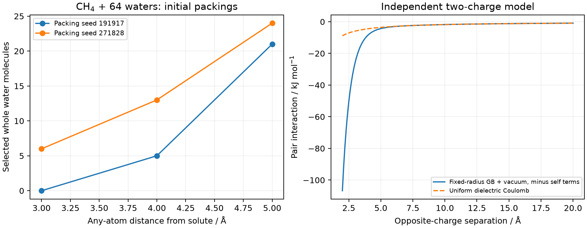

# 显式溶剂壳层的构建、筛选与采样

**适用环境：Windows、macOS 或 Linux；Packmol 构建坐标，后续优化或动力学按所用程序准备。**

显式溶剂可以描述特定配位、质子接力与局部氢键；连续介质则用于外围平均环境。建立团簇时，先说明哪些溶剂分子参与目标过程，以及需要考察一个局部结构还是一组热平衡构型。

## 两条常用准备路线

有相容力场与拓扑时，可先作显式溶剂模拟，平衡后从轨迹提取局部团簇。检查采样相关时间、局部配位与状态变化，再选择代表结构。将所有帧逐一降温或优化到局部极小值，会改变原先的热分布，应按所需对象使用。

另一条路线是装填多个溶剂初态，再分级松弛。它适合生成候选局部结构，但一次几何优化通常只找到起点附近的势阱；多阶段优化也不保证最低能结构，更不自动产生 Boltzmann 权重。不同随机种子的装填应先作为候选集合，而非等权的平衡样本。

## Packmol 装填控制什么

[Packmol](https://m3g.github.io/packmol/userguide.shtml)通过几何优化满足距离和空间约束，不计算溶质—溶剂的物理相互作用。常用设置包括：

| 设置 | 含义 |
| --- | --- |
| `tolerance` | 分子间原子距离约束；不是氢键阈值或力场排斥参数 |
| `inside sphere x y z R` | 限定所选原子中心所在的球区域，坐标与 R 用 Å |
| `fixed x y z a b g` | 固定一个分子的平移与转动，角度按手册用弧度 |
| `center` | 配合固定位置使用几何中心，不是按原子质量求中心 |
| `seed` | 指定装填随机种子，用于复现候选初态 |
| `precision` | 装填优化的收敛控制；仍需检查实际坐标残差 |

根据溶质大小和形状选择外部区域及分子数。可以用密度估计数量级，但球形边界、溶质排除体积和“所有原子中心在球内”的约束都会影响可用空间。不能只用球体积除以水分子体积就认为局部溶剂密度已经合理。

对于球形空间不合适的长分子，可用盒、椭球、分区或多步装填。`Success!` 表示装填程序达到了自身的终止要求，随后仍要检查实际几何：分子数、溶质是否移动、分子内部几何、分子间最短距离及区域边界。

## 按完整分子提取壳层

一种明确的选择规则是：溶剂分子中任一原子到溶质任一原子的最短距离不超过 $d$，就保留整个溶剂分子。这个 $d$ 是以溶质原子为参照的几何阈值，不等于距溶质中心的球半径，也不一定等于沿范德华表面量出的均匀厚度。

**为什么不能直接导出距离阈值内的所有原子？** 这样会切断边界处的水分子。应先用可靠的分子、残基或拓扑标识扩展到完整分子，再导出。VMD 可用 `same fragment as (...)` 或适用的残基选择，但需要确认片段身份正确；由自动猜键得到的 `fragment 0` 不一定是所需溶质，跨分子近接触也可能导致错误合并。

对周期轨迹，先将分子恢复完整，并按正确晶胞和周期镜像选择与溶质邻近的整分子。下面的[非周期案例](../../examples/solvent-shell/README.md)通过 Packmol 输入顺序保存分子清单，不按距离猜共价键；它的普通 XYZ 提取器不直接用于跨边界轨迹。

## 分级松弛与约束

初步松弛可以先固定已经可靠优化的溶质，放开溶剂；选择与电荷、成键、元素和非键相互作用相容的方法。通用力场或 QEq 适合某些粗准备任务，但不是对所有水、离子或配位体系都可靠的替代参数。

随后根据问题放开必要的溶质自由度，并在目标方法与环境下复查构型。约束会改变可达构象、驻点判据和热力学解释，不能将约束优化当作自由团簇极小值。若外层溶剂采用壁势或位置约束，应写明其作用区域和强度，并检查人为边界对目标性质的影响。

优化未达到阈值的结构可用作下一级方法的初猜，但不能直接用于需要驻点的频率和自由能分析。提高低层级几何收敛也无法修正不适用的势能面。通道与参数调整应按具体结构和结果判断，而非固定要求所有体系都走同一套三阶段流程。

## 用两种初态检查提取规则

[甲烷与 64 个水的案例](../../examples/solvent-shell/README.md)给出两套真实 Packmol 坐标、分子身份清单和按 3/4/5 Å 阈值提取的数量。4 Å 时，两套初态分别保留 5 和 13 个完整水分子；若只按原子距离截取，会分别留下 14 和 38 个原子，而完整团簇应有 20 和 44 个原子。

这里包含甲烷的 5 个原子，数字直接体现了逐原子裁剪如何破坏溶剂分子完整性。两种初态的计数差异也说明装填约束没有规定平衡配位结构。

## 比较性质前再核对组成与集合

壳层扩大后，考察目标能差、局部配位或光谱等量是否趋于稳定，同时改变初态与采样来源。一个结构中看见氢键网络，不足以证明它具有统计代表性；人工删水也会改变组成、配位与边界。

比较含不同显式溶剂数的团簇时，建立平衡的反应或化学势账目，不能直接排列不同组成的总电子能。团簇加连续介质时还要说明空腔包含哪些显式粒子，以及剩余溶剂如何作为体相处理。热化学和标准态见[溶液自由能循环](隐式溶剂与溶液自由能.md)。
