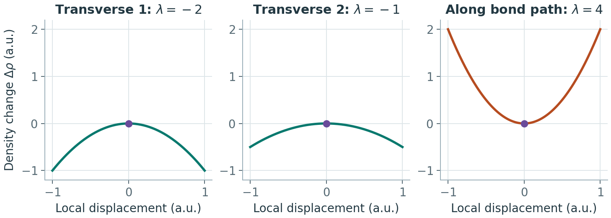

# 电子密度拓扑、临界点与键径

**适用环境：通用；操作使用 Multiwfn，周期结果需正确的晶胞和密度表示。**

QTAIM 通过电子密度及其梯度场划分原子盆、寻找临界点和连接路径。它可以说明密度在空间如何组织；若要判断某次吸附是否有利，还需要与研究问题对应的能量和结构证据。

## 临界点怎样分类

临界点满足 \(\nabla\rho=0\)。对非简并的三维临界点，按密度 Hessian 的三个本征值符号分类：

| 类型 | 负/正本征值个数 | 常用名称 |
| --- | --- | --- |
| `(3,−3)` | 3 / 0 | 吸引子；通常位于核附近，也可能存在非核吸引子 |
| `(3,−1)` | 2 / 1 | 键临界点，BCP |
| `(3,+1)` | 1 / 2 | 环临界点，RCP |
| `(3,+3)` | 0 / 3 | 笼临界点，CCP |

BCP 沿一个方向是密度极小、另两个方向是极大。沿相应密度梯度路径可连接吸引子，构成通常所说的键径。它不是几何距离小于阈值后画出的连线；分子查看器自动显示的“键”也不是拓扑分析结果。

## 先选择能计算哪些量的输入

| 输入 | 可以获得的主要信息 | 检查重点 |
| --- | --- | --- |
| 含基组和系数的波函数 | 密度及导数，部分依赖轨道的实空间量 | 模型、轨道表示、自旋、赝势芯与导入精度 |
| 电子密度 Cube、CHGCAR 等网格 | 插值密度、梯度、Hessian 及相关拓扑 | 网格、单位、边界、插值方法和函数选择 |

一张密度网格不包含唯一的轨道动能密度，不能因此恢复通常轨道定义的 ELF。赝势平滑价密度在核附近可能没有正确的吸引子，也可能出现不希望分析的局部极值；应先明确用的是价密度、PAW 重建密度、GAPW 输出还是带 EDF 的近似补芯密度。几种表示的区别见[赝势密度与近核分析](赝势密度、补芯与近核分析.md)。

对网格分析，减少格点间距后比较 BCP 位置、密度与 Hessian。二阶导数通常比密度值更敏感；低分辨率下看似平滑的等值面不能证明导数准确。对核区尤其不能仅凭拓扑图外观判断。

## 从搜索到保存

1. 载入文件后确认所分析的函数是目标密度。Multiwfn 主功能 `2` 默认的密度入口与基于网格插值的用户函数入口需要区分；周期设置见[CP2K 操作](../CP2K/电子结构与响应/CP2K与Multiwfn的周期成键与拓扑分析.md)。
2. 以核位置、原子对中点和三原子中心等作为初猜搜索，随后按空腔、层间区域或可疑接触增加初猜。一次搜索没有找到某类点，不代表它不存在。
3. 用选项 `8` 生成 `(3,−3)` 与 `(3,−1)` 的连接路径，检查端点，而非只按 BCP 离哪个原子近来命名。
4. 用 `-4` 保存 CP；用 `7` 输出临界点性质，按提示输入 `0` 可保存全部性质。记录坐标、单位、类型、Hessian 本征值、梯度残差及连接关系。

菜单中的长度通常以 Bohr 表示，导出显示数据可能使用 Å，须按各字段说明读取。输出多个函数时，优先检查当前选定函数的值及导数标签，避免把准分子参考密度当作实际电子密度。

### 找到临界点却没有完整路径时

临界点已找到而连接路径缺失时，分别检查路径积分步长、最大点数、终止条件与端点。减小步长有助于追踪弯曲路径，但可追踪的最大长度约受“步长 × 最大步数”限制；只减小步长，可能使长路径提前达到步数上限。Multiwfn 拓扑菜单的 `-2` 可调整路径生成参数，修改后重新生成并检查两端是否到达预期吸引子；路径画得更平滑不单独证明端点或密度模型正确。

### 怎样检查临界点是否遗漏

对满足相应边界条件的通常孤立体系，临界点计数应满足

\[
n_{\mathrm{attractor}}-n_{\mathrm{BCP}}+n_{\mathrm{RCP}}-n_{\mathrm{CCP}}=1.
\]

对完整三维周期晶胞、将相对面识别为同一点后的空间，右边为 `0`。这里数的是晶胞中唯一的临界点；为了显示跨边界键径而复制出的镜像不再重复计数。非核吸引子同样属于吸引子计数。部分周期、有限截断或不同标量场的边界需要另作判断，不能只按软件出现“PBC”就机械套用。

满足关系是一项必要的一致性检查，并不保证搜索完整：漏掉一个 BCP 和一个 RCP 时，两者可能抵消。还应检查对称性、搜索初猜覆盖、去重容差、边界映射以及退化或接近零的 Hessian 本征值。若只分析特定接触，报告搜索范围；不能把局部搜索称作完整拓扑。

### 用低 RDG 区域辅助设置搜索初猜

对光滑且正的有限电子密度，约化密度梯度

$$
s(\mathbf r)=\frac{|\nabla\rho|}{2(3\pi^2)^{1/3}\rho^{4/3}}
$$

在密度梯度为零的位置也为零，定义见 [NCI 原始研究](https://doi.org/10.1021/ja100936w)。因此，小 s 的切面或等值面可帮助定位候选区域，再将其中的点用于三维临界点搜索。小 s 本身并不区分 BCP、RCP 或其它类型，最终仍需梯度残差、Hessian 本征值和路径连接。

绘图前核对是否屏蔽高密度区域、低密度噪声或部分空间。阈值为正的低 RDG 区域不保证包含严格的零点；反过来，真实临界点也可能因采样较粗、截面未穿过它、颜色截断或屏蔽而看不到。把色标下限设为零后，最深颜色仍代表一个数值区间，不是“梯度等于零”的检验。核附近的密度尖点或赝势平滑表示也需另行解释，不能一概套用光滑驻点的条件。

对于层间、缺陷或表面接触，可先画穿过目标区域的多个切面，检查三维场和周期镜像，再增加搜索初猜并加密网格。若候选点的 Hessian 有很小本征值，拓扑可能对几何或数值精度敏感，应比较扰动前后的点和连接，而不是强行补出预期的键径。没有找到 BCP 的报告需限定搜索与密度模型；它也不等于该接触没有相互作用。

### 导出的点、路径和结构保持同一批次

在 VMD 中叠加 CP 点、路径和原子结构时，三份文件应来自同一几何、同一函数及同一次搜索结果。Multiwfn 的 `CPs.pdb`、`paths.pdb` 是显示载体：其中看似元素的标签可用于编码 CP 类型，路径上的记录则是采样点，不是真实原子。按对应导出器或绘图脚本解释字段，不能用这些文件重新计算化学组成、质量或电子数。

查询图中 CP 后，用坐标、类型和当前编号与性质表交叉核对。只有在点未筛选、未重排且原顺序完整保留时，查看器的零基索引才可能简单对应 CP 编号减一；脚本绘制的标签也可能已经是一基编号，不能再次加一。保留完整拓扑数据，按显示选区隐藏不讨论的点与路径；有无性质表、表非空或图像成功渲染，只能说明产生了输出，不能证明搜索完整或每条路径都收敛到正确端点。

## BCP 性质怎样解释

密度 \(\rho\) 的常用原子单位为 \(e/a_0^3\)，拉普拉斯 \(\nabla^2\rho\) 为 \(e/a_0^5\)。拉普拉斯等于 Hessian 本征值之和，正负分别描述局部密度耗减或集中。比较时需要相同的密度模型和计算层级。

\(\rho\)、拉普拉斯以及局部动能/势能密度可共同描述接触特征，但单一符号或固定密度阈值不构成通用的离子键、共价键、吸附类型或稳定性判据。能量密度还需说明定义和波函数前提，赝势或补芯下的局部维里推导尤其要检查。近简并 Hessian 给出的椭圆率等比值也可能很敏感。

水分子 PBE0/def2-SVP 波函数的配套分析找到 3 个吸引子、2 个 O–H BCP，形成两条连接 O 与 H 吸引子的键径；计数为 `3 − 2 = 1`。有限 Gaussian 基组的密度极大点可略偏离核坐标，识别时应看连接和位置。对应模型、坐标与导数见[分析数据](../../examples/orca/minimal/single-point/bonding-analysis.json)。这些数字用于理解操作，不是所有 O–H 接触的统一判据。

若要比较成键通道，可再做[键级与 NAdO](键级、模糊分区与NAdO分析.md)；若要看电子得失，转到[原子与片段电荷](原子电荷、片段电荷与方法选择.md)。拓扑路径与化学键解释的区别可参考[相关讨论](https://doi.org/10.1021/jp906341r)。

## 拉普拉斯为正，为什么仍可能有共价成分

在非简并 BCP 处，将 Hessian 本征值排列为 $\lambda_1\leq\lambda_2<0<\lambda_3$，则

$$
\nabla^2\rho=\lambda_1+\lambda_2+\lambda_3.
$$

三个截面穿过同一个示意键临界点，分别沿密度 Hessian 的三个本征方向绘制。中心的斜率均为零。两个横向曲率为负，沿键径的曲率为正，示意值之和为 +1。

阅读 Hessian 曲率比时，核对本征值排序及绝对值。例如按上述排序，$\lambda_1/\lambda_3$ 为负，而 $|\lambda_1|/\lambda_3$ 为正；二者不能共用以 1 为界的比较规则。分母接近零时，比值还会放大数值误差，应同时保留三个本征值。

负的两个曲率表示在相应横向上的局部密度极大，正曲率对应键径切向的局部密度极小。拉普拉斯的符号由三者的竞争决定：当 $\lambda_3>|\lambda_1|+|\lambda_2|$ 时，它为正，但横向的两个负曲率仍然存在。因此“BCP 是哪类临界点”和“BCP 拉普拉斯是正是负”是不同判断。拉普拉斯也不是密度与孤立原子叠加参考的差，不能把它的正值直接读成成键后损失了多少电子。

强极性接触、重元素或过渡金属成键中，BCP 可能落在明显受原子壳层结构影响的位置；一个点的曲率不代表整个价层交叠区。可沿键径检查密度与拉普拉斯，并在包含接触原子的切面画出其空间分布。图例注明画的是 $\nabla^2\rho$ 还是 $-\nabla^2\rho$，否则电子集中与耗减的配色含义会颠倒。负拉普拉斯区域、密度差中的积累区和高 ELF 区有不同定义，也不要求边界重合。

空间图也有相应边界。对离域、多中心或过渡金属成键，没有看见显著的负拉普拉斯区域或高 ELF 区域，不能单独排除电子共享贡献；沿键轴的一条曲线还可能遗漏轴外的分布。可按实际轨道方向补充切面、三维场及定义明确的键级或轨道通道分析。不同图像描述的对象不同，应核对它们对同一接触提供了什么证据，而不以“图形是否像普通双中心键”决定成键类型。

材料中的一个对照是 [MnSb₂O₄ 的孤对电子与成键研究](https://journals.iucr.org/m/issues/2020/03/00/lt5027/)：其分析中的四类短 Mn—O、Sb—O 接触在 BCP 处拉普拉斯为正，而局部总能量密度为负；作者结合变形密度、价层电荷集中方向和轨道信息讨论极性共价贡献，并保留明显的离子成分。这里说明的是多种证据如何配合，不是给所有氧化物设立新的数值阈值。该研究也明确指出，仅凭这些密度特征不足以唯一地区分重元素的极性共价与电荷转移型成键解释。

### 局部能量密度的定义与边界

局部总能量密度常写为 $H(\mathbf r)=G(\mathbf r)+V(\mathbf r)$，其中 G 为所采用的正定动能密度，V 为相容约定下的局部势能密度。使用程序输出时核对它们如何构造、是否满足所用局部维里关系，以及赝势、非局域算符或补芯近似的处理。把 H 的正负替换拉普拉斯的正负，仍不能独自证明键的稳定化能、键解离能或吸附能。对于表面吸附，保留明确的片段能量参考和结构条件；拓扑与局域量用于解释能量结果，而不是代替能量计算。

## 孤对方向与夹角：先指定所用函数

若用 ELF 或 LOL 的价层局部极大点表示孤对方向，先选择函数、搜索目标原子附近的临界点，再结合空间位置、等值面和连接关系辨认价层区域，排除核区与成键区的极大点。以原子 A 为顶点、两个已识别极大点为 P、Q，所报夹角是向量 $\mathbf r_P-\mathbf R_A$ 与 $\mathbf r_Q-\mathbf R_A$ 的夹角。它是这一描述约定下的几何量，不是仅由结构就唯一确定的“孤对电子夹角”。不同函数的极大点位置可能不同，不能把 ELF、LOL、负拉普拉斯、势极小点与局域轨道质心测得的角度直接混成一组。

Multiwfn 主功能 `2` 中用 `-11` 切换函数后重新搜索；用 `-9` 测量时，`c` 前缀表示临界点、`a` 表示原子。例如 `c5 a2 c8` 表示当前第 5、8 号临界点与第 2 号原子构成的角，编号应换成实际识别结果。保存点的坐标、类型、函数值和测量原子；重新搜索或换函数后按位置重新匹配，不能沿用旧编号。若价层极大区域发生合并、分裂或近简并，记录这一变化，避免为凑出预设的两条方向而任意选点。用于具有立体化学活性孤对的氧化物或表面位点时，可与配位畸变、电子密度分布及能量结果对照，不凭单个角度指定杂化或反应机制。

### 等值面连通域与梯度盆分别记录

对标量场 f，阈值 t 所选的高值区域为 $\{\mathbf r:f(\mathbf r)\geq t\}$。随 t 提高，连通区域可能收缩、分裂或消失；在光滑、非退化且数值充分分辨的情况下，相关变化可帮助定位极大点和鞍点，再通过梯度与 Hessian 核实。仅看一张等值面，既不能保证临界点找全，也不能将两个未连通的显示区域直接计为两个电子对。

这种阈值区域与由梯度流划分的盆不同：前者边界采用 $f=t$，后者分界满足相应零通量条件。改变绘图阈值会改变显示范围，却不等于改变已经定义好的梯度盆；需要电子布居时，应在明确的盆中积分电子密度，不能把某个高 ELF 等值面包围的体积或 ELF 积分直接当作孤对电子数。

## 盆分析把“分区函数”和“被积函数”分开

盆可由标量场 f 的梯度流定义；在光滑、非退化且边界处理相容的情形下，其分界面满足 $\nabla f\cdot\mathbf n=0$。划分得到区域 $\Omega_A$ 后，另选目标函数 g 积分：

$$
I_A[g]=\int_{\Omega_A}g(\mathbf r)\,d^3r
\approx\sum_{i\in\Omega_A}g_i\,\Delta V.
$$

| 用什么划盆 | 积分什么 | 得到什么 |
| --- | --- | --- |
| 电子密度 | 电子密度 | QTAIM 盆内电子数，再按相容的核电荷参考求净电荷 |
| ELF | 电子密度 | 所选局域化盆中的电子布居 |
| 密度差 | 同一密度差 | 该参考下局部积累或耗尽的电子数 |
| 固定的原子盆或其它区域 | 自旋密度 | 该区域的带符号自旋布居 |

积分 ELF 本身得到的不是电子数，密度差盆内重排量也不是一对原子间唯一的转移电子数。由 ELF 划分的空间与原子盆通常不同；需要原子对某个 ELF 盆的贡献时，明确采用的两套区域及其交集。LI/DI 等电子共享指标还需要相应密度矩阵、轨道或成对密度信息，不能仅从一张总密度 Cube 唯一恢复。

Multiwfn 2026.7.15 的主功能 `17` 先生成盆，再选择被积函数。对于已在内存中的网格，“积分内存数据”用的是当前网格值：如果它是 ELF，就不能把这一步误读成积分电子密度。先保存分区来源与密度文件，再按屏幕核对被积函数；生成新网格可能覆盖原有内存数据。导出的 `basin.cub` 数值是盆编号，属于分类标签，不能当连续物理场线性插值或求导。需要在另一网格上分析时，重新生成相容分区，或采用明确处理类别与边界误差的映射。

带正负号的密度差在该模块中会分别处理正部分极大和负部分极小；输出都可能称作 attractor，应同时保留极值符号。ELF 等函数还可能有环形或近简并吸引区域，网格会将其表示为多个点。自动归簇的距离和数值阈值会影响盆的合并，比较结构时记录阈值并按空间位置匹配，不能只沿用盆编号。合并后可讨论各盆积分之和，但不应为贴合预设成键图景而任意改分区。

对完整周期晶胞，确认模块识别的晶格、周期方向、跨边界映射和唯一盆计数；勿将薄膜的局部裁剪盒当作三维周期体相。所有盆、未分配格点及走向外边界的格点的积分应与原始网格总积分核对。`Unassigned` 或边界格点的数目小，不保证其电子数或目标积分可忽略；应直接检查遗漏量及其位置。裁掉远端区域可以用于有明确范围的局部分析，但不能据此报告完整原子电荷或总电子数。

分别加密划盆网格与被积函数网格，观察目标盆布居、等价区域及跨边界合并是否稳定。尖锐核密度和二阶导数尤其敏感；总电子数正确仍可能伴随明显的盆间分配误差。孤立体系的无限原子盆体积还随截断盒变化，密度阈值内的体积则需注明阈值；周期唯一盆的体积总和应与所采用晶胞体积相容。这些定义与[密度阈值及输出模型](../CP2K/基础与准备/CP2K结果文件与可视化.md#电子密度图先明确画了哪些电子)一起保留。
