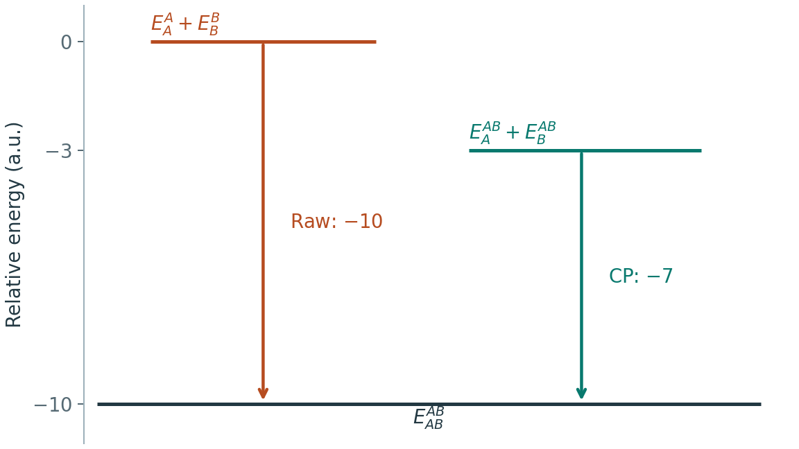

# 相互作用能与 BSSE 校正

**适用环境：通用；以原子中心基组下的双片段复合物为主。ORCA 关键词按 6.1。**

计算复合物 AB 的相互作用能时，A 在复合物中可以借用 B 上的基函数，而孤立 A 的计算通常没有这些函数。有限基组造成的这种不平衡称为基组重叠误差（BSSE）。Counterpoise（CP）通过让各片段使用同一套复合物基函数，比较一致空间中的能量。

## 固定几何，先分清五个能量

将 AB 的几何固定为 $R_{AB}$。从中抽取 A、B 坐标时保持原位置和内部结构，并事先确定片段电荷、多重度与电子态。

| 记号 | 计算对象 | 使用的基函数 |
| --- | --- | --- |
| $E_{AB}^{AB}$ | 完整 AB | A 和 B 上的全部函数 |
| $E_A^A$ | A 片段 | 仅 A 上的函数 |
| $E_B^B$ | B 片段 | 仅 B 上的函数 |
| $E_A^{AB}$ | A 片段，B 为 ghost | A 和 B 上的全部函数 |
| $E_B^{AB}$ | B 片段，A 为 ghost | A 和 B 上的全部函数 |

Ghost 中心保留基函数，去掉该原子的核势与电子。它与把原子电荷改为零、固定原子、删除原子或加入点电荷是不同操作。尤其不能保留复合物电子数来计算本应只有 A 的任务。

未校正与 CP 校正的相互作用能分别为：

$$
\Delta E_\mathrm{int}^{\mathrm{raw}}=E_{AB}^{AB}-E_A^A-E_B^B,
\qquad
\Delta E_\mathrm{int}^{\mathrm{CP}}=E_{AB}^{AB}-E_A^{AB}-E_B^{AB}.
$$

定义加到原始相互作用能上的校正量：

$$
\delta_\mathrm{CP}=(E_A^A-E_A^{AB})+(E_B^B-E_B^{AB}),
\qquad
\Delta E_\mathrm{int}^{\mathrm{CP}}=\Delta E_\mathrm{int}^{\mathrm{raw}}+\delta_\mathrm{CP}.
$$

在满足变分比较条件的计算中，扩大可用基函数空间会降低片段能量，因而 $\delta_\mathrm{CP}$ 通常为正，使过强的吸引减弱。非变分相关方法与数值近似可能出现不同表现；遇到异常符号时先核查五项的模型、几何和收敛条件。



示意图以单体基组下的两片段能量和为零点。使用 ghost 基函数后，片段参照由 0 降为 −3，复合物仍在 −10，校正后的相互作用能因此为 −7。

## ORCA 中怎样准备 ghost 任务

在 ORCA 6.1 的坐标区，元素后的冒号标记 ghost，例如 `O:`。下面只是中性单重态 He 二聚体中“保留左侧 He，右侧为 ghost”的输入教学示例；坐标距离为 3 Å，能量需由实际计算取得。

```text
! HF aug-cc-pVDZ TightSCF

* xyz 0 1
He   0.0 0.0 0.0
He:  0.0 0.0 3.0
*
```

完整五项计算依次保留两个真实中心、仅左侧真实中心、仅右侧真实中心、左侧真实加右侧 ghost、右侧真实加左侧 ghost。最后两项使用原二聚体坐标；只含一个真实中心且无 ghost 的任务直接删除另一中心。He 二聚体的 HF 例子用于说明输入与能量组合，色散结合本身需要适当的相关处理。

对复杂体系优先采用程序的片段功能，减少逐原子修改失误，具体语法见 [ORCA CP 手册](https://www.faccts.de/docs/orca/6.1/manual/contents/essentialelements/counterpoise.html)。核对每个片段电荷、多重度、电子数、基函数数及最终能量；含 ECP、混合基组或辅助基组时，还要确认 ghost 任务实际保留了所需函数。

## 结合能还包含形变代价

相互作用能对应复合物中的片段几何。若要与各自优化的孤立分子比较，还需形变能：

$$
\Delta E_A^\mathrm{def}=E_A^A(R_A^{AB})-E_A^A(R_A^\mathrm{opt}),
$$

B 同理。在上述 CP 定义下，可采用

$$
\Delta E_\mathrm{bind}^{\mathrm{CP}}
=\Delta E_\mathrm{int}^{\mathrm{CP}}
+\Delta E_A^\mathrm{def}+\Delta E_B^\mathrm{def}.
$$

本文约定负值表示结合有利。有些资料把解离能定义为相反符号，比较数据前先核对定义。零点、热修正、标准态与溶剂效应再按明确的热力学循环加入；电子相互作用能本身不能直接当作溶液结合自由能。形变、振动和环境修正的组合见[计算层级与能量比较](计算层级切换与能量比较.md)。

## 怎样判断校正是否充分

将原始值、CP 值、两者差值和更大基组结果放在一起。若 CP 改变了构象排序，或校正量与要讨论的能差同量级，就应继续检查基组和电子态。固定一个“三 ζ 已足够”的阈值，无法覆盖不同片段大小、距离与相关方法。

CP 处理基组借用的不平衡；更大的轨道基组、弥散函数、电子关联和色散模型仍各自有作用。按方案使用 [CBS 外推](基组收敛与完备基组外推.md)时，也要保存有限基组中原始和校正结果，检查趋势。

几何 CP（gCP）属于参数化校正，与逐片段 ghost 计算不同。一些 3c 复合方法已经包含对应校正，应检查完整方法定义，避免再次叠加。对共价碎片或带电解离，片段态与分割的物理意义需先成立；不能把任意分子切开后得到的 CP 数值一概当成键能修正。

对 CP 势能面做优化还涉及导数与工作流支持。ORCA 6 起有配套解析梯度与专用 Compound 流程；直接在某个 ghost 单点任务上加 `Opt` 不等于优化完整 CP 势能面。溶液中的 ghost 还可能影响空腔定义，应采用软件支持且空腔约定一致的方案。

CP2K 等局域基组方法应按各自实现准备片段与 ghost 基函数；平面波计算不直接套用这套分子 CP 输入。

## 离子对的相互作用与中性原料的结合分别列账

给体 D 与受体 A 形成明显电荷转移复合物时，可以用中性片段 D、A 作参考，也可以用离子片段 D⁺、A⁻ 作参考。后者描述离子靠近后的稳定化，数值可很负，但它尚未包括从中性原料制备这些离子的代价。不要仅凭离子参考下的强吸引，就将同一数值当作中性原料的结合能或解离难度。

先在从复合物抽出的固定片段几何上，采用一致能量定义，记 $I_D=E_{D^+}-E_D$、$\mathrm{EA}_A=E_A-E_{A^-}$，则

$$
E_{DA}-E_D-E_A
=\underbrace{E_{DA}-E_{D^+}-E_{A^-}}_{\text{离子片段参考的相互作用}}
+I_D-\mathrm{EA}_A.
$$

这里电子亲和能采用得电子有利时为正的约定。等式来自同一组总能的加减，不要求复合物的分区电荷恰好为整数；若采用 CP，所有项的基函数空间也须相容。与各自优化的中性原料比较时，再加入中性片段的形变能；改用优化离子参考，则相应重写制备与形变步骤。保留电荷、多重度和电子态，避免将垂直电离能与另一几何的绝热电子亲和能直接混入此循环。

溶液、表面或周期材料还涉及溶剂化、电子库、晶格极化及带电边界，按实际过程列入同一能量循环。某个 EDA 的静电项是其片段参考下的分解结果，不能直接代替完整结合自由能；热稳定性和释放时间还分别需要自由能与相应路径。

## 逐次结合与多体非加和分别计算

主体 H 依次结合两个客体 A、B 时，可用各自优化后的能量定义第一步结合能 $E_{HA}-E_H-E_A$ 和第二步结合能 $E_{HAB}-E_{HA}-E_B$；两步之和应恢复相同参考下的总结合能。第二步更负，描述的是这一逐次过程的增强，其中可能包含新出现的 A–B 接触、主体形变和各片段的电子响应。即使各片段之间只有两两相加的作用，也可能出现这种增强，因而它不直接等于三体非加和能。

要分离非加和项，将 H、A、B 全部固定为三聚体中的几何，采用一致的电子态与能量定义，计算

$$
\Delta E^{(3)}=E_{HAB}-E_{HA}-E_{HB}-E_{AB}+E_H+E_A+E_B.
$$

此时总相互作用能等于三个二体相互作用能之和再加上这一三体项；负的三体项表示相对该二体和的额外稳定化。各子体系使用同一几何抽取规则，保留方法、基组与 ghost 约定。若采用 CP，选择与多体展开一致的方案，不将独立二聚体 CP 值与另一基组空间中的三聚体总值直接混减；程序入口可参阅 [Psi4 多体与 BSSE 说明](https://psicode.org/psi4manual/master/nbody.html)。优化单体参考的形变代价另列，不混入固定几何的三体项。

表面共吸附也可建立相应循环：在同一晶胞与明确基底几何上比较空表面、单独吸附 A、单独吸附 B 和共同吸附 AB，保持位点、覆盖度、磁态及电子精度可比。若每项分别弛豫，所得差值同时包含基底与吸附物的结构响应，应按完整过程解释；周期镜像接触也属于该超胞模型，不能仅凭共吸附更有利就指定某个局域键为唯一来源。

## 断键能：先指定解离通道，再讨论 CP

对 AB 断裂，明确产物是中性自由基 A·、B·，还是离子 A⁺、B⁻，以及各自电子态、多重度和环境。均裂与异裂是不同反应，其能量及 CP 修正不同并不自相矛盾。分子中某种布居方法给出的分数电荷，也不要求孤立参考片段具有同样的分数电子数；参考态由所研究的解离通道定义，不能靠选取较小的校正量反推。

冻结片段内部几何得到的是相应垂直解离代价；允许产物弛豫后才是对应优化产物的解离电子能。按前文的结合能符号，解离电子能取相反号。零点修正进一步给出 $D_0=D_e+\mathrm{ZPE}_A+\mathrm{ZPE}_B-\mathrm{ZPE}_{AB}$，其中各项须采用对应几何和态；有限温度解离焓还需热修正，不能把任一固定几何单点差直接称为实验键解离焓。

CP 是给定片段与有限基组下的误差处理，不是脱离参考态的唯一“键能补丁”。对于强共价碎片或多参考解离，检查片段态、方法有效性及基组趋势后再选择校正方案。某个 HF 小分子的未校正值更接近 HF 大基组极限，只说明该测试中的误差抵消，不能证明 CP 对全部化学键有害；同样，CP 后结果更接近某个参考，也不证明剩余基组误差和关联误差都已消失。

材料中的解离吸附、键交换和缺陷反应应写完整能量循环，保留基底、吸附物及电荷库的参考。中间结构形成新键，并不意味着应把电子数任意分配给几何碎片再做 CP；先按所需反应或相互作用定义确定片段。周期净电荷补偿与有限尺寸校正处理的是其它误差来源，也不能用分子 CP 代替。

## 总能量的原子对分解与解离能分别使用

CECA 等方法将给定电子态的总能量划分为单原子项和原子对项；它与前文对独立片段总能作差的相互作用能定义不同。某些精确分解方案的各项可以恢复总能量，这里的“精确”指加和闭合，不表示每个原子对项就是可直接测量的键解离能。解离仍会改变片段电子态、其它相互作用及结构，需按指定通道比较完整能量。

采用此类分析时记录具体方案、基组和各分量定义，检查单中心项、双中心项与未分配余项怎样恢复目标总能；对称原子对矩阵的非对角项不要重复计数。不同方案对动能等项的归属可以不同，分量名称相同也不保证数值可比。HF 能量表达式的分解用于 KS 密度时，还需明确交换相关能如何处理，不能仅换入密度矩阵就宣称恢复 DFT 总能。方法差别可参阅[CECA 与 E2 的反应路径研究](https://doi.org/10.1039/D5CP04854K)。周期、赝势或平面波结果则需相应算符与分区实现，不能直接照搬分子程序的原子对矩阵。

## 分子内氢键：局部估计与构象能差分别命名

同一分子内部的给体与受体没有天然分离的单体参考。将羟基转开、改变骨架二面角或移动取代基，会同时改变扭转、位阻、共轭、极化及其它接触。两个构象的总能差可用于比较构象稳定性，但不能未经分解就全部归为一条氢键的稳定化能；约束后的无氢键构型也不是无约束极小点，需保留约束和残余响应。

Molecular Tailoring Approach（MTA）通过若干删改或封端模型的单点能加减，尝试消去局部相互作用以外的贡献，见[方法原文](https://doi.org/10.1021/jp065836o)。参考模型的组成、截断、封端方向和键长、固定几何及能量组合都是定义的一部分。独立优化全部碎片会另引入形变项；改模型后出现新接触或明显电子重排，也会降低误差相消的可信度。它是指定模型下的估计，不因写成能量循环就成为唯一的分子内键能。

以 BCP 密度或局部能量密度回归氢键能，则依赖标定的键型、电荷状态、几何、密度层级与能量参考。分子间数据拟合出的关系用于分子内、表面或带电氢键时属于迁移，需独立检验；没有对应 BCP 时不能把缺失值置零后代入。若不同估计的大小顺序不一致，先比较各自定义与参考，不以某一个描述符单独宣布另一方法错误。多个近似数值接近可以形成对照，但不是严格上界、下界或共同真值的证明。

例如，[2019 年氢键相关分析](https://doi.org/10.1002/jcc.26068)分别考察中性与带电小分子复合物。将这类分组模型用于复杂体系时，应对照标定中给体、受体的化学身份、质子化态和局部环境，而非只看整个超胞是否电中性。远处的反离子可使总电荷为零，却不消除局部电荷辅助效应；任意选区的分数电荷之和也不提供一个普适的分类阈值。无法可靠归类时，保留模型不确定性并用明确能量参考复查。

### 回归误差怎样解释？

检查回归时同时看绝对误差、相对误差和独立测试。能量范围很宽可产生很高的 R²，而弱作用的相对误差仍很大；MAPE 在参考值接近零时尤其敏感。数据集的平均百分误差不是单个预测的置信区间，不能将某一预测值乘上 MAPE 就声称其误差不超过这个数。由总结合能进一步回归 SAPT 分项也只估计相应训练分布，不能从一个标量唯一恢复任意体系的能量分解。

材料中的氢键网络还存在协同、竞争及环境弛豫。水吸附、表面羟基重排和孔道客体中的单条氢键估计，不能普遍相加还原总吸附能；也不能从总结合能中减去经验氢键能后，将剩余部分唯一命名为色散或 π 相互作用。定量比较优先报告完整过程的能量与参考态，局部几何、拓扑和相容分解用于解释变化。

## CVB：比较 ELF 特征时保留计算定义

CVB（core–valence bifurcation）用 ELF 的二分特征比较氢键。对常规 D–H···A，Multiwfn 的自动功能采用

$$
\mathrm{CVB}=\mathrm{ELF}(C\!-\!V,D)-\mathrm{ELF}(DH\!-\!A).
$$

这两个量均无量纲。原始拓扑定义涉及 ELF 盆之间的二分点；自动功能沿 H→D 与 H→A 取 ELF 曲线极小值来近似，不能把它的输出直接写成已完成三维 ELF 临界点搜索。数值更负可作为相容体系中氢键增强的描述符，但 CVB 本身没有能量单位，也没有对所有表面、元素和电荷状态通用的强弱阈值。

使用支持该功能的 Multiwfn，读取能提供所需轨道信息的波函数文件，进入主功能 `200` → `1`，按 **D、H、A** 的顺序输入原子编号。保存给体侧、氢键区和受体侧三个 ELF 值、极小点位置及最终差值；差值采用给体侧，受体侧的输出不自动参与上述公式。交换给体与受体不是同一指标的简单重命名。比较一组结构时保持密度计算层级、ELF 定义和提取方式一致，并检查两条曲线，确认极小值对应所需区域。

质子转移或很强的共享质子作用可改变盆连接关系；π 受体也未必能由某个原子中心代表。这时应查看 ELF 分布并搜索相应三维临界点，说明采用了哪两个盆之间的二分值，避免强行指定最近原子后照用自动流程。赝势波函数还需核查给体内核区的表示：依赖核–价分界的量，不能未经比较便与全电子结果混用。材料中可把 CVB 与 O–H 键长、受体距离、电子密度拓扑和完整吸附／反应能并列分析；具体数值趋势只在已检查的结构系列中解释。

返回[计算化学方法](README.md)。
