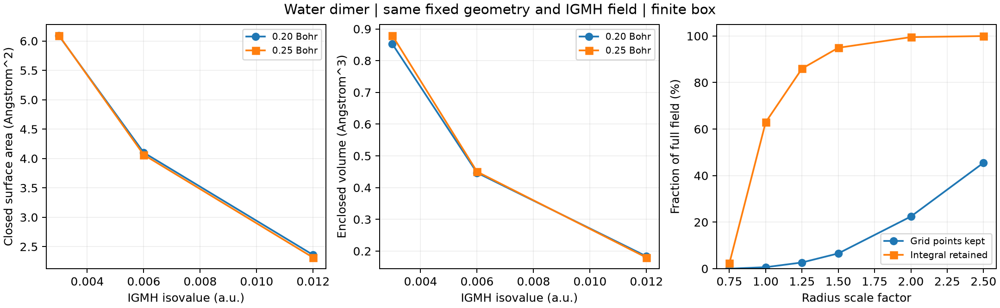

# 等值面面积、体积与网格收敛

**适用环境：Windows、macOS、Linux；示例使用 Multiwfn 与已有 Python 分析环境。**

给定标量场 \(f(\mathbf r)\) 和阈值 \(c\)，面积描述 \(f=c\) 的表面几何，体积描述相应封闭区域。先写清哪个函数、阈值、内侧定义与连通分量，再比较数值；这些条件和坐标单位一样重要。

## 先确定测量对象

IGMH 常测 \(\delta g_{\mathrm{inter}}=c\) 的闭合表面及其高值区体积。一个薄片形闭合表面的面积包含上下两面和边缘，不等于投影接触面积，也不等于溶剂可及表面积或界面埋藏面积。它包围的是指标阈值区域，体积不是分子的总体积。

面积和相互作用能可以在特定同系列模型中建立经验关联，但需固定方法、构型、片段、阈值和数值处理，并检验关联与适用范围。对任意体系直接按面积换算结合能，缺少这层依据。

## 在 Multiwfn 中定义目标表面

对于两个片段，当前程序可以在本次会话中直接选择 IGMH 片段间函数：

1. 载入相应波函数，用 `1000 → 16`，选择定义两个片段并输入原子列表。
2. 回到主菜单输入 `iu`，再输入 `91`，将本次会话的用户函数设为 \(\delta g_{\mathrm{inter}}\)。这条路线不需要改写 `settings.ini`。
3. 进入 `12`，通过 `1 → 2 → 100` 选择用该函数定义表面，输入阈值；用 `3` 设置网格间距，再用 `6` 开始不考虑映射函数的分析。
4. 读取 `Overall surface area` 和 `Volume`，保存其单位。需要原网格时按提示导出 `surf.cub`。

如果已经有待测 Cube，也可在 `12` 中用 `1 → 10` 选择外部网格，输入文件和阈值，再用 `6` 分析。此时测量对象是该网格实际包含的场；若它被筛选、裁剪或重采样，这些处理都跟着进入结果。多片表面时还要说明读到的是总面积还是指定分量。

该功能可能同时打印基于分子质量和所围体积的 `M/V`。对于 IGMH 阈值区域，这不是材料体密度或水二聚体的真实密度，不用于物理解读。

## 从三角网格复查

对三角面顶点 \(\mathbf a,\mathbf b,\mathbf c\)，面积为

\[
A=\frac12\sum_{\mathrm{triangles}}
| (\mathbf b-\mathbf a)\times(\mathbf c-\mathbf a) |.
\]

闭合且方向一致的三角网格，体积可由有向四面体和得到：

\[
V=\frac16\left|\sum_{\mathrm{triangles}}
(\mathbf a-\mathbf o)\cdot
\bigl[(\mathbf b-\mathbf o)\times(\mathbf c-\mathbf o)\bigr]\right|.
\]

\(\mathbf o\) 是统一参考点。检查每条网格边恰由两个三角形共享、邻面方向一致，再计算体积；表面被盒边切开或有孔时，应先解决截断，不能默认为闭合。对多个分量或带空腔的区域，保持外壳和内壁的方向关系，不能无条件把各分量的绝对体积相加。

节点中高于阈值的数量乘格子体积，是另一种体积近似，受网格边界误差影响；不要求它与三角网格体积逐位相等。脚本见[measure_surfaces.py](../../examples/orca/minimal/weak-interactions/measure_surfaces.py)。

## 同一数据怎样区分阈值、网格和算法

本例的完整片段间场来自[同一水二聚体波函数](../../examples/orca/minimal/weak-interactions/README.md)，采用三角网格测量：

| 网格间距 / Bohr | 阈值 / a.u. | 面积 / Ų | 体积 / ų |
| --- | ---: | ---: | ---: |
| 0.20 | 0.003 | 6.08777 | 0.85263 |
| 0.20 | 0.006 | 4.10094 | 0.44676 |
| 0.20 | 0.012 | 2.35930 | 0.18358 |
| 0.25 | 0.006 | 4.06337 | 0.45027 |

增大阈值会在这个例子中收缩高值区域；对一般场，连通分量还可能合并、分裂或消失，不能只看一张图就假定面积始终平滑单调。两档网格接近是一项敏感性检查，细档本身不是精确真值，节点起点和边界取整也需考虑。

对完全相同的 `0.20 Bohr` Cube 和 `0.006` 阈值，Python 的 marching cubes 得到 `4.10094 Ų`、`0.44676 ų`；Multiwfn 外部网格入口的改进 marching tetrahedra 得到 `4.09638 Ų`、`0.44485 ų`。这组差异体现相同采样数据上表面构造和处理的区别。

若让 Multiwfn 直接从实空间函数另建网格，本例得到 `4.12177 Ų`、`0.42337 ų`，此时还改变了网格位置及顶点细化过程，不能把全部差异只归因于表面算法。输入、表格与科学条件见[案例测量步骤](../../examples/orca/minimal/weak-interactions/README.md#完整场migm-与表面测量)。

## 片段暴露面积与孤立片段面积

“某基团的表面积”至少有两种定义：在完整体系的同一表面上，按归属规则分给该基团的面积；或删除其它原子后，重新构造孤立片段表面的面积。前者保留周围区域的遮蔽，后者会产生新的暴露面；即使片段坐标相同，两者也不要求相等。划分完整表面时保存原子组、归属算法和面积权重，检查互斥且完备的分组能否恢复总面积，而不按彩色点数估算比例。

Multiwfn 的定量表面分析可对原子组报告局部面积。若只需要几何量，可使用该版本跳过映射函数的分析入口，避免额外计算静电势。真实密度与准分子密度则仍是不同表面模型，某个例子结果接近不能证明它们对金属位点、极化界面或带电体系都同样可靠。`0.001` 或 `0.002 a.u.` 也只是密度阈值约定，凝聚相并不因此具有唯一的通用阈值。局部点文件的字段和显示规则见[局部表面说明](弱相互作用可视化的方法选择与读图.md#局部表面静电势裁剪显示与删减模型分开)。

### SASA 与密度等值面面积有什么区别？

SASA 由原子半径及探针半径构造，测的是探针中心的可及表面，与密度等值面、溶剂排除表面及实际接触面分别解释。[VMD 的 `measure sasa`](https://www.ks.uiuc.edu/Research/vmd/vmd-1.9.3/ug/node138.html)使用原子已分配的 `radius` 并加上探针半径；`1.4 Å` 可作为水探针的常见示例，不是适用于所有吸附分子的固定半径。记录半径表、探针和采样数，比较数值时检查采样收敛；改变探针还可能改变孔隙遮蔽与连通性，不能假设所有结构的总面积都简单单调变化。

计算片段在整体中暴露的 SASA 时，完整原子选择用于定义遮蔽，`-restrict` 再限制所计入的片段贡献。直接只选片段作为完整输入，会丢掉其它原子的遮蔽。可用 `-points` 查看贡献位置，但局部无重叠采样点不自动证明探针能沿连续路径从外界到达；周期多孔材料还需处理镜像、内外孔面和[孔道贯通](孔径、内切球与贯通限制.md)。SASA 的 Ų/模型与实验比表面积的 m²/g 在探针、质量归一化及可达孔隙等条件一致前不能直接等同。

## 多个表面分量和第三方软件

已有 ChimeraX 等体数据工具时，可载入 Cube，设置相同阈值，并按该版本的表面或独立 blob 测量功能选择目标分量。记录模型编号、分量、阈值、单位、显示步长、平滑与是否补盖孔洞。测量前先查看数据盒子，避免把边界截断或自动补帽产生的表面也当成接触区域。

裁剪视图、隐藏其他分量或改变透明度，并不必然改变统计所用的底层网格；确认实际被测对象。用分子表面命令得到的 SASA/BSA 则属于另一类几何定义，不替代指标等值面的面积。

最后检查原场是否完整、阈值是否一致、表面是否闭合，再比较不同软件或体系。加速筛选可能保留某个等值面却改变积分，应分别核对目标表面与数值积分。

## 由面积和体积计算球形度

对具有正体积、闭合有限边界的三维物体，一种常用球形度定义为

$$
\Phi=\frac{\pi^{1/3}(6V)^{2/3}}{A}.
$$

上式的分子是与该物体同体积的球的面积。A、V 使用一致长度单位时，$\Phi$ 无量纲；理想球为 1，其它有限物体在适用的等周条件下不超过 1。统一放大或缩小不改变它，所以球形度不同于尺寸、直径和孔隙率。计算值略大于 1 时先检查面积、体积、闭合性与网格误差，不直接截为 1。

Multiwfn 的定量表面分析可同时给出 `Sphericity`、面积和体积。用密度表面比较客体或团簇时，保持电子密度定义、等值面阈值、网格和分量选择一致，再由同一表面的 A、V 复核。程序同时打印的质量除体积值不因此成为材料体密度；表面细化或平滑也可能同时改变分子和分母，应检查 $\Phi$ 本身是否稳定。

### 多个区域合并后，球形度为何会下降？

多个分离区域应先分别报告，再决定是否讨论总并集。以 N 个彼此不接触、大小相同的球为例，每个球的球形度都是 1，但把总面积与总体积代入上式会得到 $N^{-1/3}$。这个下降来自分量数增加，不能解释为每个分量都变得更扁。密度阈值导致区域合并、分裂时，也要同时记录连通分量。

含内腔时，说明 V 是外壳包围体积还是扣除空腔后的实际区域体积，A 是否计入内壁；不要把包含内壁的总面积与未扣空腔的体积随意组合，称作同一物体的球形度。公式可以用于定义明确的含孔物体，但其数值同时反映内部边界，不能只按外轮廓解释。

周期贯通孔道、无限片层或被盒子切开的等值面，没有这里假定的孤立封闭外壳。对其强行补盖再计算 $\Phi$，会引入盒子及补盖选择；若研究有限孤立连通域，应先拼接完整镜像并去重。孔道是否可通行仍见[孔径与贯通限制](孔径、内切球与贯通限制.md)，不能由球形度高低直接判断扩散速率、吸附选择性或分子堆积稳定性。

## 分子占据体积与材料平均体积

原子半径球并集、电子密度高于指定阈值的区域，以及溶剂探针定义的表面，给出不同的几何对象。电子密度等值面包含当前电子态的信息，却仍依赖阈值与波函数模型；更换定义不等于单纯提高数值精度。比较之前先明确测量用途，原子半径的选择见[几何自由空间](晶体自由空间、平滑网格与探针体积.md#半径表怎样选)。

从材料质量密度 $\rho_m$ 与摩尔质量 M 得到的 $M/(\rho_mN_A)$，是按所选化学式单位分配的平均体积。它含实际相态、温压与堆积的信息，不是直接测量一个孤立分子的等密度面体积。晶胞中有 Z 个同类化学式单位时，可与 $V_{\rm cell}/Z$ 对照；溶剂、部分占据和组成必须同时计入。质量单位和长度单位统一后再换算，不能只因软件输出了 `cm³/mol` 就认定对应实验摩尔体积。

若明确定义了同一套几何占据边界，可讨论其晶胞内并集体积与胞体积之比。将每个孤立分子的体积直接乘 Z，则可能重复计入重叠部分；它不自动等于晶体占据体积。经验密度预测还需独立标定与适用范围，不能把一个体积比普遍当作真实孔隙率或材料密度。

## 蒙特卡罗积分误差怎样报告

在完整包含目标区域、体积为 $V_b$ 的盒子中，独立均匀抽取 m 个点，其中 n 个落在所定义区域，令 $\hat p=n/m$，则

$$
\hat V=V_b\hat p,\qquad
\widehat{\mathrm{SE}}(\hat V)
=V_b\sqrt{\frac{\hat p(1-\hat p)}{m}}.
$$

这是独立随机采样、二项命中模型下的标准误近似，不覆盖截断、错误阈值或密度计算误差；命中极少、全部命中或全部未命中时，应采用合适的二项区间或增加采样，不能据零估计方差宣布精确。相关采样、准蒙特卡罗或重要性采样也需采用相应的误差方法。

误差通常按 $m^{-1/2}$ 缩小，目标误差减半约需四倍独立样本。盒子过大而命中率很低会降低效率；缩盒子前仍要保证目标边界完整。记录种子或采样结果并做独立重复，有助于复现和识别异常。确定性的三角网格法没有这项随机误差，但仍需检查网格、阈值和边界收敛，不能因每次输出相同就认定已经足够准确。
