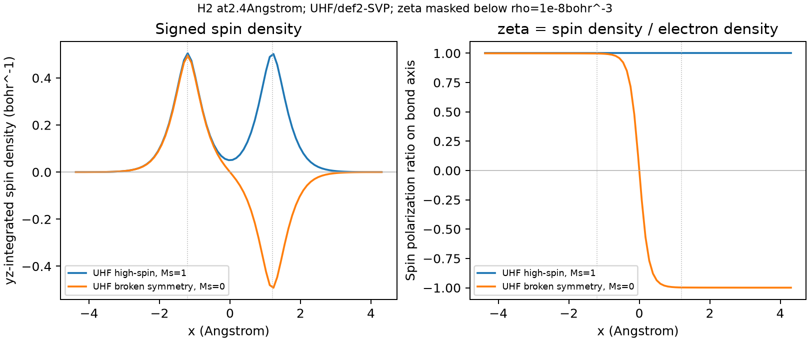

# 自旋密度、布居与磁矩的区分

**适用环境：通用；案例采用共线 RHF/UHF，涉及 SOC 或非共线自旋时需改用相应定义。**

自旋密度是空间函数，原子自旋布居是按指定规则分配后的积分或矩阵量，磁矩还涉及自旋量子数、g 因子和观测方式。先确定要回答哪一种问题，再选择输出。

## 空间函数与总自旋投影

在共线表示中，\(m(\mathbf r)=\rho_\alpha(\mathbf r)-\rho_\beta(\mathbf r)\)，全空间积分为 `Nα−Nβ=2Ms`。正负号表示沿所选量子化轴的局部极化，不能直接解释为该位置存在几个可辨认的独立电子。

**α、β 电子数相同，是否就没有局部自旋？** `Nα=Nβ` 允许局部 m 正负抵消。纯单重态可具有开壳层相关和零自旋密度；破缺对称行列式则可有局部极化，但未必是总自旋 S 的本征态。`S=|Nα−Nβ|/2` 不能用于一般行列式或任意自旋分量。

归一化的局部自旋极化参数为 `ζ=m/ρ`。对物理非负的 alpha/beta 密度，范围为 `[−1,1]`；总密度很小时比值对数值噪声敏感，需要设置密度掩膜。ζ=0 表示该点净极化为零，不证明没有开壳层关联；ζ也不是通用的“未配对电子比例”。

[拉伸 H2 案例](../../examples/orca/minimal/spin-density/README.md)中，高自旋解的 m 积分约为 2，破缺对称解约为零，后者仍有正负两部分。右图显示沿键轴的 ζ，只保留 `ρ>10⁻⁸ bohr⁻³` 的位置。两图不是同一种函数的不同配色。

比较不同缺陷或吸附态的自旋密度图时，统一正负等值面的绝对阈值、密度单位与观察范围，并标明颜色对应的符号。m 是电子数密度差，例如以 Bohr⁻³ 表示；ζ 无量纲，两者不能共用阈值。等值面包围区域较大不直接表示自旋布居较多，核附近峰值也不等于原子积分。切面图另保留平面、坐标单位和色标；超出色标范围的饱和颜色只表明数值越界，定量比较应查看原始值或等值线。

## 从磁性初猜到收敛电子态

对预期有反向局域自旋的缺陷、吸附物或磁性位点，仅设置总 `Nα=Nβ` 不一定能得到破缺对称解。完全相同的 α、β 初猜可能在迭代中一直保持相同。可按程序支持的方式混合轨道、指定不同位点的初始磁化，或组合具有相反自旋方向的片段轨道，再进行整体自洽。

片段轨道需与整体的几何、朝向、原子映射和基组对应；组合时还需满足总电子数及分自旋计数，并按程序的重叠度量处理归一化、正交化。片段初猜中的电荷和自旋用于引导搜索，普通整体 SCF 会继续弛豫它们，不会将每个片段固定在输入整数值。需要保持指定片段布居时，应另用定义明确的[约束 DFT](电子转移、极化与分析方法的选择.md#约束-dft构造指定局域电荷的电子态)。

对同一几何尝试几种有物理依据的初猜，比较收敛能量、局域自旋分布和可用的自旋污染指标；分别保存不同解，避免沿优化或扫描时无意切换电子分支。程序支持的波函数稳定性测试检查固定核坐标下的轨道变化，与几何优化或振动稳定性不同；通过测试也只说明所测变化空间内的局部稳定，不能证明已找到所有磁态或真实基态。周期计算的具体初猜入口见[CP2K 自洽收敛](../CP2K/基础与准备/CP2K自洽收敛.md)。

## 原子自旋布居依赖分区

Mulliken 自旋布居可由 `diag(Pspin S)` 按原子求和，Löwdin 使用相应正交化表示；Becke、Hirshfeld 或 QTAIM 按各自空间权重或盆积分 m。它们具有不同的定义和基组/积分敏感性，不存在对所有体系统一更准确的排序。

本例破缺对称 H2 的两个原子 Mulliken 布居为约 `±0.993368`，Becke 为 `±0.934444`。两者都给出零总和，但局部数值不同。总和正确只检验一个约束，不能证明每个原子的划分都已收敛或具有唯一物理意义。弥散基组可能加剧某些 AO 布居的不稳定，需要做方法和基组对照，而非一律判所有含弥散函数的结果无效。

在 Multiwfn 中，基函数布居需含 AO 信息的输入，空间积分需足以重建相应密度的文件。可用 `5 → 5` 生成自旋密度网格，`15 → 1 → 5` 做当前默认 Becke 空间积分；方法和网格参数按版本屏幕核对。案例保留完整命令和输入。

**局部布居能写成占总自旋的百分比吗？** 总自旋接近零时，“占总和百分比”会发散或无法显示，直接报告带符号的布居。`Σ|原子积分|`、`∫|m|dr` 和 SNO 正负谱权重的绝对和也不同，不能互换成“总未配对电子数”。

## 用自旋自然轨道看相互抵消的贡献

对共线自旋的一粒子密度算符差 $\gamma_\alpha-\gamma_\beta$ 对角化，得到自旋自然轨道（SNO）$\chi_j$ 与带符号的本征值 $s_j$。非正交 AO 表示需先按重叠度量处理，而不是直接对 AO 密度矩阵作普通本征分解。归一化 SNO 可重建

$$
m(\mathbf r)=\sum_j s_j|\chi_j(\mathbf r)|^2,
\qquad
\sum_j s_j=N_\alpha-N_\beta.
$$

对满足物理占据条件的自旋密度矩阵，$s_j$ 在 $[-1,1]$ 内；它不是轨道能量，也不是总密度自然轨道的 $[0,2]$ 占据。SNO 轨道等值面的正负颜色表示 $\chi_j$ 的相位；该轨道对自旋密度贡献的符号由 $s_j$ 决定，不能将负本征值轨道上的某一色瓣单独解释成正自旋。

若几个较大的正负本征值主导，可分别查看其空间分布，并用全部项或明确截断后的和复核原始 m。某一区域净自旋小，可能是正负贡献抵消，而非各项都很小。轨道成分百分比描述归一化的 $|\chi_j|^2$ 如何分配；计算该模式的原子自旋贡献还需乘 $s_j$，再与其他模式按同一分区求和。简并 SNO 的单轨道形状依赖选基，比较时保留完整子空间。

由 FCHK 生成分析轨道时，先确认密度对应的电子态、方法及弛豫约定，再导出并重载一致的分析文件，见[密度矩阵与格式核对](波函数文件的选择与转换.md)。某些导出格式会借用 α 轨道区保存整套 SNO；存储标签不改变负本征值模式的物理含义，也不使该文件成为普通 α/β 占据的基态波函数。

## 自旋投影与实验磁矩

在忽略轨道贡献的模型中，电子自旋磁矩的轴向投影为 \(\mu_z=-g\mu_B M_S\)。若已知纯自旋 S，常见自旋有效磁矩为 \(g\mu_B\sqrt{S(S+1)}\)，饱和投影又对应 `gSμB`。这些量的观测含义不同，不能把一个自旋布居总和直接代入全部公式。

轨道角动量、SOC、g 张量、温度、磁场与多个能级布居可影响实验结果。零自旋投影不自动意味着 S=0 或没有磁响应；破缺对称行列式的局部极化也不是直接测得的局部磁矩。

## 反应位点和其它近似

自旋密度较大可提供反应活性线索，但成键还受轨道、位阻、相对取向和势能面控制。N±1 自由基的自旋密度可用于某些反应性指标，却不等同于有限差分 Fukui 函数；后者还包含电子数变化引起的整体密度弛豫。比较时统一几何、参考态和分区，不因图形相似就认定两个函数相等。

CASSCF 等方法能否输出自旋分辨密度取决于所选态和实现，并非在原理上不能得到自旋密度。RO 与 U 参考的取舍也需根据自旋纯度、性质和模型判断，不按“U 一律更准”选择。

## 过剩电子的空间宽度先明确权重

描述有限体系中局域电子的分布宽度时，对非负权重 $w(\mathbf r)$ 定义

$$
W=\int w\,d\mathbf r>0,\qquad
\mathbf r_c=\frac1W\int\mathbf r w\,d\mathbf r,\qquad
R_g^2=\frac1W\int|\mathbf r-\mathbf r_c|^2w\,d\mathbf r.
$$

$R_g$ 是相对于该分布自身中心的均方宽度，不是包围全部电子的球半径。以归一化单轨道的 $|\psi|^2$ 为权重时，W 为 1；但 UKS 的某条 α-HOMO 是否足以代表额外电子，需要结合轨道分布、电子态和其它分析判断，不能只按轨道编号选择。定域化或双正交化改变分析表示，其选取依据也应保留。

### 带正负号的密度差能直接当概率权重吗？

自旋密度和加电子前后的密度差可能同时有正负区域。即使其总积分接近 1，直接代入上述矩公式也不保证得到概率分布的中心或正的方差；负区反映的自旋极化、电子弛豫不能仅因净积分较小就忽略。选择 $|\Delta\rho|$ 作为非负权重时，衡量的是总密度重排的空间范围，W 一般不等于新增电子数；只取 $\max(\Delta\rho,0)$ 又是另一种定义。分别报告所用函数、正负积分和归一化，不将这些半径混作同一个“电子大小”。闭壳层加电子模型的自旋密度还可能处处为零，无法据此定位额外电子。

计算前保持比较态的核坐标、环境和网格相容，见[密度差定义](密度差、平面平均与电荷位移.md)。二阶矩对远处低密度尾部很敏感，应分别检查波函数的弥散描述、积分盒大小和网格；电子数积分稳定并不保证 $R_g$ 已稳定。周期体系先为局域分布选取连续镜像和共同参考；跨边界切开的电子云会产生依赖盒子切法的假宽度，离域于整个晶体的态则不具有这里假设的有限局域半径。逐帧分析保留同一权重定义，并区分 $\langle R_g\rangle$ 与 $\sqrt{\langle R_g^2\rangle}$。
