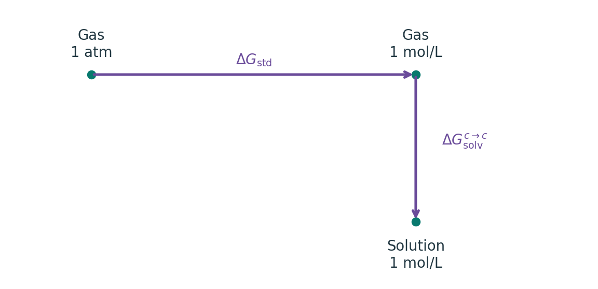

# 隐式溶剂与溶液自由能

**适用环境：通用；具体输入以所用程序和版本为准。**

隐式溶剂用连续介质和经验项描述环境的平均作用。计算前先明确目标是同几何的极化响应、平衡溶剂化自由能，还是溶液反应自由能；它们需要的结构、能量项与标准态并不相同。

## 三种常见比较

| 目标 | 需要保持与改变的条件 | 结果含义 |
| --- | --- | --- |
| 同几何气相/溶剂单点差 | 固定结构和电子方法，切换环境 | 当前模型在该几何上的环境响应 |
| 溶剂化自由能 | 按模型定义比较两相，含对应非静电与标准态约定 | 与该转移过程匹配的自由能 |
| 溶液反应自由能 | 对各物种统一组装溶液自由能并作化学计量求差 | 指定温度、标准态下的反应量 |

常见分解写为 $\Delta G_\mathrm{solv}=\Delta G_\mathrm{elec}+\Delta G_\mathrm{nonel}$。极性部分描述自洽反应场；非静电部分可含空腔、色散及局部溶剂结构的经验贡献。仅写 PCM、CPCM 或 COSMO 名称，往往不足以说明非静电项是否启用。SMD 则有明确的相应参数化和输出项。

**为什么不能把所有修正都加到“最终能量”上？** 模型下的“最终能量”有时已包含经验自由能贡献。读取前核对程序定义，已计入的项不再手动相加。ORCA 的 SMD 输出中可查看 `SMD CDS` 及最终能量，见[隐式溶剂手册](https://www.faccts.de/docs/orca/6.1/manual/contents/essentialelements/solvationmodels.html)。

## 结构与热力学循环

气相与溶液结构相近时，可用共同几何分离电子方法与溶剂化项；对离子、质子转移、配位变化或显著不同的构象，环境可能改变极小值和反应路径，需要在目标环境中重新搜索和优化。

一套可复查的分层循环是：

1. 按目标环境准备各物种和构象，完成优化、驻点与电子态检查，保存所用几何层级。
2. 在所选几何上获得适当精度的气相电子能 $E_\mathrm{gas}^{\mathrm{high}}$。
3. 以同一定义提取热修正 $G_\mathrm{corr}$，说明频率的环境、低频模型和温度。借用另一环境的修正时，检验这一步近似。
4. 在模型适用的电子层级、几何与参数下求溶剂化项 $\Delta G_\mathrm{solv}$，明确是否已含非静电贡献。
5. 按两相定义加入一次[标准态换算](分子热力学量与标准态.md)，然后对全部物种一致求差。

采用相同几何和明确兼容的项时，可概括为

$$
G_\mathrm{sol}^\circ\approx
E_\mathrm{gas}^{\mathrm{high}}+G_\mathrm{corr}
+\Delta G_\mathrm{solv}^{c\to c}+\Delta G_\mathrm{std}.
$$

这条路径先把理想气体的 1 atm 标准态换成 1 mol/L 的浓度参照，再用同浓度定义的溶剂化项转到溶液。使用已有溶剂化自由能前，先确认其起点和终点。

另一种安排直接使用已含溶剂贡献的高层级最终单点能，再加适当热修正与标准态项。两种安排应分别写账目，避免在直接溶剂单点上又加一次完整溶剂化差值。

## 参数化范围怎样影响方法选择

溶剂模型的原子半径、非静电参数和参考数据与特定定义绑定。更大的基组或更高的电子方法不保证溶剂化误差更小，但也不能据此断言某个固定层级对所有离子、过渡金属与溶剂都最好。应查看模型的参数化、测试范围，并在类似物或可用实验上验证。

同名 SMD 在不同程序中可能采用不同极性求解、空腔或数值离散。跨程序比较时核对这些实现，而不是把某程序的经验问题推广到所有实现。后 HF 或激发态的反应场还涉及参考密度、响应密度和状态特异处理，按任务与模块另行选择。

## 溶剂参数、混合物与温度

自定义静态介电常数只补充了部分信息。SMD 等模型还使用折射率、表面张力、氢键酸碱性等描述符；不能只改介电常数，就宣称得到完整的新溶剂模型。

混合溶剂的优先溶剂化、非理想组成与氢键网络可能使线性混合失效。采用体积分数加权参数或纯溶剂结果时，应视作近似并验证浓度趋势。改变热化学温度也不会自动更新溶剂模型的温度依赖；由单一温度的溶剂化自由能，不能直接推出可靠的溶剂化焓和熵。

## 何时加入显式溶剂

质子接力、特定配位、强氢键或电荷高度集中的离子，需要检查显式第一溶剂层或更完整的采样。显式加隐式的团簇模型仍需搜索溶剂排列，并在反应两侧平衡溶剂分子数与其化学势。

对 pKa、还原电势或离子转移，单离子参考值、质子/电子约定和热力学循环必须一致。先明确参考反应，再讨论模型误差，避免把某个孤立离子的绝对数值直接移用于另一套约定。

局部结构准备见[完整溶剂壳层与采样](显式溶剂壳层的构建、筛选与采样.md)。周期电极与表面模型还需核对电荷补偿、边界条件及电势参考，不能直接把孤立分子的溶剂化自由能解释为电极反应自由能。
